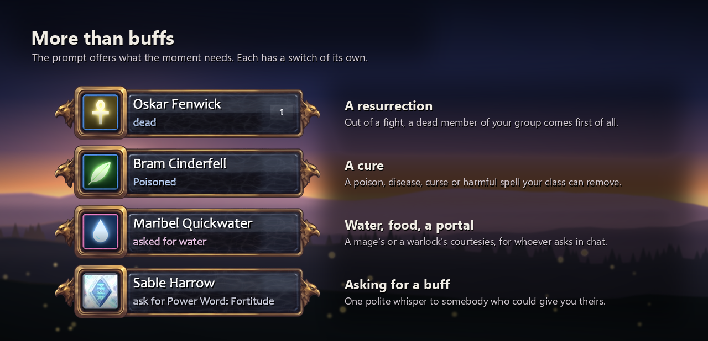
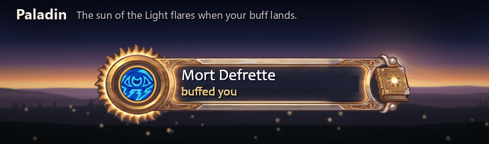

**A buff given is a favour owed. Manners repays it in one press.**

A priest buffs you in passing. By the time you find them among a dozen nameplates, they are gone. Manners saw who it was and put them on one button. Press your key: they have your buff, your own target comes straight back, and the favour goes in your ledger.

- **One press, never a hunt.** Whoever buffed you, your group, somebody who asks in chat, a passer-by missing your buff: the right person is on the prompt, in a sensible order, and your target comes back after every cast.
- **More than buffs.** Your resurrection for the group's dead, a cure for a poison, curse or disease, and a mage's or warlock's courtesies (water, portals, healthstones, summons) for whoever asks, and a polite ask for a buff you lack, if you tick it. Your own armor, aura, poison or oil comes up as "You" when it lapses.
- **Good manners, kept.** A favour ledger with titles, thirteen milestones and a hall of fame for whoever earns them all. If your character should speak, over three thousand In character lines, about a hundred of them the Forsaken's own.

Yours to arrange: twenty-nine looks, a blessing for each class for paladins, profiles that switch by themselves as you enter a dungeon, a raid or a battleground, a profile manager with *Undo*, and options that start short, each page under a painted icon.

### What you see

### New lately

- **A look for each class.** Tick *Use my class's look on each character* on *Look*, and on one profile your druid wears the Druid look and your paladin the Paladin look.
- **Mana Shield and the wards.** A mage on WoW Forever, Classic Era or Burning Crusade can be reminded of Mana Shield and of Fire Ward or Frost Ward out of a fight.
- **Add a spell of my own.** Up to ten buffs Manners does not know, by name or spell id, under *Myself*.
- **Nothing used on the run.** Food, stones, oils and the sleeping bag wait until you stand still.
- **Thorns, not on you in a dungeon.** *Not on me in a dungeon or raid*, under Thorns' *Offer to*.
- **Skip players in a fight.** On *Who to skip*: no buff that drags somebody's mobs onto you.
- **Ask in your own words.** *What the ask says* takes *My own words* and a line you write.
- **Your pet, hunters.** Call, Revive and Mend Pet when it needs them, Feed Pet on WoW Forever, Classic Era and Burning Crusade, *Bond with my pet* for a pat or a kind word now and then, and Mend Pet on a button of its own in a fight.

> **I read every comment here and on GitHub.** Most of the list above was asked for in these comments, and a new version comes out most days. Found a bug? Please send a log with it: see **Report a bug** below.

### Who it offers, in this order

Out of a fight, a dead member of your group comes first with your **resurrection** (never a released spirit, never one already being raised). Then:

1. **Your target**, when the game can confirm they are missing it.
2. **Your group at a ready check, or just back from the dead.**
3. **Somebody who buffed you.** Strangers too, remembered through a reload.
4. **Somebody who asked in chat**, if you switch it on: "int pls", "fort?" or "can I get motw". Nothing is ever said back.
5. **You**, when your own buffs are missing.
6. **Your party or raid**, and their pets if you tick *My group's pets too*.
7. **Passers-by** missing your buff, seen through the game's friendly nameplates.

A **cure** goes ahead of a buff with *Cure my party and raid*, *Cure passers-by* or *Cure myself too* ticked. Everybody gets the first buff they lack before anybody gets a second. Tank buffs (Earth Shield, Beacon of Light, Oath of Light on WoW Forever, Symbiotic Relationship, Blistering Scales and the like) go to your group's tank. In a dungeon or raid, carry the reagent and one group cast covers the party. Two Manners users of one class in a group split it, so nobody is buffed twice.

It skips the dead, the out of range, anyone a buff does nothing for (Arcane Intellect is wasted on a rogue) and, while you are not flagged, anyone flagged for PvP. A *Never offer* list keeps people off the prompt unless they buff you, since returning a favour is the point. *Offer nothing in cities and inns*, *Offer nothing in dungeons, raids and battlegrounds*, *Hide the prompt in combat* and `/manners snooze` keep it quiet when you want quiet.

### Clients and languages

**WoW Forever**, **Classic Era**, **Burning Crusade Classic** (Anniversary), **Mists of Pandaria Classic** and **retail** (Midnight), one download for all five. Each offers what its own game gives: Commanding Shout in Burning Crusade, Legacy of the Emperor and Dark Intent in Mists, Skyfury and Blessing of the Bronze on retail.

English, German, Spanish (Spain and Mexico), French, Italian, Korean, Brazilian Portuguese, Simplified and Traditional Chinese, whichever your client runs in.

### Set up in one minute

1. Type `/manners`. It opens on **Start here**.
2. On a new profile, answer its two questions (who to buff, and whether your character talks), or press *Not now* to keep the defaults.
3. Its second step, *Put it on a key*, sets one key. Or *Put Manners on an action bar* puts a macro on your cursor for any slot, showing the spell a press would cast. A controller button works too.

The *Simple view* shows only the ten or so settings your class changes on each page; the search box finds the rest.

### For each class

- **Mage:** Arcane Intellect (Arcane Brilliance for a group), your armor, Mana Shield and the wards if you like, water, food and portals for whoever asks.
- **Priest:** Fortitude, Divine Spirit, Shadow Protection once ticked, Inner Fire and Shadowform for you, resurrection and cures.
- **Druid:** Mark of the Wild, Thorns for everyone, the tanks, the tanks and you, or you alone, Moonkin Form for you, Symbiosis on Mists.
- **Paladin:** Kings first, then Wisdom or Might, a blessing for each class and Greater Blessings by class; Beacon of Light (Oath of Light on WoW Forever) for the tank; your aura and Righteous Fury.
- **Shaman:** Earth Shield for the tank, your shield and weapon imbues, Skyfury on retail.
- **Warlock:** Unending Breath and Detect Invisibility where your game has them, Dark Intent on Mists, your armor and Demonic Sacrifice, a Firestone or Spellstone on WoW Forever, healthstones and summons for whoever asks.
- **Warrior:** Battle Shout for the people it reaches (your whole raid on WoW Forever), Commanding Shout where it exists.
- **Hunter:** your aspect and Trueshot Aura, and your pet looked after.
- **Rogue:** a poison for each hand, from your bags or your spellbook.
- **Death knight, monk, evoker:** Horn of Winter and Legacy of the Emperor on Mists, Blessing of the Bronze and Source of Magic on retail.

Every class can be reminded of food, flasks, elixirs, scrolls and a stone, oil or lure for its weapon, where its game has them, and every class has a look of its own among the twenty-nine.

### The good-manners side

**The favour ledger** (`/manners ledger`): who buffed you and with what, whether you returned it, who you buffed unasked. Favours returned earn a title, from *Well Brought Up* at 10 to *The Very Soul of Courtesy* at 1,000.

**Milestones**: thirteen of them, from *Much Obliged* for your first favour returned to *The Kindness of Strangers* for a hundred strangers buffed unasked, three hidden until earned. A small toast greets each one, never in a fight.

**The hall of fame**: earn every milestone your character can, and *Start here* gives you a code and a certificate. Post a screenshot with the code on [GitHub](https://github.com/fpsacha/Manners#gentlefolk-of-good-manners) and your name joins the *Gentlefolk of Good Manners*, on the addon's page and inside the addon.

**What it says**, off until you turn it on: a line with each buff, from sets you can edit, or **In character (fits your race and class)**, picked at the click for your people, your class and the moment. A dwarf has his brogue, an orc his *Lok'tar ogar*, and it speaks all nine languages.

> *"Most kind, Mort. You've lifted me from 'deceased' to 'mildly deceased'."* -- a Forsaken, returning a favour

Or a `/thank` emote, if you would rather say nothing. *Ask me before thanking* holds it for a press.

### Good to know

- Blizzard does not let an addon cast on its own. Manners decides; you press; the game casts.
- It cannot see line of sight, so a buff can still fail round a corner.
- With the game's friendly nameplates off, as a fresh install has them, it sees few passers-by. It says so, with *Show friendly nameplates* one click away.
- `/manners help` lists every command. `/mnr` works too.

### Report a bug (please include a log)

A description alone is rarely enough: the log says what Manners saw and decided. It takes ten seconds:

1. Type `/manners`, or click the minimap button, to open the options.
2. Go to the **Diagnostics** page and press **Run a full check-up**.
3. Click in the box that appears, press **Ctrl+A** then **Ctrl+C**.
4. Paste it into your comment here, or into [a GitHub issue](https://github.com/fpsacha/Manners/issues/new/choose), with a few words on what went wrong and what you expected.

The log holds the self-test, your settings, who was on the prompt and why, and the last few minutes, kept through a `/reload`. Other players are named "Person 1", "Person 2" and so on, so it is safe to paste in public. Run it right after the bug if you can.

### Credits and licence

Free, MIT licensed, [source on GitHub](https://github.com/fpsacha/Manners). The bundled libraries (Ace3, LibSharedMedia-3.0, LibDBIcon and others) keep their own licences. Also on [Wago](https://addons.wago.io/addons/rNkgzlNa), which is the one WowUp reads.

Manners is free and always will be. If it saves you a few clicks and you would like to say thanks, you can [buy me a coffee on Ko-fi](https://ko-fi.com/fpsacha).
