**Somebody buffed you. One click buffs them back, and your target is handed straight back.**

> **I read every comment here and on GitHub, and I fix bugs as fast as I can.** Found one? Please send a log with it: it takes ten seconds and turns a guess into a fix. See **Report a bug** below.

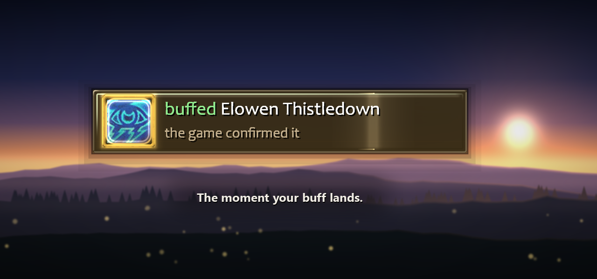

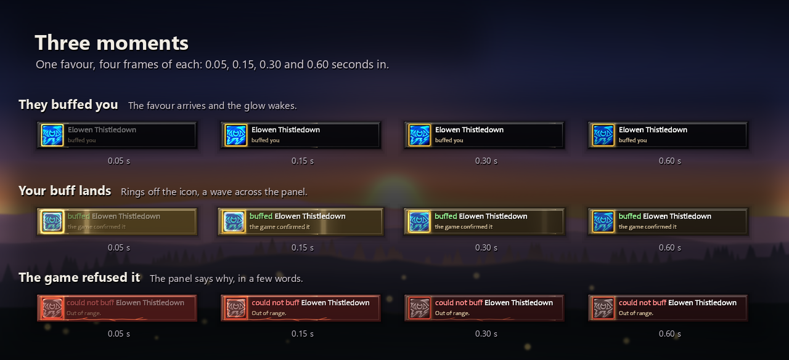

A priest buffs you in passing. By the time you have picked them out of a dozen nameplates, they are gone. Manners saw who it was, worked out what you owe them and put one button on screen. Click it, or press your key: they get their buff, your own target comes straight back, and the favour is remembered through a reload or a disconnect.

The same button offers your group, people who ask for your buff in chat, and passers-by who are missing it, so buffing a stranger costs one click instead of a minute of squinting at names. It looks after you too: your own armor, aura, aspect or shield, and the poison, stone, oil or lure for each weapon, come up as "You" when they are missing. In a dungeon or a raid it offers one group cast for a whole party when you carry the reagent, and offers a top-up at the moment that suits each buff's length.

Setting it up takes one page. `/manners` opens **Start here**: four numbered steps (who to buff, one key, see it, say thanks). The first time, two questions set the defaults for you, or *Skip* keeps them.

### What you see

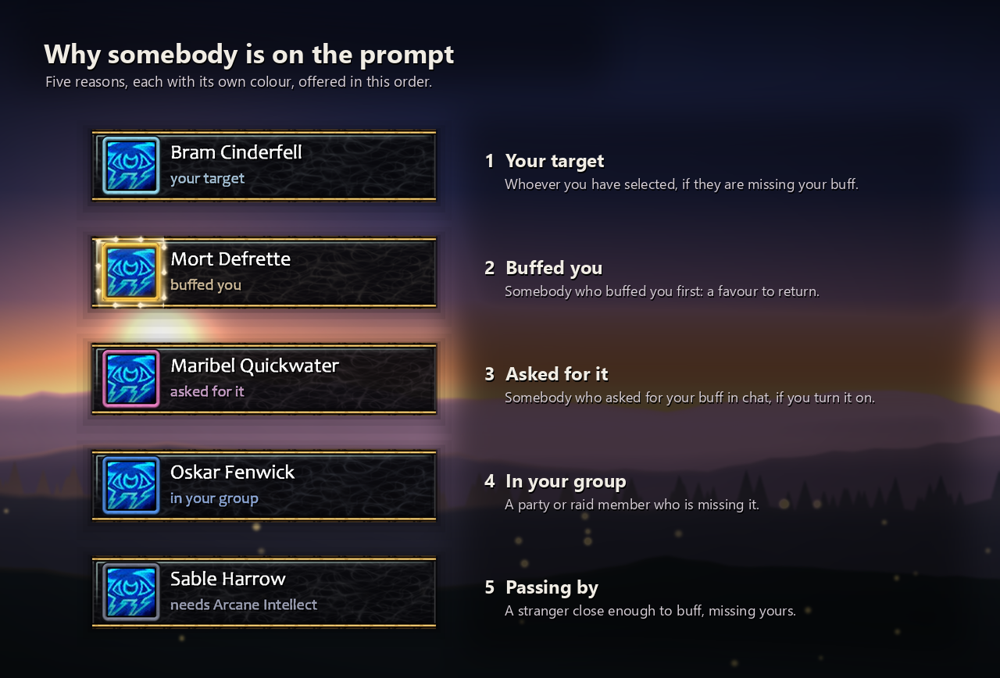

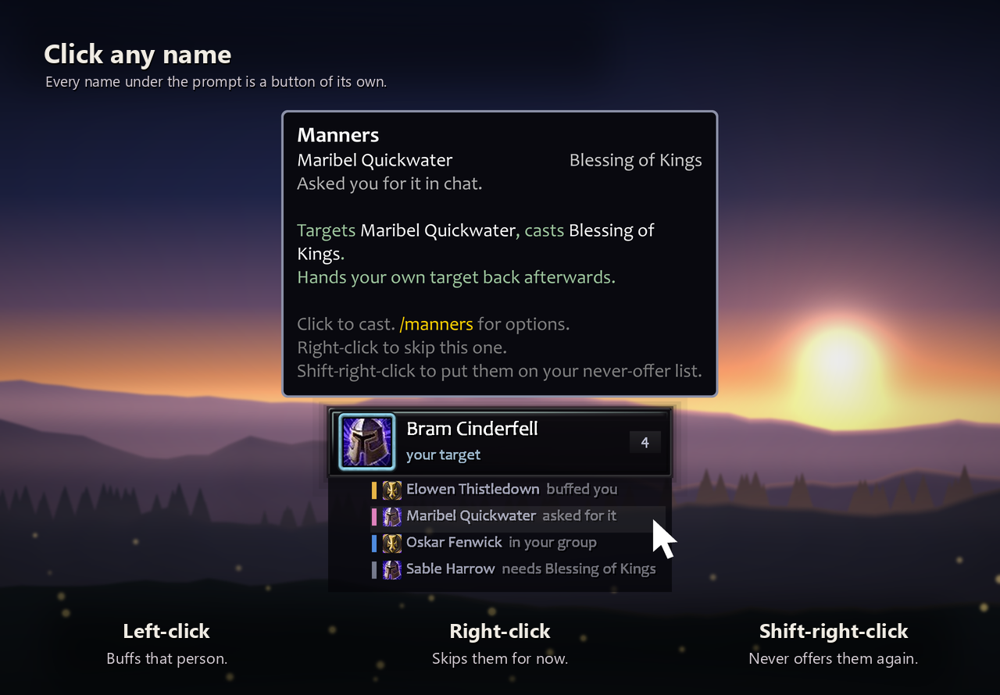

Turn on *List the next few below* (Look) and every name under the prompt is a button of its own, with the icon of the buff they would get: left-click buffs that person, right-click skips them for now, shift-right-click puts them on your never-offer list.

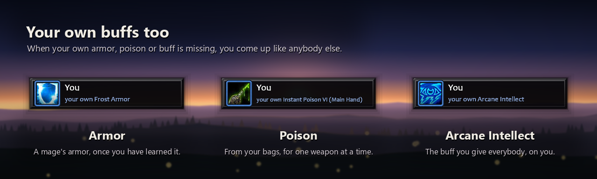

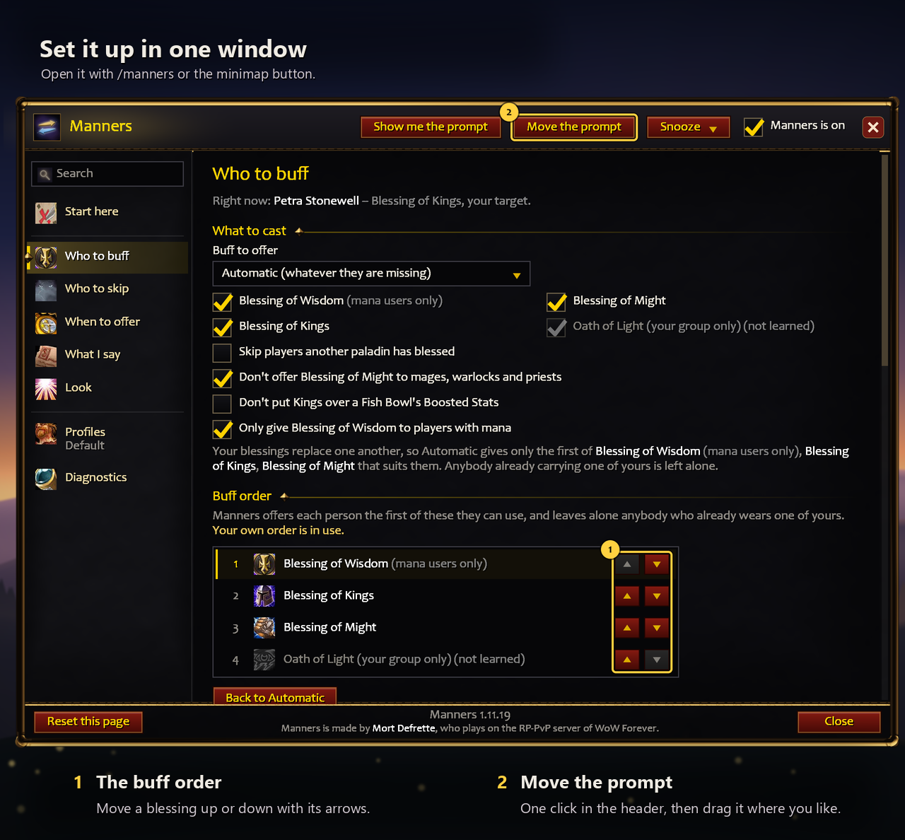

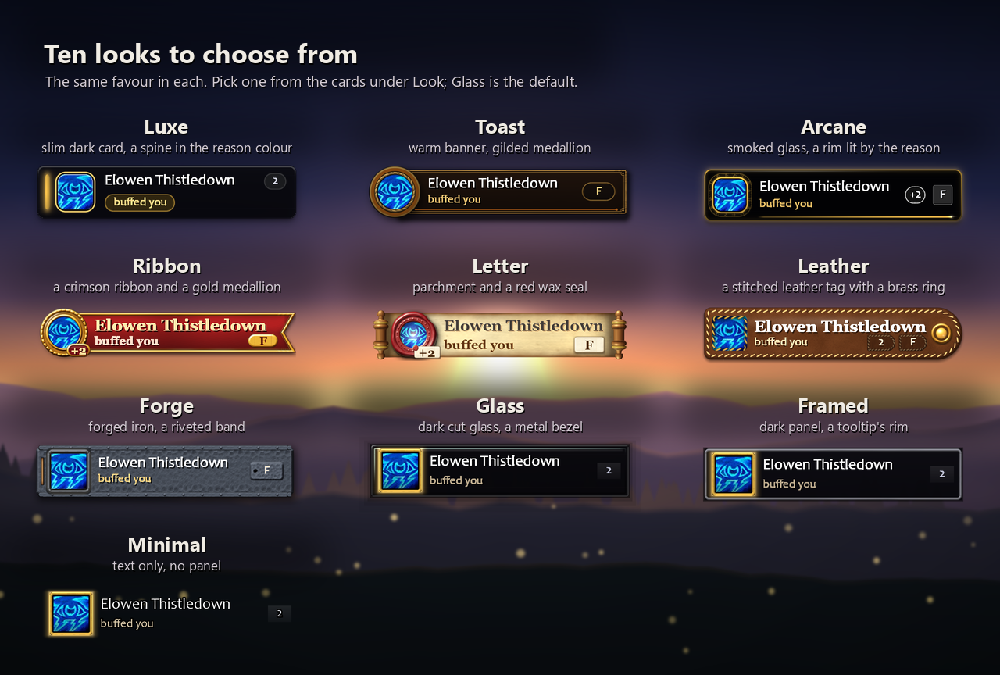

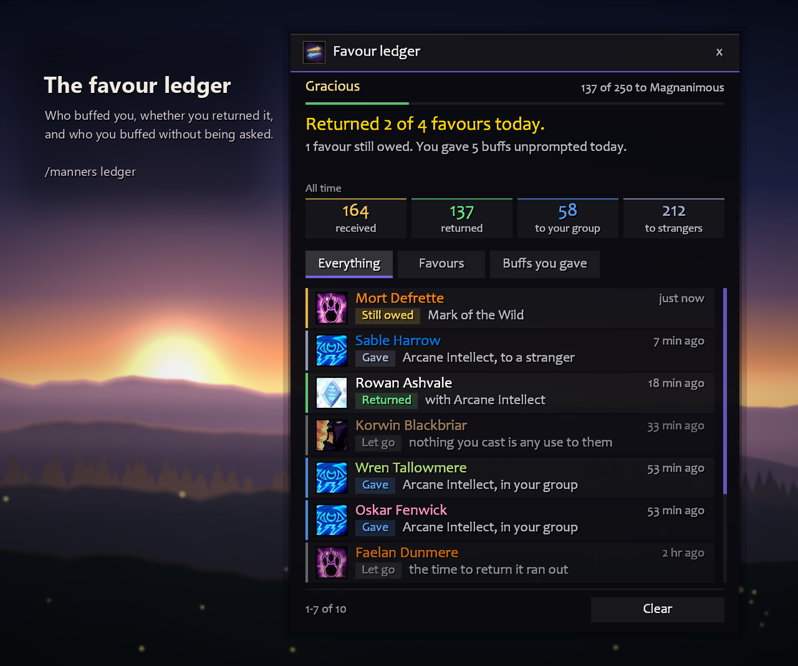

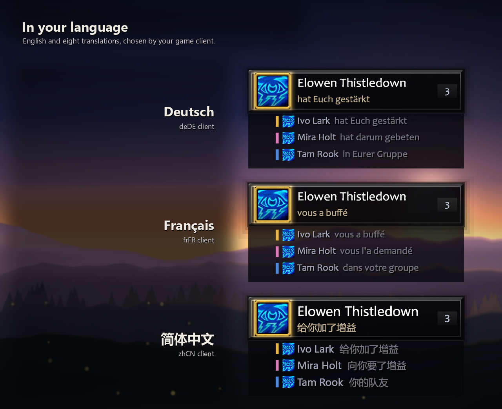

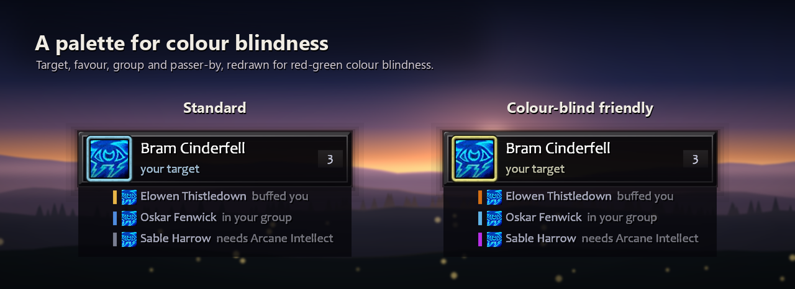

### Who it offers, in this order

1. **Your target**, when the game can confirm they are missing it.
2. **Your party or raid at a ready check, or just back from the dead.**
3. **Somebody who buffed you.** Strangers too.
4. **Somebody who asked in chat**, if you switch that on. "int pls", "fort?" or "can I get motw" in /say, /yell, group chat or a whisper counts for a minute (short messages that plainly ask, nothing said in a fight unless whispered). Nothing is ever said back.
5. **You**, when your own buffs are missing.
6. **Your party or raid**, anyone missing your buff.
7. **Passers-by** missing your buff: nameplates, your target, focus and mouseover.

It skips the dead, the out of range, anyone you just tried, anyone the buff does nothing for (Arcane Intellect is wasted on a rogue) and, while you are not flagged yourself, anyone flagged for PvP, since buffing them would flag you too. Friends and guildmates go ahead of other passers-by. A *Never offer* list keeps people off the prompt, unless they buff you, because returning a favour is the point. How near is near: passers-by can be limited to about ten yards (the default), right beside you, or cities and inns.

Buffs you give: mage Arcane Intellect; priest Fortitude, Divine Spirit, Shadow Protection; druid Mark of the Wild, Thorns; paladin Wisdom, Might, Kings (and Salvation, Light and Sanctuary where the game still has them); warlock Unending Breath; warrior Battle Shout. Any one can be switched off, Thorns held to tanks or to you alone, and Unending Breath left out.

**For your tank:** Earth Shield, Spirit of the Alpha, Beacon of Light (Oath of Light on WoW Forever), Beacon of Faith, Symbiotic Relationship and Blistering Scales, the buffs only one person can wear, go to the player your group gives the tank role, and only while none of yours is on anybody. Put yours on somebody else and it stays there, and Beacon of Faith finds your second tank. A tank who buffs you gets one back. Season of Discovery, Burning Crusade, Mists and retail, wherever the game has them. Mists druids also get Symbiosis for one member of the group, and Season of Discovery warriors Commanding Shout beside Battle Shout.

### Buff myself

- **Your own buff**, the one you give everybody else, and **your class's own**: armors (mage, warlock), auras (paladin), aspects and Trueshot Aura (hunter), shields (shaman), Inner Fire, Shadowguard and Shadowform (priest), Moonkin Form and Tree of Life (druid, never while you are in another form), Demonic Sacrifice or Soul Link while your demon is out (Classic Era, WoW Forever, Burning Crusade), Grimoire of Sacrifice (Mists and retail), the Season of Discovery runes Molten Armor, Aspect of the Falcon, Aspect of the Viper, Heart of the Lion and, for a shaman who tanks, Spirit of the Alpha, Righteous Fury (only while your role is tank, unless you say *Always*).
- **Weapons, one hand at a time.** When a weapon has nothing on it and a poison, sharpening stone, weightstone, oil or fishing lure that fits is in your bags, "You" comes up with its icon and one press puts it on: rogues' poisons, and stones, oils and lures for every class on WoW Forever, Classic Era, Burning Crusade and Mists. A rogue's poisons are reminded on retail too. On WoW Forever an oil and an imbue are each reminded on their own, and a mage carrying familiar or weapon imbue scrolls is reminded of those.
- **A shaman's weapon imbues** (Rockbiter, Flametongue, Frostbrand, Windfury) on WoW Forever, Classic Era, Burning Crusade and Mists: with none on the weapon in your main hand, "You" comes up with the first you know. On retail, the main hand and the off hand each have their own switch: Flametongue waits for a weapon in the off hand, and Thunderstrike Ward for a shield. A Lightsmith paladin's rites on retail too.
- **Well Fed**, if you switch it on: food in your bags that gives the buff, offered when none is on you, one press eats it. Every class, on WoW Forever, Classic Era, Burning Crusade and Mists.
- **Well-Rested**, if you switch it on: with a Cozy Sleeping Bag in your bags and no Well-Rested on you, one press lays the bag down. Not at the level cap. Classic Era and WoW Forever.
- **Detect Invisibility** for warlocks, if you switch it on: offered when none is on you, one press casts it on you. Classic Era, WoW Forever and Burning Crusade.
- **Flasks, elixirs and scrolls**, if you switch them on: one switch for Flask, one for Elixir and one per scroll, each shown once you carry one. The best one you can use is offered when none of its kind is on you, one press uses it. A flask counts as your elixirs on Burning Crusade and Mists, a flask that works only in some places comes last, and a scroll waits while the class buff of the same stat is on you. WoW Forever, Classic Era, Burning Crusade and Mists, and on retail a Flask switch for every class.
- **Consumables only in dungeons and raids**, if you like: oils, stones, food, flasks, elixirs and scrolls. On your own, a stone or oil is renewed only once it has worn off; in a group it is topped up ahead of the next pull.
- **Automatic, or your choice.** Where a class has several of one kind, pick one or leave it on *Automatic*, which follows the one you had up last. Only when none of a kind is up, never in a fight, and not in cities and inns unless you tick *Also in cities and inns*. *Don't remind me* turns any of it off.
- Hunters and rogues, who give nothing to others, get a prompt for their own buffs, and so does a shaman who has not learned Earth Shield.

### Dungeons and raids

- **One cast for the group.** Know Arcane Brilliance, a Prayer, Gift of the Wild or a Greater Blessing and carry its reagent, and when 3 or more need your buff you are offered one group cast, not one each (a Greater Blessing goes by class). The prompt says who it is for ("Your party", "Every Warrior"), and the tooltip counts your reagents. Short of mana or reagents, you get the single buff.
- **Ready checks and the fallen.** From a ready check until the pull, your group goes to the front. For two minutes after somebody is brought back, so do they. Feign Death does not count.
- **Raid groups I buff.** Untick the groups you were not assigned; people who buffed you or asked are still offered.
- **Save mana.** Below the level you set, only your own buffs and people who buffed you or asked are offered.
- **Quieter raids.** No "buffed you" chat line inside a raid; the favour is still remembered.
- **Battle Shout reach.** A warrior's shout is offered only to the people it reaches: your own party, or your whole raid on WoW Forever.

### Quiet when you want it

- **Offer nothing in cities and inns:** nothing offered to anybody while you are resting (passers-by, your group, a favour you owe); a target or focus still is.
- **Offer nothing in dungeons, raids and battlegrounds:** the same inside any instance; a target or focus still is, and your own buffs too.
- **Skip players another paladin has blessed:** for paladins whose group shares out the blessings.
- **Thorns for the tanks only, or for you alone:** *Offer to* on Who to buff, by the game's tank role or a raid's main tank mark.
- **Hide all Manners messages in my chat window:** not even the few lines the *Show what Manners is doing* switch leaves. What you type after `/manners` is still answered.
- **A controller on:** Manners opens none of the game's own menus (the minimap right click is the switch, a drop-down steps to the next choice).

### Timing

With *Offer a top-up when it runs low* on (the *kept topped up* choice on Start here sets it), Manners knows how long every buff lasts on your client and offers the top-up about a tenth of that before it ends: a minute before a ten-minute buff, five before an hour's. In a raid or dungeon it starts earlier (twice as early by default, which you can change), earlier still for your own buffs, and only in the last half minute for somebody outside your group. The tooltip says how long the buff lasts and when the top-up is due. After a fight everybody is read again at once.

### Paladins

**Blessing of Kings first**: once you have learned it, everybody is offered Kings before Might or Wisdom, and a whole class gets it as a Greater Blessing (on WoW Forever, Classic Era and Burning Crusade; Mists already does). Blessings overwrite one another, so nobody wearing one of yours is switched to another. A **buff order** under Who to buff, for any class with more than one buff, puts your buffs in your order with a pair of arrows: the first one a person can use is what they are offered, and it travels with `/manners export`.

### The favour ledger

Who buffed you and with what, whether you returned it (and if not, why), and who you buffed unasked, with today's count and your all-time totals. `/manners ledger`. Favours you return earn a title, from *Well Brought Up* at 10 to *The Very Soul of Courtesy* at 1,000, with how far you are from the next.

### What it says

Optional, and off until you turn it on: a line when you buff somebody, from four sets you can edit (Azeroth, Polite, Cheeky, or just their name). Say it, yell it, tell your group, or *whisper them*. It goes out through the button's macro, so it counts as you talking, and only with a buff that can land: when Manners cannot tell, the buff goes out without it.

Or pick **In character (fits your race and class)**: over two thousand lines, chosen when you click to fit your people, your class and the moment. Every race has its own voice (a dwarf's brogue, an orc's *Lok'tar ogar*), it does not repeat itself, and it speaks all nine languages.

> *"Most kind, Mort. You've lifted me from 'deceased' to 'mildly deceased'."* -- a Forsaken, returning a favour

Or just `/thank` them with an emote (off by default, never in a fight or an instance).

### Looks

- **Ten looks**, picked from cards in the options window: Glass (the default: a pane of cut glass, the icon in a metal bezel), Framed (a thin rim, like the game's tooltips), Minimal (the words alone), Luxe (a slim dark card with a spine in the reason colour), Toast (a warm banner, gilded medallion), Arcane (smoked glass, a rim lit by the reason), Ribbon (a crimson ribbon and a gold medallion), Letter (a parchment scroll with a red wax seal), Leather (a stitched leather tag with a brass ring) and Forge (forged iron and a riveted band, the reason glowing like heated steel). On Glass, Framed and Minimal, rules of light draw out as the prompt comes up and the panel's edge lights when your buff lands. Your own colours and fonts, and *Animations* on *Calm* if you would rather it kept still.
- **A colour-blind palette** for the reason colours. Text turns dark by itself on a light panel.
- **A flat prompt, if you like:** on Glass, Framed and Minimal, *Frame round the icon* and *Shadow and outline on the text* can each be switched off.
- **Move the prompt** is one click in the options window's header (or `/manners move`): drag it where you like, and it locks itself when you let go.
- **Minimap button** and addon compartment: click for options, shift-click for the ledger, right-click for a menu.

### Keys, action bars and controllers

- **A key of your own.** Bind *Buff the prompted player* (Options > Keybindings > Manners): one press buffs whoever is on the prompt and hands your target back.
- **On an action bar.** *Put Manners on an action bar* on Start here (or `/manners macro`) puts the Manners macro on your cursor: drop it on any slot of any bar. The slot shows the spell a press would cast, with its cooldown and range, and the macro says your line from *What I say* too.
- **Controllers.** Works with the game's own controller support: bind a controller button to *Buff the prompted player*, or put the macro on a bar your controller reaches. The prompt shows the button's picture instead of a key name.

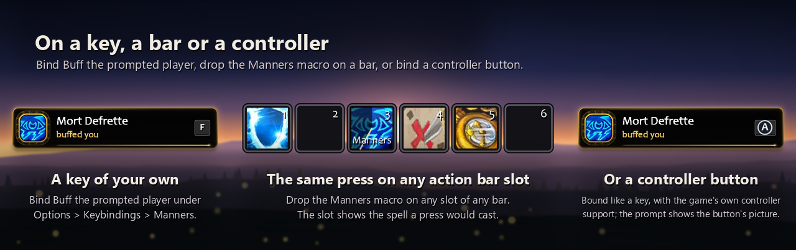

### Languages and clients

English, German, Spanish (Spain and Mexico), French, Italian, Korean, Brazilian Portuguese, Simplified and Traditional Chinese, whichever your client runs in.

Runs on every live client: **WoW Forever** 1.60.1, **Classic Era** 1.15.9, **Burning Crusade Classic** (Anniversary) 2.5.6, **Mists of Pandaria Classic** 5.5.4 and **retail** (Midnight) 12.1.5. Each offers what its own game gives: Commanding Shout in Burning Crusade; Legacy of the Emperor, Dark Intent and Horn of Winter in Mists; Skyfury, Blessing of the Bronze and Source of Magic on retail.

### Commands

```
/manners            options
/manners on | off   switch it on or off
/manners test       preview the prompt
/manners move       drag the prompt; it locks itself when you let go
/manners unlock     the same as move; lock puts it back, and an unlocked prompt never casts
/manners snooze     hide the prompt for 15 minutes, or as long as you say
/manners ledger     the favour ledger
/manners never      who is never offered anything; add a name to put them on it
/manners allow      take a name off that list
/manners macro      the macro for your bars, on your cursor
/manners export     your settings as one line of text, to keep or share
/manners import     use a line somebody exported (import undo puts yours back)
/manners debug      what your class and this build allow
/manners errors     the last few things that broke
/manners selftest   checks Manners against your game, as a report to paste
/manners help       every command, grouped
```

`/mnr` works as well. Profiles are supported, and a pasted settings line never switches on speaking to other players or moves your prompt.

### Good to know

- Blizzard does not let an addon cast on its own: nothing is cast until you press the key or click. Manners decides; the game casts.
- It cannot see line of sight, so a buff can still fail round a corner.
- Hovering the prompt or a name in the list shows a short tooltip; hold Shift for the full one, or choose Full, Shift only or Off and where it goes under Look.

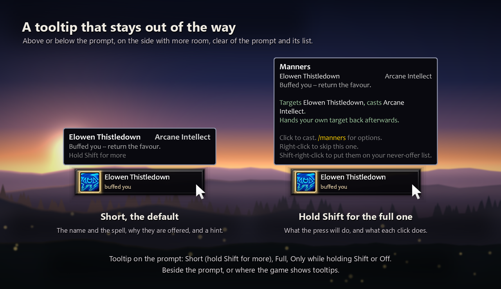

- In a fight the prompt keeps what the fight found, and names in the list cannot be clicked until it ends.
- Passers-by are seen through the game's friendly nameplates. With them off Manners sees almost nobody outside your group; the *Who to buff* tab says so and has a button to turn them on.

### Report a bug (please include a log)

A description alone usually is not enough to find a bug: the log says what Manners saw and decided. Getting one takes ten seconds:

1. Type `/manners`, or click the minimap button, to open the options.
2. Go to the **Diagnostics** page and press **Run a full check-up**.
3. Click in the box that appears, press **Ctrl+A** then **Ctrl+C**.
4. Paste it into your comment here, or into [a GitHub issue](https://github.com/fpsacha/Manners/issues/new/choose), with a few words on what went wrong and what you expected.

The log holds everything: the self-test, what the client allows, your settings, who was on the prompt and why, and what happened over the last few minutes (favours seen, presses, what the game said back), kept even through a `/reload`. Other players are named "Person 1", "Person 2" and so on, so it is safe to paste in public. If you can, run it right after the bug happens.

Also on [Wago](https://addons.wago.io/addons/rNkgzlNa), which is the one WowUp reads. Free, MIT licensed, [source on GitHub](https://github.com/fpsacha/Manners).

### Support

Manners is free and always will be. If it saves you a few clicks and you would like to say thanks, you can [buy me a coffee on Ko-fi](https://ko-fi.com/fpsacha).
