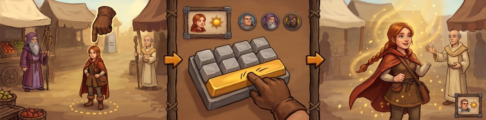
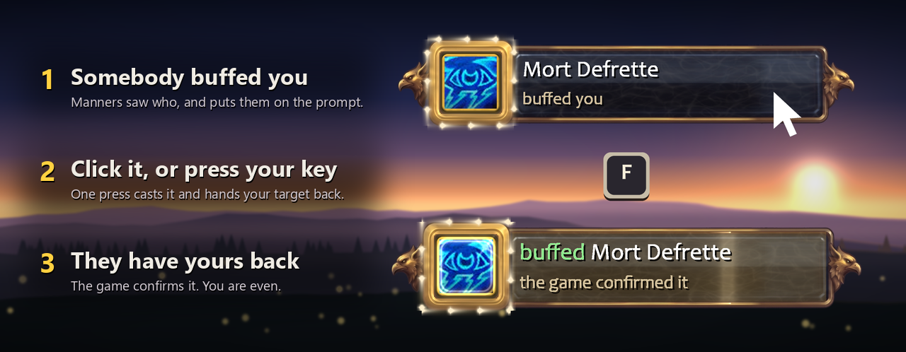
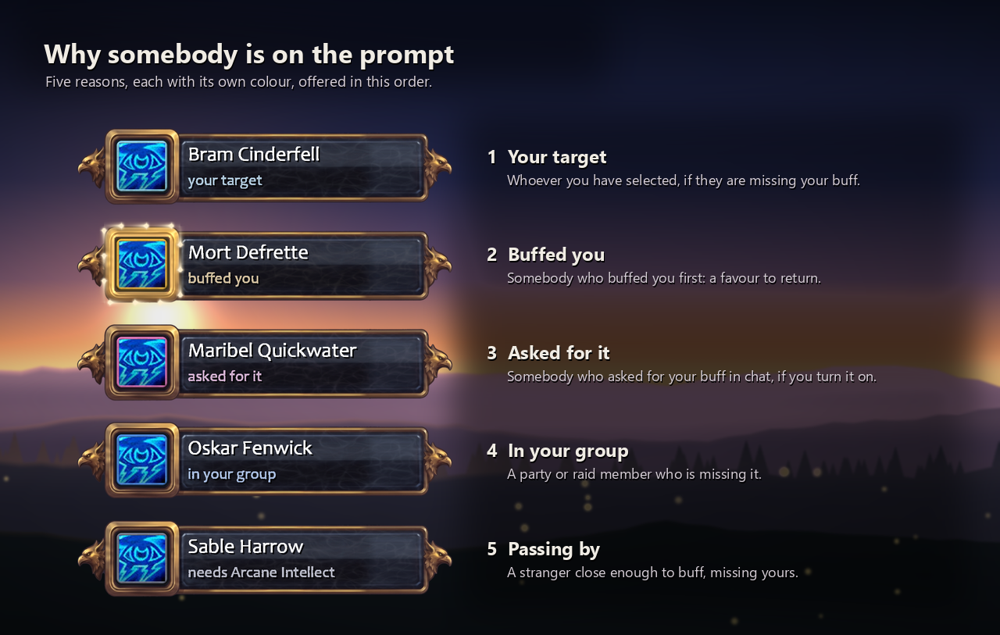
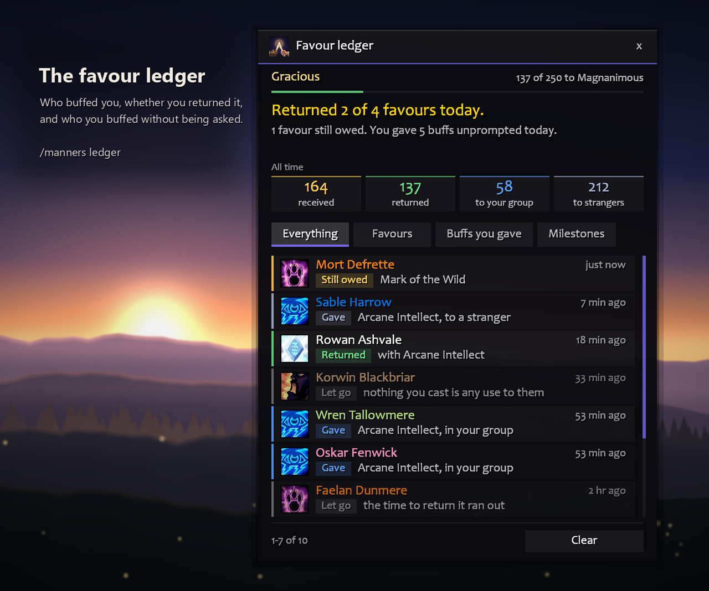

**Join the Manners Discord: [discord.gg/JHc8YSDvur](https://discord.gg/JHc8YSDvur)** (help, every new version, bug reports and ideas)

**A buff given is a favour owed. Manners repays it in one press.**

A priest buffs you in passing. By the time you find them among a dozen nameplates, they are gone. Manners saw who it was and put them on one button. Press your key: they have your buff, your own target comes straight back, and the favour goes in your ledger.

- **One press, never a hunt.** Whoever buffed you, your group, somebody who asks in chat, a passer-by missing your buff: the right person is on the prompt, in a sensible order, and your target comes back after every cast.
- **More than buffs.** Your resurrection for the group's dead, a cure for a poison, curse or disease, and a mage's or warlock's courtesies (water, portals, healthstones, summons) for whoever asks, and a polite ask for a buff you lack, if you tick it. Your own armor or aura comes up as "You" when it lapses, and a poison or an oil too once you tick it.
- **Good manners, kept.** A favour ledger of who buffed you, what you gave back and who you buffed first. If your character should speak, over three thousand In character lines, about a hundred of them the Forsaken's own.

Yours to arrange: thirty looks, a blessing for each class for paladins, profiles that switch by themselves as you enter a dungeon, a raid or a battleground, a profile manager with *Undo*, and options that start short, each page under a painted icon.

### What you see

### New in 1.13

- **Combat prompt** (Manners: Combat): interrupts, defensives, dispels, heals and *Blessing of Freedom* on a slowed friend, each lit only when needed, one click to cast. Cards in a row or on one spot, wherever you put them.
- **Spells and items of my own**: any buff spell, or an item or trinket whose use gives a buff (an attractor, say), and Manners reminds you of it.
- **Achievements** that say what to do, with a goal count; **companion moments** with your pet; right-click skips of 15 to 60 minutes; Battle Shout kept to melee and tanks if you like.

> **I read every comment here and on GitHub**, and a new version comes out most days. Questions, help and every new version: **[join the Manners Discord](https://discord.gg/JHc8YSDvur)**.

### Who it offers

A dead group member first (your **resurrection**), then your target, your group at a ready check, **somebody who buffed you**, somebody who asked in chat, you, your party or raid, and **passers-by** missing your buff. A **cure** can go first. Everybody gets their first missing buff before anybody gets a second; tank buffs go to the tank; two Manners users of one class split a group. It skips the dead, the out of range and anyone a buff does nothing for, and stays quiet in cities, dungeons or on `/manners snooze` when you want.

### Clients and languages

**WoW Forever**, **Classic Era**, **Burning Crusade Classic** (Anniversary), **Mists of Pandaria Classic** and **retail** (Midnight), one download, each with its own game's buffs. English, German, Spanish, French, Italian, Korean, Brazilian Portuguese, Simplified and Traditional Chinese.

### Set up in one minute

Type `/manners`: it opens on **Start here**. Answer its two questions, then *Put it on a key* or *Put Manners on an action bar*. A controller button works too. The *Simple view* shows just the essentials.

### Every class

Mage intellect and portals, priest Fortitude and cures, druid Mark and Thorns, paladin blessings (Greater Blessings by class), shaman Earth Shield, warlock breath, stones and summons, warrior shouts, hunter aspects and pet care, rogue poisons, and Horn of Winter, Legacy of the Emperor and Blessing of the Bronze where they exist. Every class can be reminded of food, flasks, elixirs, scrolls and weapon stones, oils and lures, and has a look of its own among the thirty.

### The good-manners side

A **favour ledger** (`/manners ledger`), and, off until you turn it on, a line with each buff or **In character** lines fitted to your race and class, in all nine languages.

> *"Most kind, Mort. You've lifted me from 'deceased' to 'mildly deceased'."* -- a Forsaken, returning a favour

### Good to know

Blizzard does not let an addon cast on its own: Manners decides, you press, the game casts. It cannot see line of sight, and sees passers-by through the game's friendly nameplates. `/manners help` lists every command.

### Report a bug (please include a log)

Press **Report a bug** on *Diagnostics* (or `/manners bug`): it opens a GitHub issue and a report to paste, with every player's name left out. Or paste **Run a full check-up** into a comment here.

### Credits and licence

Free, MIT licensed, [source on GitHub](https://github.com/fpsacha/Manners). Bundled libraries keep their own licences. Also on [Wago](https://addons.wago.io/addons/rNkgzlNa), which WowUp reads. If it saves you a few clicks, you can [buy me a coffee on Ko-fi](https://ko-fi.com/fpsacha).
