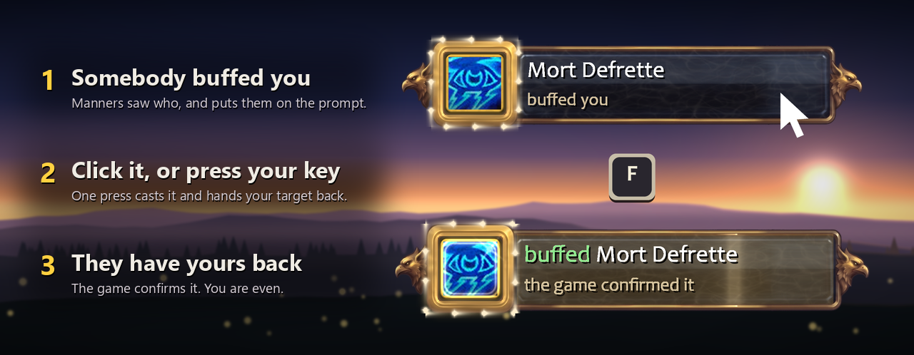

**Somebody buffed you? One press buffs them back, and your own target comes straight back to you.**

> **I read every comment here and on GitHub, and I fix bugs as fast as I can.** Found one? Please send a log with it: it takes ten seconds and turns a guess into a fix. See **Report a bug** below.

A priest buffs you in passing, and by the time you have picked them out of a dozen nameplates they are gone. Manners saw who it was and put them on one button: click it, they get their buff, and your own target comes straight back. The same button offers your group, people who ask in chat, and passers-by missing your buff, and it looks after you too, down to the poison or oil for each weapon. `/manners` opens **Start here**: two numbered steps, who to buff and one key.

Runs on every live client: **WoW Forever**, **Classic Era**, **Burning Crusade Classic**, **Mists of Pandaria Classic** and **retail** (Midnight).

- **Who comes first:** your target, then your group at a ready check or just back from the dead, then people who buffed you, people who asked in chat, you, the rest of your group, and passers-by, each in its own colour (with a colour-blind set).
- **For your tank:** Earth Shield, Spirit of the Alpha, Beacon of Light and Beacon of Faith, Oath of Light, Symbiotic Relationship and Blistering Scales, the buffs only one person can wear, go to your group's tank while none of yours is on anybody.
- **Buff myself:** armors, auras, aspects and shields, Shadowform, Moonkin Form and Tree of Life, Demonic Sacrifice, a shaman's weapon imbues, food for Well Fed, flasks, elixirs and scrolls, the sleeping bag for Well-Rested, a companion pet and a warlock's Detect Invisibility if you switch them on, a mage's Mana Shield and Fire Ward or Frost Ward if you switch them on (and his Detect Invisibility for the group, if he ticks it), a warlock's Firestone or Spellstone on WoW Forever, a warlock's Unending Breath while you swim, and the poison, stone, oil or lure for each weapon, come up as "You"; one press puts it on. Never in a fight; and up to ten buffs of your own that Manners does not know, under *Add a spell of my own*.
- **Click any name** in the list under the prompt to buff that person; right-click skips them, shift-right-click never offers them again.
- **Kept out of the way:** a *Never offer* list, friends and guildmates first, nobody flagged for PvP while you are not, `/manners snooze`, the prompt hidden while you ride or in a fight, *Offer nothing in cities and inns* (or cities only, or inns only) or *in dungeons, raids and battlegrounds*, paladins skipping players another paladin has blessed, Thorns for tanks only or for you alone, consumables only in dungeons and raids, and *Hide all Manners messages in my chat window*.
- **People who ask me in chat** (off by default): "int pls", "fort?" or "can I get motw" puts them on the prompt for a minute.
- **Courtesies on request:** a mage's water, food and portals, a warlock's healthstones and summons, for whoever asks in chat. Off until ticked.
- **Resurrection and cures:** out of a fight, your group's dead are offered your resurrection first, and a poison, disease, curse or harmful spell its cure, if you tick it.
- **Ask for a buff:** when somebody near could give you a buff you are missing, one press whispers them a polite line. Off until ticked.
- **Two Manners users, one group:** two of the same class each get their own part of it, so nobody is buffed twice.
- **Battlegrounds and arenas:** your own buffs first after a death, your team freely before the gates open, no line said with a cast there unless you tick it, and your thanks to your own team alone.
- **Dungeons and raids:** one group cast for a whole party when you carry the reagent, your group's pets if you tick them, ready checks and the fallen first, only the raid groups you buff, save mana below a level you set, holding back as much as you choose.
- **Top-ups timed to each buff:** with top-ups on, about a tenth of its length before it ends, earlier in a raid or dungeon.
- **Paladins:** Blessing of Kings first, **a blessing for each class** (Wisdom for mages, say), and a buff order of your own for any class with several buffs.
- **The favour ledger** and titles for your manners, from *Well Brought Up* to *The Very Soul of Courtesy*, and thirteen **milestones** to earn, three of them hidden. Earn them all and you join the **hall of fame**, the *Gentlefolk of Good Manners*. `/manners ledger`.
- **Profiles that switch by themselves** as you arrive in the open world, a dungeon, a raid or a battleground, and a profile manager: every profile at a glance, use, duplicate, rename or delete one, with *Undo*.
- **Options that start short:** a simple view with the ten or so settings your class changes on each page, everything else one switch or one search away; a long page in parts you pick from a bar, and a painted icon for each page.
- **Say something**, if you like: four sets, whispers, or **In character**, over three thousand lines picked for your race, class and the moment (about a hundred of them the Forsaken's own), with your own mixed in if you like. Off by default, as is a `/thank` or a whispered thank-you for whoever buffs you, which can wait for a press of the prompt.
- **Keys, action bars and controllers:** a key binding, a macro for any action bar slot that shows the spell it will cast and says your line, and the game's own controller support (bind a controller button; the prompt shows its picture).
- **Twenty-nine looks**, each a painting, picked from cards on four shelves, effects you can calm, and **Move the prompt** one click away in the options window. One switch has each character wear its own class's look.
- **Nine languages:** English, German, Spanish (Spain and Mexico), French, Italian, Korean, Brazilian Portuguese, Simplified and Traditional Chinese.

Blizzard does not let an addon cast on its own, so nothing happens until you press the key: Manners decides who deserves the buff, and the game casts when you click. Passers-by are seen through friendly nameplates, which the options can turn on.

**Report a bug, with a log:** open the options (`/manners`), go to **Diagnostics**, press **Run a full check-up**, then click in the box, **Ctrl+A**, **Ctrl+C**, and paste it into your comment or [a GitHub issue](https://github.com/fpsacha/Manners/issues/new/choose). Other players are named "Person 1", "Person 2", so it is safe to paste.

`/manners help` lists every command. Free, MIT licensed. Full documentation and bug reports on [GitHub](https://github.com/fpsacha/Manners). If you would like to say thanks, you can [buy me a coffee on Ko-fi](https://ko-fi.com/fpsacha).
