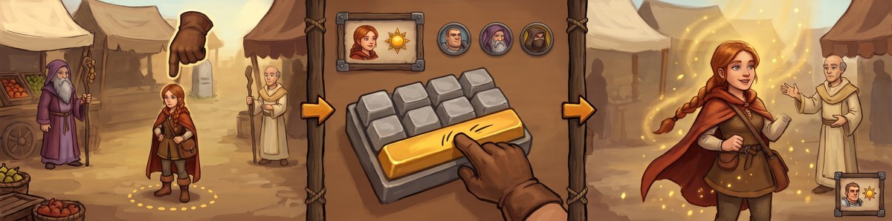
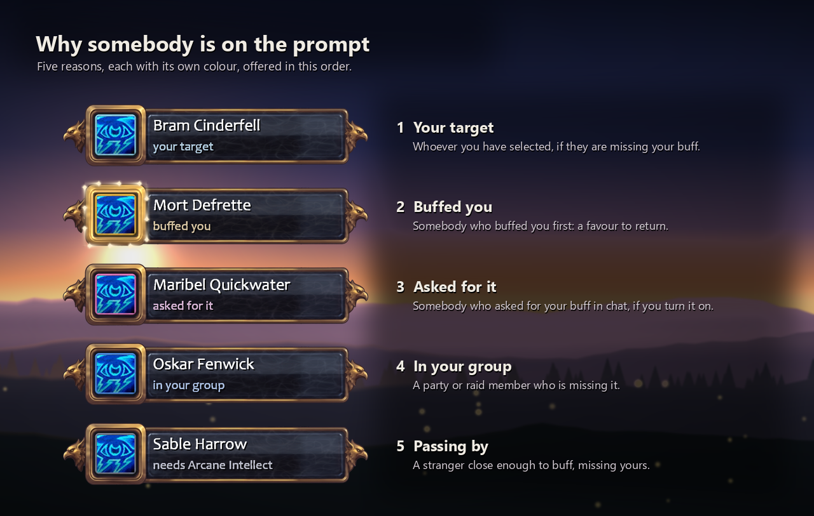
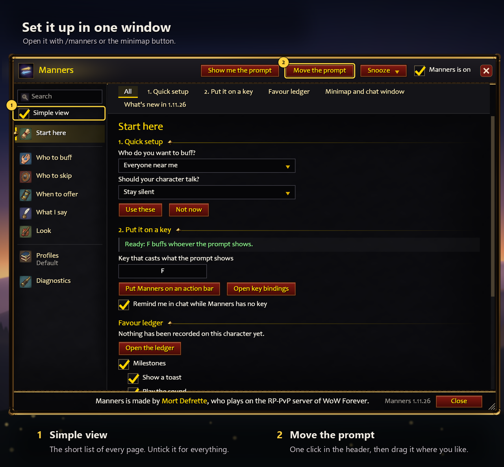
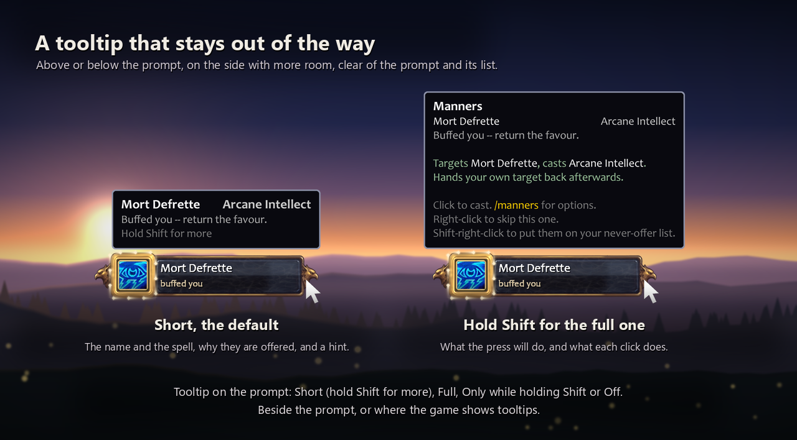
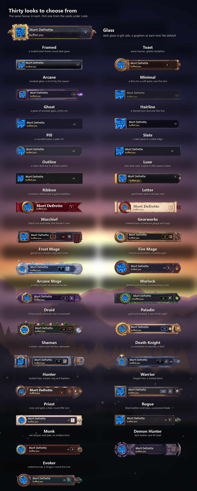
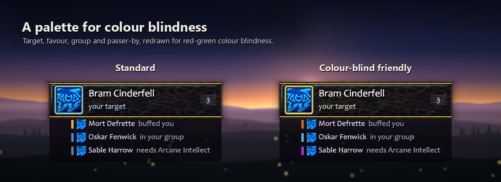

# Manners

**A buff given is a favour owed. Manners, a World of Warcraft addon, repays it
in one press.**



[](https://github.com/fpsacha/Manners/actions/workflows/ci.yml)
[](https://wow.curseforge.com/projects/1705364)
[](https://addons.wago.io/addons/rNkgzlNa)
[](https://discord.gg/JHc8YSDvur)
[](LICENSE)


A priest buffs you in passing. By the time you find them among a dozen
nameplates, they are gone. Manners saw who it was and put them on one button,
*the prompt*. Press your key: they have your buff, and your own target comes
straight back.

Runs on **WoW Forever**, **Classic Era**, **Burning Crusade Classic**, **Mists
of Pandaria Classic** and **retail**, in nine languages.

## What it does for you

- **Returns a favour with one press.** Whoever buffed you, a stranger
  included, comes up on the prompt with the buff you owe them, remembered
  through a reload.
- **Your group and passers-by.** Group members missing your buff first, then
  players near you; one group cast when you carry the reagent, and top-ups
  timed to each buff.
- **Resurrection and cures** on the same button, and **courtesies** on request
  (water, portals, summons) with **Manners: Services**.
- **Asking.** A press whispers one polite line to somebody who could give you
  a buff you lack.
- **A blessing for each class.** A paladin picks the blessing each class is
  offered first.
- **Profiles that switch by themselves** for the world, dungeons, raids and
  battlegrounds, with a profile manager and *Undo*.
- **Thirty looks**, and options that start short: a Simple view and a
  painted icon for each page.
- **In character, if you like.** A line when you buff somebody, fitted to your
  race and class: the Forsaken alone have about a hundred.

Optional modules, each off until you enable it: **Combat** (one prompt that
lights up in a fight when an action you picked is needed), **My Buffs** (your
own buffs, food, flasks, scrolls and items), **Services**, **Achievements** and
**Pets** (pet care, and moments with your companion).



## New in 1.13

- **Combat prompt**: interrupts, defensives, dispels, heals and Blessing of
  Freedom on a slowed friend, each lit only when needed; one click casts. Cards
  sit in a row (right, left, up or down) or on one spot.
- **Spells and items of my own**: add any buff spell, or an item or trinket
  whose use gives a buff, and Manners reminds you of it.
- **Achievements** that say what to do, with a goal count.
- **Companion moments**, longer right-click skips (15 to 60 minutes), a bigger
  consumables button, the Well-Rested bag before food, and Battle Shout kept to
  melee and tanks if you like.

## Installing

Install from **[Wago](https://addons.wago.io/addons/rNkgzlNa)** (and WowUp),
**[CurseForge](https://wow.curseforge.com/projects/1705364)**, or unzip a
[release](https://github.com/fpsacha/Manners/releases) into `Interface/AddOns`.
The optional modules come in the same zip and are enabled on *Choose modules*.

> **Do not install from a clone of this repository.** `Libs/` is fetched at
> build time, so a zip made from a checkout will not load. Use a release.

## The first minute

1. **See the prompt.** `/manners` opens the options on **Start here**; *Show me
   the prompt* previews it and *Move the prompt* lets you drag it.
2. **Put it on a key.** Set a key on Start here (**Options > Keybindings >
   Manners**), or press *Put Manners on an action bar* (`/manners macro`).
   A controller button works too.
3. **Stay in the Simple view** until you want more: the search box finds any
   setting.




## How it works

**Who comes first.** Your target, somebody who buffed you, somebody who asked
in chat, your group, then passers-by, each in its own colour. Click a name in
the prompt's list to buff that person, right-click to skip them,
shift-right-click to never offer them again.


**The tooltip** says who, what and why in one line; hold Shift for everything.



**Keys, bars and controllers.** The action bar macro's first line is
`/click MannersBar`; under it Manners writes what a press would cast, so the
slot shows its icon, cooldown and range.

**In a fight** the game freezes secure buttons, so the prompt keeps what it
held at the pull and casts nothing new. The fight's own buttons (cures, Will
of the Forsaken, Mend Pet, the combat prompt) come with **Manners: Combat**.

## Your own buffs

With **Manners: My Buffs**: your armor, aura, aspect, shield or form, weapon
enhancements, food, flasks, elixirs, scrolls, tracking, the sleeping bag and a
companion pet, each with its own switch. Add any other buff spell, or an item
whose use gives a buff, under *Add a spell or an item*.


## The favour ledger

Who buffed you, what you gave back, and who you buffed first.


## The prompt's look

Thirty looks, from dark glass to a death knight's runeblade, each with its
own animation, picked from a gallery of cards.






## The options window

### Start here
Two questions for a new profile, a key for the prompt, the bar macro, and the
game's friendly nameplates.

### Choose modules
Turn the optional modules on and off.

### Who to buff
What to cast, on whom: favours, your group, passers-by, yourself, a blessing
for each class, Battle Shout for melee and tanks only.

### Who to skip
People left alone, the never-offer list, and how long a right-click skips.

### When to offer
Favours, top-ups, timing and targeting.

### Quiet times
Cities and inns, dungeons, battlegrounds, the mana floor, snooze.

### What I say
Thanks, the line said when you buff, In character, whispers.

### In a fight
What the prompt does when a fight starts.

### Look
The look, size, colours, sounds and the exact position.

### Profiles
Profiles that switch by themselves, and the profile manager with *Undo*.

### Diagnostics
Why the prompt is empty, the check-up and *Report a bug*.

### My own buffs
Each of your own buffs, consumables and spells or items of your own
(Manners: My Buffs).

### My companion
Your companion pet, and moments with it (Manners: Pets).

### My pet
Feed Pet, Mend Pet and pet care (Manners: Pets, hunters).

## Commands

```
/manners                    the options
/manners on | off           switch it on or off
/manners snooze [min|off]   hide the prompt for a while
/manners test | move        preview the prompt, or drag it
/manners macro              the macro for your action bar
/manners ledger             the favour ledger
/manners spell [add|remove] your own spells and items
/manners never | allow      the never-offer list
/manners export | import    share your settings
/manners debug | errors     what Manners sees, and what broke
/manners bug | mark         report a bug, or mark this moment for one
/manners selftest           check Manners against your game
/manners help               every command
```

`/mnr` works in place of `/manners`.

## Languages


English, German, Spanish, French, Italian, Korean, Brazilian Portuguese,
Simplified and Traditional Chinese.

## The five clients

| Client | Version |
|---|---|
| WoW Forever | 1.60.1 |
| Classic Era, Season of Discovery included | 1.15.9 |
| Burning Crusade Classic (Anniversary) | 2.5.6 |
| Mists of Pandaria Classic | 5.5.4 |
| Retail (Midnight) | 12.1.5 |

One download holds all five, and each offers what its own game gives.

## What it cannot do, and why

- **It cannot cast by itself.** Only a key press or a click casts; Manners
  decides who and parks it on a secure button.
- **A fight freezes the button**: whoever it held at the pull stays until the
  fight ends.
- **Targeting is by name**, then your target comes back. `/target` matches the
  start of a name, so offering Mort could find Mortimer beside him; where the
  game does not say who received the spell, the favour is counted as repaid
  on the strength of the `/target` line alone.
- **It cannot see line of sight**, and sees passers-by mostly through the
  game's friendly nameplates. On WoW Forever turn those on to thank strangers.

## Troubleshooting

Press your key on the empty prompt, or read the first line of *Diagnostics*:
both say what holds it back. `/manners debug` says what Manners sees.
To report a bug press **Report a bug** (`/manners bug`): it fills in a GitHub
issue and a report to paste, with every name left out. Questions:
[Discord](https://discord.gg/JHc8YSDvur).

## For developers

Start with [CLAUDE.md](CLAUDE.md) and [.claude/docs/](.claude/docs/);
[tests/README.md](tests/README.md) and [tools/README.md](tools/README.md)
explain the suites and the tools.

```
python tools/lint.py                every file compiles, the tocs are current
python tools/check.py --release     everything a release is checked against
python tools/release.py X.Y.Z       release (--dry-run prints every step)
```

`.pkgmeta` declares all 14 libraries as build-time externals.

## Licence

MIT, see `LICENSE`. Bundled libraries keep their own terms, see
`THIRD-PARTY-NOTICES.md`.
