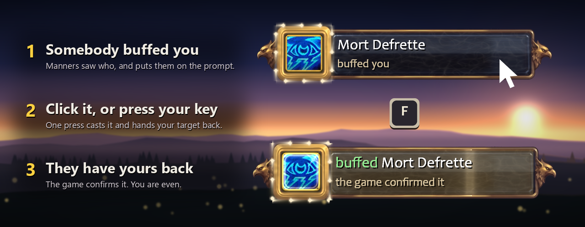
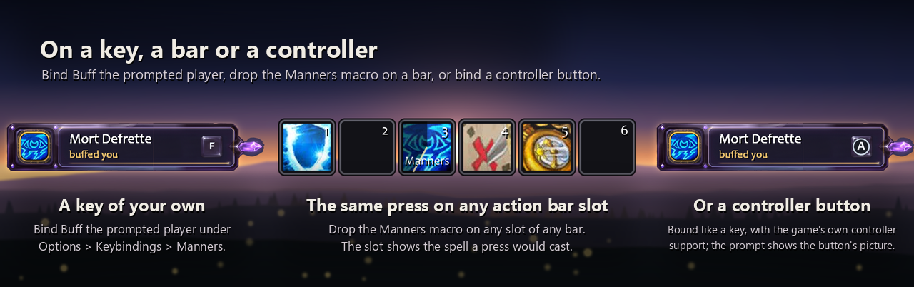
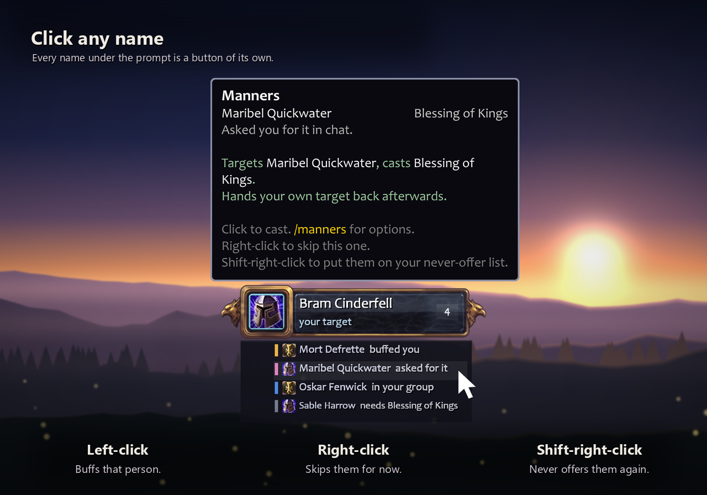
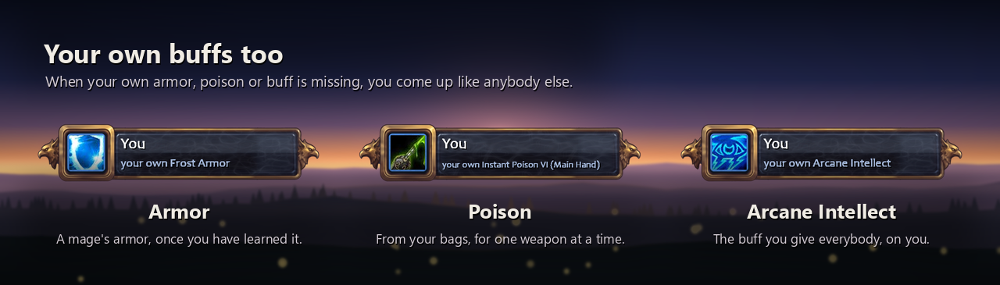
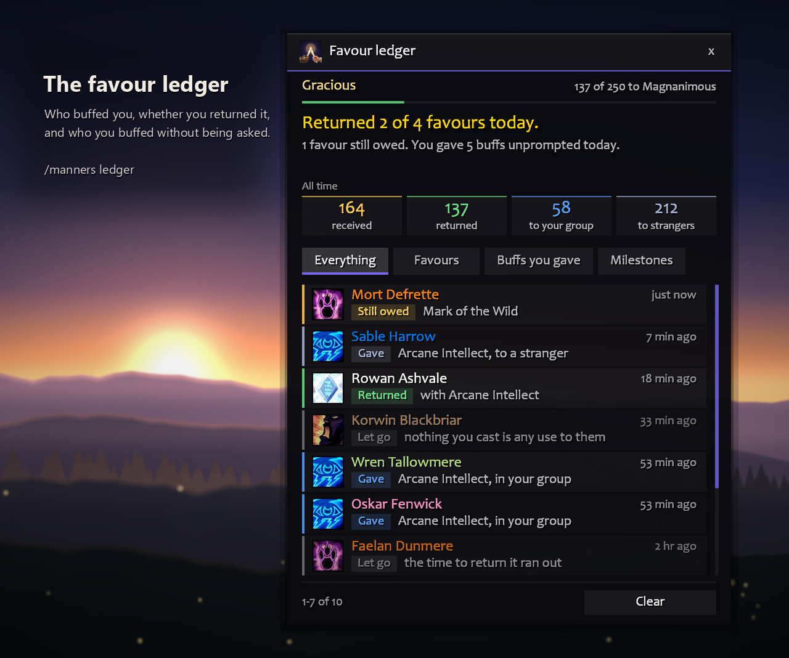
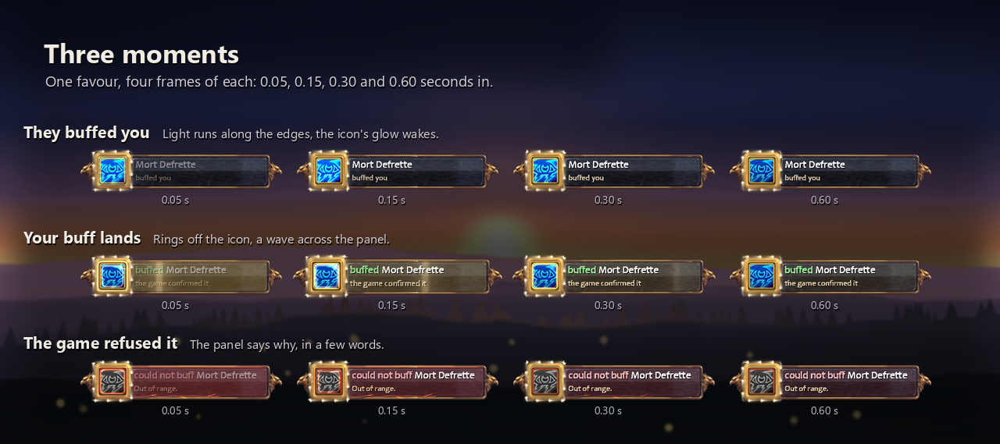
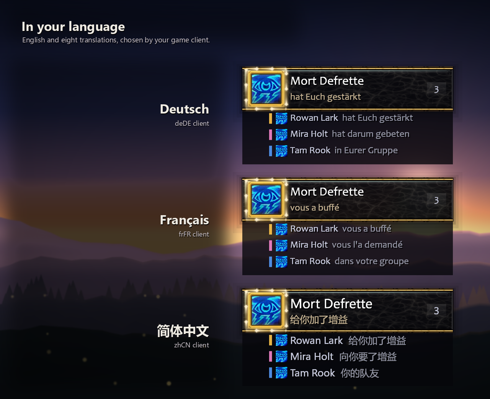

# Manners

**Manners is a World of Warcraft addon that returns buffs. When somebody buffs
you it puts one button on screen: press it and they get your buff back, and
your own target is handed straight back to you.**

[](https://github.com/fpsacha/Manners/actions/workflows/ci.yml)
[](https://wow.curseforge.com/projects/1705364)
[](https://addons.wago.io/addons/rNkgzlNa)
[](LICENSE)



A priest buffs you in passing. By the time you have picked them out of a dozen
nameplates, they are gone. Manners saw who it was, worked out what you owe them
and put one button, *the prompt*, on screen. Click it or press your key.

Runs on **WoW Forever**, **Classic Era**, **Burning Crusade Classic**, **Mists
of Pandaria Classic** and **retail**, in nine languages.

## What it does for you

- **Returns a favour with one press.** Whoever buffed you, a stranger
  included, comes up on the prompt with the buff you owe them. The favour is
  remembered through a reload or a disconnect.
- **Your group and passers-by.** Anybody in your party or raid missing your
  buff is offered it, then the players near you who are. One group cast for
  the whole party when you carry the reagent, your group first at a ready
  check, and a top-up at the moment that suits each buff's length.
- **Your own buffs and consumables.** Your armor, aura, aspect, shield or
  form, the poison, stone or oil for each weapon, food, flasks, elixirs and
  scrolls come up as "You" when they are missing.
- **Resurrection, cures and courtesies.** Your resurrection for the group's
  dead, a cure for a poison or a curse, a mage's water and portals and a
  warlock's healthstones and summons for whoever asks in chat.
- **Asking.** When somebody near you could give you a buff you are missing,
  a press whispers them one polite line.
- **Sharing a group.** Two Manners users of one class in a group split it
  between them, so nobody is buffed twice.
- **Battlegrounds and arenas.** Rules of their own: your own buffs first
  after a death, your team freely before the gates open.
- **A blessing for each class.** A paladin picks the blessing each class is
  offered first: Wisdom for mages, say, where the order would give them Kings.
- **The favour ledger, milestones and a hall of fame.** Who buffed you, what
  you gave back, the title your manners have earned and thirteen milestones;
  earn them all and you join the *Gentlefolk of Good Manners*.
- **Profiles that switch by themselves.** One for the open world, one for
  dungeons, raids or battlegrounds, chosen as you arrive, and a profile
  manager that can use, duplicate, rename or delete any of them, with *Undo*.
- **Twenty-nine looks.** From a pane of dark glass to a death knight's
  runeblade, picked from a gallery of cards on four shelves.
- **Options that start short.** A simple view of each page, a long page in
  parts you pick from a bar, and a painted icon for each page.
- **In character, if you like.** A line when you buff somebody, fitted to your
  race, class and the moment: the Forsaken alone have about a hundred.


## Installing

- **[Wago](https://addons.wago.io/addons/rNkgzlNa)**, and through it
  **WowUp**: search *Manners* and install.
- **[CurseForge](https://wow.curseforge.com/projects/1705364)**, and the
  CurseForge app.
- **By hand**: take a zip from
  [Releases](https://github.com/fpsacha/Manners/releases) and unzip it into
  `Interface/AddOns`.

All three carry the same build from the same tag.

> **Do not install from a clone of this repository.** `Libs/` is deliberately
> not committed (the libraries are fetched at build time), so a zip made from
> a checkout has none of them and will not load. Use a release.

## The first minute

**1. See the prompt.** The first login on each character says in chat what
Manners does and shows the prompt where it sits (`/manners welcome` says it
again). On a brand-new character whose buff is still at the trainer it says
only that it starts once you learn it, and greets you properly the moment
you do. `/manners`, or a click on the minimap button, opens the options on
**Start here**. On a new profile two questions lead the page, *Who do you want
to buff?* and *Should your character talk?*: *Use these* sets them, *Not now*
keeps the defaults, and they are not asked again. *Show me the prompt* at the
top of the window (or `/manners test`) previews it; *Move the prompt* beside it
(or `/manners move`) lets you drag it, and it locks itself when you let go.

**2. Put it on a key.** Step 2 of Start here, *Put it on a key*, sets a key
right there (it is the game's own binding, **Options > Keybindings > Manners**,
"Buff the prompted player"). Or press *Put Manners on an action bar* (or type
`/manners macro`) and drop the macro on any slot of any bar: the slot shows the
spell a press would cast, with its cooldown and range. A controller button
bound to the same command works too. Without a key you can still click the
prompt.



**3. Stay in the Simple view.** A new profile opens the options in the
*Simple view*: each page draws only the ten or so settings a player of your
class changes, every buff's own switch among them. *Show everything* under the
list brings the rest, and the search box finds any setting in either view.


A new profile offers your buff to everyone near you, says nothing aloud and
reminds you of your own buffs. That suits most players; the rest of this page
is reference.

## Who is offered, and in what order

Everybody who could use your buff is queued, in this order:

1. **Your target**, when the game can confirm they are missing it. A guess
   does not get to jump the queue.
2. **Your party or raid at a ready check, or just back from the dead**, when
   they are read as missing your buff or running low on it.
3. **Somebody who buffed you.** Spotted by watching your own buffs appear and
   reading who cast them, which works on strangers too, as long as the game
   can still name them for you. Somebody you buffed first who buffs you back
   is not owed anything: the ledger lists it as *Buffed back*, and nothing
   chimes.
4. **Somebody who asked for it in chat**, if you switch that on.
5. **You**, when you are missing your own buff or one of your class's own.
6. **Your party or raid**, anyone missing your buff, and their pets once you
   tick *My group's pets too*.
7. **Passers-by** missing your buff, seen through nameplates, your target,
   your focus and your mouseover. With the game's friendly nameplates off
   Manners sees almost nobody outside your group, and cannot tell who a
   stranger who buffs you is. It says so where you look: a red line under the
   first greeting, *Who to buff* and *Start here* in red (*Start here* while
   *Quick setup* is still asking, too), the minimap tooltip in amber, and the
   options window's strip, each with *Show friendly nameplates* or the way to
   it. When a stranger's buff lands with nobody to name, one line in chat says
   why there is nobody to buff back, once a session on your first three. If
   you thank with an emote and *Thank them even when I can't see who it was*
   (under *What I say*) is off, the line names it: it thanks them with your
   emote, nobody targeted, all the same. With it on, the line says your emote
   thanks them where it may.

Ahead of all of them comes your **resurrection** for a dead member of your
group, and a **cure** comes before any buff for the same person; a **courtesy**
somebody asked for is offered with the requests, and an **ask** for a buff you
are missing comes last of everything. Each is described under *More than
buffs* below.

Everybody is offered the first buff they are missing before anybody is offered
a second, so a party gets its Fortitude all round before the first Divine
Spirit. Among people offered for the same reason, somebody read as missing a
buff comes before somebody whose buffs the game would not show, and both
before a top-up of a buff still running; then friends and guildmates, then by
name.

It skips the dead, the out-of-range, anyone you just tried, anyone the buff
does nothing for (Arcane Intellect is wasted on a rogue), and, while you are
not flagged yourself, anyone flagged for PvP, since buffing them would flag
you.

A passer-by who walks off is kept on offer by name for ten seconds, in case
they are still within reach; somebody in reach right now comes first, and
takes the prompt from them at once unless your cursor is on it. When the game
refuses a buff on somebody, they are left off for a while, longer each time
in a row: for where they stand (out of sight, out of range) a few seconds,
half a minute at most; for anything else up to five minutes, and chat says
so. Targeting them tries again at once.

**On the prompt.** Left-click (or your key) casts. **Right-click** skips that
person for now without marking their favour repaid; on one of your own buffs
it skips just that buff, and **Ctrl-right-click** skips all of yours.
**Shift-right-click** puts them on the never-offer list.

**The list.** With *List the next few below* on (Look, under *Waiting list*,
off by default), the names under the prompt are buttons of their own, each
with the icon of the buff that person would get: left-click buffs them and
hands your target back, right-click skips them, shift-right-click never offers
them again. *Click a name in the list to buff them* turns the buttons off.
While the cursor is on a name it stays on that line: the others may move
round it, and if that person drops off the list the line goes blank rather
than taking the next name, so a click never lands on somebody you did not
point at.



**The tooltip.** Hover the prompt, or a name in its list, and it says who and
what, and why they are offered, in one short line; hold Shift for everything
(who comes first and why, how long the buff lasts, what the clicks do).
Nothing shows in a fight.


### Keys, action bars and controllers

1. **A key.** Bound on Start here or under **Options > Keybindings >
   Manners**. It is saved with your game key bindings, so it follows every
   profile. A press does what a click on the prompt does.
2. **An action bar.** *Put Manners on an action bar* makes the Manners macro
   (or puts it right, if it is there) and puts it on your cursor. A press of
   the slot, by mouse or by key, casts what a press of the prompt would, at
   whoever the prompt shows, and hands your target back the same way. The
   game does not let one macro press a button that runs another, so the
   macro carries the cast itself: its first line is
   `/click MannersBar`, which tells Manners about the press, and under it
   Manners writes what the prompt would cast, out of combat, each time that
   changes. With nobody to buff, in the last moments of a global cooldown,
   or while the macro window is open, only the first line is there, and a
   press says why. The macro is Manners' to write: a `#showtooltip` line you
   put on top stays; any other change by hand makes it yours, left as you
   wrote it and no longer followed (Manners says so once, and pressing the
   button again hands it back). A macro of your own that clicks the prompt
   casts nothing. The slot draws the icon, cooldown and range of the spell
   (or scroll, or enhancement) a press would use, and with nobody to buff it
   goes back to the macro's own icon, a note.
3. **A controller.** A controller button bound to the same command presses
   the prompt as a key does, and the prompt shows the button as the game
   draws it. The macro works with the controller's own action bar navigation
   like any other. With a gamepad switched on Manners opens none of the
   game's own menus: the minimap button's right click is the on/off switch,
   and an options drop-down opens a list Manners draws itself.

### In a fight

The game locks the prompt for as long as a fight lasts: an addon may not
change what a button casts then. So as a fight begins Manners hands the prompt
everybody who still needed a buff at that moment (a passer-by who walked off
in the seconds before is left out, though the prompt would still have offered
them out of a fight), and each press of the prompt
or its key casts at the next of them in turn, once each. The second line
says which of how many ("in a fight -- 2 of 4, a press moves on"); once
everybody has had a press it says so, and a press casts nothing until the
fight ends, rather than buffing again somebody it has just buffed. The game
lets no addon see in a fight whether a press landed, so a press the global
cooldown turned away still moves on: whoever it passed over is offered again
when the fight ends. Nobody is
added to that list or taken off it before the fight ends, a skip cannot take
somebody off it (chat says so), and names in the list cannot be clicked. *In a
fight, each press moves on to the next person* (Look, under *In a fight*, on)
switches the round off, and every press then casts at the one person the
prompt was on. The Manners macro on an action bar keeps to that one person
either way: the game does not let an addon rewrite a macro in a fight, nor a
macro press a button that runs one, so in a fight the bar macro cannot move
on. *Put Manners on an action bar* (Start here) says so.

#### Will of the Forsaken

A Forsaken gets a small button of its own just right of the prompt, with a
key of its own, for every fight: even when the prompt is off the screen,
hidden by *Hide the prompt in combat* or snoozed. It casts Will of the
Forsaken and nothing else, from its key or a left click. While you are
feared, charmed or asleep and the spell is ready it lights up, glowing, with
the spell's name over it and "press <key> to break free" under it; the
prompt, when it is up, says the same. It stays dim while nothing holds you
and while the spell cools down. The prompt's own key keeps to buffs: the
fight has locked it. *Offer Will of the Forsaken when I am feared, charmed or
asleep* (Look, under *In a fight*, on) switches it, and *Key for Will of the
Forsaken* under it sets the key. Only a Forsaken who has the spell sees
either.

Other players' buffs are hidden by the game in a fight, and sometimes for a
moment after: somebody whose buffs cannot be read is offered marked
*unverified*, and everybody is read again the moment the fight ends.

## Your own buffs



When you are missing the buff you give others, "You" comes up on the prompt
with "your own Arcane Intellect" under it, and a press casts it on you and
hands your target back: nothing is said, and nothing goes in the ledger. With
it come the buffs your class casts only on itself and what you carry in your
bags. They sit on *Who to buff* in four sections: **Myself**, **Weapons**,
**Food, flasks and scrolls** and **When my own buffs come up**.

The rules for all of them:

- One at a time, your buff for others first: a mage missing both is offered
  Arcane Intellect, then the armor.
- Only when **none** of a kind is up, so the armor, aura or aspect you chose
  is never swapped for another. Only yours count: another paladin's aura on
  you does not stop the reminder. But two of the same aura do not stack, so
  Automatic passes over one that already reaches you from another paladin (or
  an Aspect of the Wild or a Trueshot Aura from another hunter) for the next
  you know.
- Where your class has several of one kind, you pick one, or leave it on
  *Automatic*, which reminds you of the one you had up last. Until you have
  had one up, a mage gets Mage Armor in a dungeon or raid and Frost or Ice
  Armor elsewhere, a paladin Devotion Aura and a hunter Aspect of the Hawk.
  Automatic never picks the Cheetah or the Pack, but with either up you are
  not reminded. Righteous Fury on Automatic waits until your group role is
  tank.
- Never in a fight, and not in cities and inns unless you tick *Also in
  cities and inns*; that goes for your buff for others on yourself too. The
  first time a buff of yours waits for that reason, chat says so, once a
  character, and names the switch. Nothing is offered while the game says the
  spell cannot be cast (a druid in cat form, a priest in Shadowform, a mage
  out of mana).
- *Top up my own buffs before they run out* (When to offer, under *My own
  buffs*, on) offers a buff with a timer again shortly before it ends; an
  aura or an aspect never is. So is Lightning Shield or Shadowguard down to
  its last charge, and Inner Fire down to its last five, after a fight.
- Right-click "You" to skip that buff for now; Ctrl-right-click skips all of
  your own. Shift-right-click switches *Myself* off, since the never-offer
  list is for other people, and chat says where to switch it back on.
- `/manners debug`, and the lines at the foot of *When my own buffs come
  up*, say which of your own buffs is up, which is due, and why one is not
  being offered.

**Myself.** *Myself, when I'm missing my own buff* (on) switches everything on
yourself on or off. Under it, one control for each of your class's own buffs
you have learned: a drop-down where there is a choice (a mage's *Armor*, a
paladin's *Aura*, a hunter's *Aspect*, a shaman's *Shield*) with *Automatic*,
each spell you know and *Don't remind me*, and a checkbox for a buff on its
own. The full list for each class is under *Which buffs each class offers*.

- **Forms.** Shadowform, Moonkin Form and Tree of Life are reminded of like
  any other buff of yours, and a druid's form never while you are in another
  one (cat, bear, travel). On Classic Era and Burning Crusade Moonkin Form
  waits while your group still needs your Mark of the Wild.
- **Tracking.** Find Herbs, Find Minerals, a hunter's Track Beasts and the
  other tracking skills are one kind, *Tracking*, reminded of when none is on
  (after you die, say). On WoW Forever a dwarf can keep Find Treasure on
  beside a gathering tracking, so there it has a switch of its own, *Find
  Treasure*, reminded of once you have had it on. In a battleground or an
  arena a gathering tracking is not reminded of at all; one to fight with
  (Track Humanoids, Track Hidden), picked or the last you had on, still is.
- **Detect Invisibility** (warlocks; Classic Era, WoW Forever, Burning
  Crusade): off until you switch it on. To hand it to your group as well,
  tick *Detect Invisibility (your group only)* among the buffs you offer.
  Ticked, *Offer Detect Invisibility to passers-by too* appears under it,
  off by default: with it on, passers-by missing it are offered it as well,
  and so is one who asks for it in chat.
- **Unending Breath while swimming** (warlocks, every client): on by
  default. Only while you swim with no water breathing on you; a fight in the
  water holds it until the fight ends.
- **Dampen Magic or Amplify Magic** (mages): off until you pick one, each
  only while you are in no group unless you untick *Dampen Magic only when
  I'm alone* or *Amplify Magic only when I'm alone*.

**Weapons.** One hand at a time.

- **From your bags.** On WoW Forever, Classic Era, Burning Crusade Classic
  and Mists of Pandaria Classic, when a weapon has nothing on it and a
  poison, sharpening stone, weightstone, wizard or mana oil or fishing lure
  that fits it is in your bags, "You" comes up with that item's icon, and one
  press puts it on: your target is not touched. The main hand and the off
  hand are reminded of separately, a lure only for a fishing pole, and each
  kind has its own switch. Poisons are a rogue's alone, and a rogue's poisons
  are reminded on Mists and retail too (spells there, not items). On WoW
  Forever a weapon wears an imbue and an oil, stone or lure at the same time,
  so each is reminded of on its own, and a warlock is reminded of a
  *Firestone or Spellstone* for the main hand. With *Make a Firestone or
  Spellstone* turned on (off by default), a warlock with no stone in his bags
  or on his weapon and a Soul Shard to hand is offered Create Firestone or
  Create Spellstone first. Alone, a stone, oil or poison
  is offered again only once it has worn off; in a group, with top-ups on, it
  is renewed ahead of the next pull. Manners never answers the game's
  question about replacing an enchant: that is left to you.
- **A shaman's weapon imbue.** Rockbiter, Flametongue, Frostbrand and
  Windfury Weapon are one family, *Weapon imbue* (Classic Era, Burning
  Crusade, WoW Forever and Mists, with each client's own imbues). With none
  on the weapon in your main hand, "You" comes up with the first one you
  know, Windfury ahead of the rest; pick one in the drop-down to be reminded
  of that alone. On retail the main hand and the off hand (Flametongue once a
  weapon is in it, or Thunderstrike Ward once a shield is) each have a switch
  of their own. *Weapon imbues before the shield* (off) brings them up ahead
  of the shield, for a shaman short of mana.
- **A Lightsmith paladin's rites** on retail.

**Food, flasks and scrolls.** Each is off until you switch it on, and shown
once you carry one.

- **Well Fed** (every class; Classic Era, Burning Crusade, Mists, WoW
  Forever): with a food in your bags that gives *Well Fed* and none on you,
  "You" comes up with that food's icon and one press eats it. *Which food*
  chooses the order: *The best one I can eat* (the default), *The weakest
  first*, or one of the foods in your bags by name. *Never remind me about*,
  under it, lists the foods in your bags to leave out (a fishing food, say).
  Nothing is offered while you are eating, mounted or in a fight, and a meal
  cut short brings the reminder back at once.
- **Well-Rested** (Classic Era and WoW Forever), for the Cozy Sleeping Bag:
  one press lays it down. Not at the level cap, nor during the hour its use
  cools down.
- **Companion pet** (every client). On WoW Forever, Mists and retail Manners
  brings a pet out of your pet journal itself, with no press: *Which pet*
  picks the one you had out last, a random favourite, any pet, or one of your
  pets by name. A pet you use from your bags each time (every pet on Classic
  Era and Burning Crusade, a handful on Forever) comes up on the prompt as
  "You". Never in a fight, a dungeon, a raid, a battleground, an arena or a
  pet battle, nor while you are mounted, stealthed, dead, flying or casting.
  A pet you put away stays away until you bring one out yourself.
- **Flask, Elixir** and one switch per scroll (Agility, Strength,
  Protection, Intellect, Stamina, Spirit): with none of that kind on you,
  "You" comes up with the best one you can use. A flask that works only in
  some places comes last. On Burning Crusade and Mists *Elixir* is two
  switches, *Battle Elixir* and *Guardian Elixir*, one for each elixir slot,
  each by the slot the elixir's own tooltip names; a flask fills both, and on
  Mists a scroll fills the slot its tooltip says, so a Scroll of Stamina
  stands in for a guardian elixir and a Scroll of Agility for a battle one.
  Your *Elixir* switch carries over to both. On Classic Era and WoW Forever,
  where elixirs have no slots, *Elixirs to keep up* under *Elixir* lists the
  elixirs in your bags: tick the ones you want on at once, and "You" comes up
  for each ticked one that is in your bags and not on you, one at a time.
  With none ticked, any one elixir on you will do. Two ticked elixirs the
  game does not let stack (one drunk takes the other off) are noticed, said
  once in chat, and kept as one from then on; untick and tick either again to
  have both reminded of once more. A Scroll of Intellect,
  Stamina or Spirit waits while the class buff of the same stat is on you,
  unless that is a weaker rank than the scroll; the other way round, somebody wearing such a scroll worth at
  least what your rank would give them is not offered your Fortitude,
  Intellect or Divine Spirit, since the game refuses the weaker of the two.
  Classic Era (Season of Discovery's too), WoW Forever, Burning Crusade and
  Mists; on retail *Flask* alone, for every class.
- ***Scrolls*** (on) covers every scroll at once: switch it off and no scroll
  is offered and their switches leave the page; switch it back on and each is
  as you left it.
- **A mage's scrolls on WoW Forever.** *Familiar* reminds you when no
  familiar is with you and a Rat, Frog or Cat Familiar scroll is in your
  bags; *Weapon imbue* when no imbue is on the weapon in your main hand and
  you carry an imbue scroll that fits it. One press uses it from your bags.
  *Automatic* takes the one you used last while you still have one that fits,
  otherwise the best your level and weapon allow.

**When my own buffs come up.**

- *Also in cities and inns* (off).
- *Consumables only in dungeons and raids* (off) keeps the oils, stones,
  food, flasks, elixirs and scrolls out of the open world; poisons and lures
  are not held back.
- *Put consumables on a button of their own* (off): food, flasks, elixirs,
  scrolls and your weapon's oils, stones and poisons leave the prompt for a
  small button of their own, which you drag where you want it while the
  prompt is unlocked. It has its own key under Key Bindings and its size on
  *Look*; a left-click uses the item, a right-click skips it for your skip
  time, and it never shows in a fight.
- *Remind me of my shout when I'm alone* (warriors, off): with nobody in your
  group, or nobody of it near enough, Battle Shout is offered to you when it
  is missing or running low, in a fight as well.
- *Never remind me about*: a box for each spell of your families you know. A
  ticked spell is skipped by *Automatic* and never offered at all.

## Your group

**Group buffs.** Once you know the group version of your buff (Arcane
Brilliance, Prayer of Fortitude, Prayer of Spirit, Prayer of Shadow
Protection, Gift of the Wild) and carry its reagent, a party with enough
people missing it gets one cast instead of one each. Three is the default,
and *When this many need it* sets 2 to 5. In a raid on WoW Forever the whole
raid is counted together, because there the spell reaches everybody in your
party and raid within 100 yards. Somebody more than ten levels under the
group spell is not counted and keeps the single buff. A paladin's Greater
Blessings go by class across the group instead, and are held back while
anybody of that class carries another of your blessings, which the Greater
one would replace. The prompt names who it is for ("Your party", "Your raid",
"Every Warrior") and why ("Arcane Brilliance -- 4 missing"), and the tooltip
counts your reagents. A right-click skips the cast for the whole group. Short
of mana for the group spell, you are offered the single one; chat says when
you are down to 5 reagents and when you run out. With WoW Forever's Legacy
perk Reagent Economy you need no reagent at all.

**Dungeons and raids.**

- *My group first at a ready check* (on): from the check until the pull (or a
  minute after everybody has answered), your party or raid goes to the front,
  behind only your own target.
- *Group members just revived first* (on): for two minutes after somebody in
  your group is brought back, they go to the front. A hunter getting up from
  Feign Death does not count.
- *Raid groups I buff*: untick the groups you were not assigned. Their
  members are offered only if they buffed you, asked, or you target or focus
  them. A shout cannot be aimed at a group: a warrior's ticks only choose
  whose missing shout brings the prompt up, and the page says how far the
  shout reaches on your client (your own party on Classic Era and Burning
  Crusade, the raid around you on WoW Forever, Mists and retail).
- *Save mana: stop below (% mana)* (0, off): below it, your group, your
  target and passers-by wait until your mana is 5 points above it. *Below
  it, still offer* says what still comes up meanwhile: *People who buffed me
  or asked* (the default), *Only my own buff*, or *Nothing*. A favour held
  back stays owed.
- In a raid group, a battleground or an arena the "buffed you" chat line is
  not printed, and in a dungeon it waits out the fight. The favour is still
  noticed and offered.

**My group's pets too** (off): a hunter's beast or a warlock's demon missing
your buff is offered it as its owner is. Only what does something for a pet
(no Arcane Intellect for one without mana), and in a raid by the groups you
buff. A pet is targeted by its name like everybody else, so one named as
somebody in your group is left out.

**Sharing a group with other Manners users.** *Share the group with other
Manners users* (on). When somebody else of your class in your party or raid
uses Manners too, the group is split between you (a raid by its groups, a
party by its members), and each of you is offered only your own part. A favour
owed, a request, your target and your focus are never held back, and anybody
still missing the buff after 45 seconds is offered anyway. A group cast is
left to one of you. `/manners debug` says who you share with.

**Topping up.** With *If they already have it* on *Offer a top-up when it
runs low*, Manners knows how long each buff lasts on your client and tops it
up about a tenth of that before it ends (a minute before a ten-minute buff,
five before an hour's), earlier in a raid or dungeon and for your own buffs,
and only in the last half minute for somebody outside your group.

## More than buffs

**Resurrection.** *My group's dead* (on), for a class with a resurrection:
out of a fight, somebody of your party or raid who is dead and within reach
comes up first of everything, and a press targets them, casts and hands your
target back. Never somebody who has released their spirit, never a hunter
feigning death, and not while another resurrection is already on its way to
them. Nothing is said aloud. *Dead passers-by too* (off) adds a dead player
outside your group whom you target, focus or hover.

**Cures.** *Cure my party and raid* and *Cure passers-by*, both off, for a
class with a cure. Somebody carrying a poison, a disease, a curse or a
harmful spell your class can remove is offered the cure, out of combat:
before any buff for that person, after a favour you owe. *Only with more
than this many seconds left* (10) leaves alone what is about to run out by
itself, and a debuff with no timer is never offered. A handful that punish
whoever removes them (Unstable Affliction, Vampiric Touch) are never offered
either.

**People who ask me in chat.** Off by default, because reading chat is
guesswork. Somebody who asks for your buff in `/say`, `/yell`, group chat or a
whisper ("int pls", "fort?", "can I get motw", or the spell's name in your
language) is offered it for the next minute. Nothing is ever said back. What
counts: eight words at most, naming the buff as a whole word, with a please,
a question mark or an opener like *can I*, and nothing like *no* or *not*;
words English uses for other things (*might*, *mark*, *spirit*) need a
please or to stand alone, and never count in group chat; nobody of your own
class counts as asking; and nothing said in a fight counts unless it was
whispered.

**Courtesies on request.** Four switches under *People who ask me in chat*,
each off and shown to the class that has it, read from chat by the same
rules. Never in a fight.

- *Water and food, when they ask* (mages): "water pls" puts them on the
  prompt. With none in your bags that suits their level, the first press
  conjures it; the next targets them and opens a trade with it already in
  the window. Accepting the trade stays yours.
- *Portals, when my group asks* (mages): a member of your party or raid who
  names a city ("port to Orgrimmar pls") is offered that portal.
- *Healthstones, when they ask* (warlocks): as water, with a trade. On Mists
  and retail it is a Soulwell for a member of your group.
- *Summons, when my group asks* (warlocks): the press targets them and casts
  Ritual of Summoning.

**Asking for a buff.** *Ask people for a buff I'm missing* (off). When
somebody in your group, or right beside you, could cast a buff you would want
and do not have, they come up last of everything on the prompt, and a press
whispers them one short polite line. It casts nothing and leaves your target
alone. One ask a person for each buff in ten minutes, and one ask in all in
two; never in a fight, a battleground or an arena; nobody on your never-offer
or `/ignore` list, nobody dead, fighting, away or busy. *Ask in* chooses a
whisper (the default) or `/say`, *What the ask says* one of three lines, and
*Ask in cities and inns too* is off. The Manners macro on an action bar does
not carry an ask.

## Battlegrounds and arenas

After a death your own buffs come ahead of your team's, what you fight with
before food, flasks and the rest. While the gates are still shut your team is
offered freely, group casts first, and *Save mana* holds nothing back; once
they open, only while you are out of combat, and only somebody within reach.
Four switches on *When to offer*, under *Battlegrounds and arenas*:

- *Buff my team there* (on): off, nobody else is offered anything there but
  somebody you target or focus.
- *Say my line there* (off).
- *Thank people there* (on): somebody of your own team, never in a fight.
- *Consumables there too* (off): what *Consumables only in dungeons and
  raids* holds back comes up there as it does in a dungeon.

## Leaving people out

**Never offer.** People on the list are never offered anything, as passers-by
or as group members. Somebody on it who buffs you is still offered the favour
back, because returning a favour is the point; shift-right-click them again
to let that favour go. Your `/ignore` list goes further: nobody on it is
thanked, offered a favour back or offered as a passer-by, though a group
member on it still is. `/manners never` and `/manners allow <name>` work from
chat.

**Guilds.** *Leave out these guilds* takes guild names, one a line, as the
game shows a guild under a player. Nobody in those guilds is offered
anything; people who buffed you or asked, and your target and focus, still
are. *Show their guild under the name* (Look, under *Text*) writes the guild
on the prompt's second line, which is a quick way to see which name to type.

**Classes.** *Classes I buff as passers-by* is a grid of the classes, all
ticked. Untick one and its passers-by are not offered your buff. Your group,
people who buffed you or asked, and your target and focus are offered
whatever their class.

**Friends and guildmates first.** A friend (Battle.net friends included) or
guildmate goes ahead of the other passers-by, or of the rest of your group.
It only changes the order.

**Snooze, and hiding while mounted.** `/manners snooze` hides the prompt for
15 minutes; `snooze 5`, `snooze 1h` (up to four hours) or `snooze off` for
your own. The minimap menu and the *Snooze* button at the top of the options
window have it too. Favours are still noticed while snoozed. *Hide the prompt
while I'm mounted* (When to offer, under *Mounted and mana*, off) keeps the
prompt away while you ride.

## The favour ledger



Who buffed you, with what and when, whether you returned it, and who you
buffed without being asked, newest first. Today's count ("Returned 12 of 14
favours today") and the all-time totals sit at the top, then tabs for
everything, favours, buffs you gave, and *Milestones*. A favour you did not
return says why: the time ran out, nothing you cast helps them, they already
had your buff, or you put them on the never-offer list. A group buff counts
as one buff given and says how many who needed it got it.

Open it with `/manners ledger`, a shift-click on the minimap button, or *Open
the ledger* on Start here. It keeps the last 200 entries per character;
*Clear* empties the list and today's count but keeps favours still owed, the
all-time totals and your title.

**Titles.** Favours you return earn you a title: *Well Brought Up* at 10, then
*Well Mannered*, *Courteous*, *Gracious* at 100, *Magnanimous*, *Paragon of
Etiquette* and, at 1,000, *The Very Soul of Courtesy*. The one you hold sits
at the top of the ledger with how far you are from the next ("37 of 50 to
Courteous"), and in the minimap tooltip. A new title gets one line in chat.

**Milestones.** Thirteen marks of good manners, read from what the ledger
records: *Much Obliged* for the first favour you return, *You Only Had to Ask*
for answering a request in chat, *All Walks of Life* for favours returned to
five different classes, *Thank You, Everyone* for ten different people in one
day, *Old Acquaintance* for thanking the same person on ten different days,
*The Kindness of Strangers* for a hundred strangers buffed unasked, *A Hundred
Thank-Yous*, *Back on Your Feet* for a resurrection through the prompt, *A
Clean Bill of Health* for a cure, *At Your Service* for a courtesy on request,
and three hidden ones that say what they were once earned. The *Milestones*
tab lists them with how far along each is; an earned one has a small speech-bubble button, *Link in chat*,
which puts a line about it in your chat box and sends nothing until you press
Enter. A new milestone gets a small toast for a few seconds and one line in
your chat window: never in a fight, never over the prompt, at most one a
minute, and a click sends it away. Nothing counts presses: the same stranger
counts again only once the buff you gave would have run out, and the same
person once a day. *Milestones* on Start here, under *Favour ledger*,
switches all of it off (what was earned is kept); *Show a toast* and *Play the
sound* sit under it. They are kept per character, and neither *Clear* nor a
profile reset touches them.

## The prompt's look


Twenty-nine looks, each a card under Look > *Panel style*. Tabs over the
cards sort them: **For my class** (the looks made for your class, three for a
mage; it opens first), **All**, and one tab for each shelf, **Minimal**,
**Classic**, **Themed** and **Class**. Point at a card and the prompt wears
that look at once; move off and yours comes back; click to keep it (not in a
fight, where a look waits for the fight to end). A small *New* marks the
looks new in this release.

Under the cards, headed with the chosen look's name, are its own settings.
Every look's frame is a painting; *Earlier art* keeps the frames they had
before the repaint, and the cards then show those.
*Round the icon off* is greyed where the look always rounds it. *Show my key
on the prompt* puts the key you press on the prompt's keycap: as the look has
it (the choice says which), always, or never; nothing is shown while no key
is bound. With them, *Gryphons at the ends* on Glass and the reason's colours.

**Minimal** and **Classic**:

- **Glass** (the default): the game's own action bar. A dark pane of glass
  in beaded gilt rails, the spell icon in a metal bezel. Light drifts inside
  the glass; while you owe somebody the border of a spell that is ready runs
  round the icon. *Gryphons at the ends* (off, with Glass's settings) sits a gilt
  gryphon at each end.
- **Framed**: a flat dark panel in a thin rim, like the game's tooltips.
- **Minimal**: a thin gold rim round the icon and a soft pane you can
  barely see under the words, over one hairline of light: it fills behind a spark when somebody buffs you,
  flashes with a ready check's tick when your buff lands, and runs back out
  red with a cross when it is refused.
- **Luxe**: a slim dark card with a spine in the reason colour.
- **Ghost**: a pane of smoked glass in a thin rim; **Pill**, a rounded pane
  with a pale rim; **Slate**, a dark pane in a steel edge. A little of the
  world shows through the three panes, never enough to lose the words.
- **Hairline**: a framed icon and one fine line, the words on a soft shadow.
- **Toast**: a warm banner and a gilded medallion, the icon's ring a twist
  of rope.
- **Arcane**: smoked glass with a rim lit by the reason.

**Themed** and **Class** (Ribbon, Letter, Warchief and Gearworks are the
themed ones; a class look is named for its class):

- **Ribbon**: a tournament pennant of crimson damask on a twisted gold cord,
  its forked end fluttering. A buff that lands pins a laurelled medallion on.
- **Letter**: a torn and folded sheet of parchment under a red wax seal. A
  quill writes each new name in and signs a landed buff; a refusal cracks the
  seal.
- **Hunter** (once Leather): tooled, stitched hide with brass studs and a buckle, two
  feathers stirring, and a paw-print brand that smoulders while you owe
  somebody.
- **Warrior** (once Forge): forged iron and a riveted band, the reason glowing in a slot
  like a bar of heated steel, embers rising off a molten seam.
- **Arcane Mage** (once Archmage): a violet crystal, your spell in a hexagon of six arcane
  charges that light one by one, travel round while you owe somebody and
  discharge in lightning when your buff lands.
- **Paladin** (once Lightbringer): a paladin's plate of silver and royal-blue enamel, your
  spell in a golden sun. A pillar of light comes down when somebody buffs
  you, and wings of light spread when your buff lands.
- **Warlock** (once Fel): a warlock's slab of black felsteel lit from within by fel fire,
  your spell in a summoning circle of eight runes under a demon's horns, and
  a soul shard held in a claw.
- **Druid** (once Wild): a druid's bough of living wood, your spell in a wreath under a
  stag's antlers and ringed with moonwell water. A vine grows along the bough
  when somebody buffs you and stands in blossom while you owe them.
- **Frost Mage** (once Frost): a frost mage's slab of glacial ice hung with
  icicles, your spell in an ice crystal, in a painted frame. An Ice Block shuts over your spell and shatters
  when your buff lands.
- **Shaman** (once Stormcaller): a shaman's. A carved totem holds your spell beside a slab
  of weathered stone, the reason wakes the sigil of air, fire, water or
  earth, and chain lightning arcs along it when your buff lands.
- **Warchief**: the Horde's, in Orgrimmar's black iron and red hide. A
  spiked slab between two ivory tusks, the crest glowing like iron out of the
  forge, a war banner stirring, and a drum beat when your buff lands.
- **Gearworks**: an engineer's, in Gnomeregan's brass and Kezan's copper.
  Your spell under the glass of a pressure gauge, three cogs turning in mesh,
  steam let off when a buff lands and a spark when one is refused.
- **Death Knight** (once Ebon): a death knight's runeblade of dark saronite. Your spell in an
  eight-sided socket under a skull with soulfire behind it, and three runes
  that kindle one after another when somebody buffs you.
- **Fire Mage**, **Priest**, **Rogue**, **Monk**, **Demon Hunter** and
  **Evoker**: painted frames of their own (bronze and embers; ivory and gold;
  black leather and a poisoned blade; red lacquer and jade; fel steel and a
  warglaive's ring; scaled bronze and a dragon), the socket's rim breathing
  softly while you owe somebody.

On Glass, Framed and Minimal the prompt has a way of arriving and of
answering: rules of light draw out from the icon as it comes up, a ring pops
out of the icon and a wave of light crosses the panel when a buff lands, and
when the game refuses it the edge flashes red, a crack runs under the words
and the text shakes. The other looks answer in ways of their own. *Animations*
on *Calm* stills all of it. The icon shows the global cooldown sweep, like an
action bar, and the prompt fades out after your last buff.



Pick your own colours and fonts too; LibSharedMedia is supported. Leave the
text colour at white and it turns dark by itself on a light panel colour.

**A colour-blind palette.** *Colour set*, with the look's own settings under Look > *Panel style*, swaps the
reason colours for pale yellow, orange, sky blue and violet, which stay apart
under protanopia and deuteranopia.


## The minimap button

A click opens the options, a shift-click the ledger, and a middle click
switches Manners on or off. Right-click for a menu: on or off, snooze, who is
next (skip one, or never offer them anything), the ledger, a preview, the
prompt's lock, position, sound and effects, the chat lines, and your profiles
when you have more than one. The icon dims while snoozed and goes darker
still while off. A broker display shows how many people who buffed you are
still waiting. The same launcher is in the **addon compartment** under the
minimap, so hiding the button loses nothing.

## The options window

`/manners` opens it on the page you used last. Drag it by its title bar; Esc
closes it. Drag the grip in its bottom-right corner to make it bigger;
dragged wide enough, a page flows into two columns, and into three when there
is room. The game's own **Options > AddOns > Manners** has a button that opens
it too.

**On every page.**

- Along the top: *Show me the prompt*, *Move the prompt* (it reads *Lock it*
  while the prompt is unlocked), *Snooze* (5, 15 or 30 minutes) and *Manners
  is on*.
- Under them, a line appears only while something keeps the prompt from
  doing what you would expect: Manners is off, the prompt is unlocked, a
  snooze is running, nothing can be offered, or the prompt is kept away while
  you are mounted.
- On the left, the pages, each with a painted icon of its own: *Start here*;
  *Who to buff*, *Who to skip*, *When to offer*, *What I say*, *Look*;
  *Profiles* and *Diagnostics*. A page with
  nothing for your character is left out. A red dot beside a page means
  something there wants looking at; a key binding is optional, so no red dot
  asks for one.
- Over a page of many sections (*Start here*, *Who to buff*, *When to offer*,
  *Look*), a bar of its parts: *All* draws the whole page, and a part draws
  only its sections, its folded ones open. The red dot is on the part that
  wants looking at too, and the window remembers the part you last opened on
  each page until you log out.
- The **search box** above the pages finds a setting by its name, its
  tooltip, one of its choices or the section it is in, in every language
  Manners is translated into, and "quiet", "mute" or "spam" finds the chat
  switches. Pick a result and the window goes there, opens the part and the
  section and flashes the setting; one hidden behind a switch says which to turn on
  first.
- ***Simple view***, a switch under the search box. On, each page draws only
  its short list, and says under it how many settings it leaves out, with
  *Show everything*. *Start here*, *Profiles* and *Diagnostics* are always
  drawn whole. A new profile starts in the simple view; one made before it
  existed keeps everything on screen and is offered it once.
- A setting that belongs to a switch sits a step in under it, and is not
  drawn while that switch is off. A greyed-out setting says under itself
  which switch greys it.
- *Who to buff*, *Who to skip* and *When to offer* open on a grey line saying
  who the prompt is on right now and why, and how many more are waiting.
- Under a thin line, "The defaults suit most players; change these only if
  something bothers you.", come folded sections for fine-tuning. A gold dot
  on a folded section means something in it is not at its default.
- *Reset this page*, bottom left, resets the page you are on, after asking.
  It keeps where the prompt sits and its lock, the lines you wrote, the
  never-offer list, your key and *Manners is on*. The version number sits at
  the bottom too, for bug reports.

What follows is every page, section by section, with what the tooltips have
no room for. Defaults are in brackets.

### Start here

- ***1. Quick setup***, only on a profile that has never been set up: the two
  questions, with *Use these* and *Not now*. A class with nothing to give is
  not asked.
- ***1. Who to buff***: *Offer my buff to* is a quick choice. *Only people who
  buff me*; *People who buff me, and my group*; *Everyone near me* (a new
  profile's); or *My group, kept topped up (dungeons and raids)*. Each sets a
  few switches on *Who to buff* and *When to offer*, and the grey line under
  it says what they add up to; when the switches match none of the four it
  reads *Custom (changed by hand)*. A hunter or a shaman, with nothing to
  give anybody else, gets a line naming the buffs of their own instead, and
  *Ask people for a buff I'm missing* at the top of the page.
- ***2. Put it on a key***: where the key stands (*No key yet*, or the key),
  the box that sets it, *Put Manners on an action bar* and *Open key
  bindings*. *Remind me in chat while Manners has no key* (on): one line in
  your chat window says where to set it, about twenty seconds after you log
  in, never in a fight, on three logins at most for a character, and not at
  all once a key is set or the Manners macro is made.
- ***Favour ledger***: today's count, *Open the ledger*, and *Milestones* (on)
  with *Show a toast* and *Play the sound* under it.
- ***Minimap and chat window***: *Show minimap button*; *Show what Manners is
  doing in my chat window* (on), a line in your own chat when somebody buffs
  you, when a favour is repaid, and when a click fails, never said to anybody
  else; *Hide all Manners messages in my chat window* (off), which silences
  even the few lines the first leaves (what you type after `/manners` is
  still answered); and *Show the welcome again*.
- ***What's new in*** *the version you run*, folded at the foot of the page:
  that release's date and what it changed, in short, the highlights first and
  the fixes last, then the three releases before it in brief. In English, as
  the changelog is.

### Who to buff

- ***Offer my buff to***: *People who buff me* (on); *My party and raid* (on)
  with *My group's pets too* (off) under it; *Passers-by (players near me,
  not in my group)* (on) with *Passers-by within* and *Only in cities and
  inns* (off) under it; *People who ask me in chat* (off) with your class's
  courtesies under it.
  - *Passers-by within*: *Anywhere I can cast* (about thirty yards), *Nearby*
    (about ten, the default) or *Right beside me* (about five). Only
    passers-by are measured. The game gives no exact distance, so this lands
    on the nearest step the client can measure; where nothing can measure,
    everybody in casting range is offered.
- ***What to cast***: *Buff to offer*, automatic or one spell pinned (a pinned
  spell is the only one considered). Under it each buff on a row of its own
  with its switch, and that buff's own switches a step in under it; untick a
  buff to never offer it. A class with a single buff reads "You offer Arcane
  Intellect." instead.
  - Shadow Protection (Classic Era, WoW Forever, Burning Crusade) and a
    warlock's *Detect Invisibility (your group only)* start unticked.
  - A buff the game would refuse for somebody's level (more than ten levels
    under its lowest rank) is passed over for the next one that reaches them.
  - A druid's Thorns has *Offer to*: *Everyone*; *Tanks only* (the players in
    your group with the tank role or a raid's main tank mark, and nobody
    outside it); *Tanks, and anyone outside my group*; or *Only me*. Anybody
    who asks you for Thorns in chat is still offered it. In a group, the two
    tank choices leave your own Thorns alone too unless you are the tank; on
    your own you are reminded as ever.
  - A warlock's Unending Breath goes to everybody, your group and passers-by,
    with *Offer Unending Breath to everybody near me* (on) on Classic Era,
    WoW Forever and Burning Crusade. Unticked, it goes to return a favour
    and to whoever asks for it by name.
  - **Paladins.** Blessings overwrite one another, so anybody already
    carrying one of yours is left alone rather than handed a different one.
    *A blessing for each class*, under *Buff order*: pick a class, then the
    blessing its players are offered first (Wisdom for mages, say). Somebody
    who already wears it from another paladin, or who cannot be given it,
    gets what the order would have chosen.
    Automatic picks Wisdom for anyone with a mana bar and Might for everyone
    else. *Don't offer Might to mages, warlocks and priests* (on); *Skip
    players another paladin has blessed* (off); *Don't put Kings over a Fish
    Bowl's Boosted Stats* (WoW Forever, off), which also keeps the Greater
    Blessing of Kings off a class with somebody sitting by one, and under it
    *Never put Kings over Boosted Stats* (off): no Kings at all for them
    while it lasts, unless they ask for it by name.
- ***Buff order***, for a class with more than one buff to give: the buffs as
  a list in the order they are tried, each with an arrow up and an arrow
  down, and *Back to Automatic*. A paladin's *Blessing of Kings first* (on)
  heads it until you move one. Anybody wearing one of your buffs is left
  alone whatever the order, and Greater Blessings follow it.
- ***My group and raid***: *Use group buffs* (on) and *When this many need it*
  (3), with how many reagents are in your bags; *Raid groups I buff*; *Share
  the group with other Manners users* (on).
- ***More than buffs***: *My group's dead* (on) with *Dead passers-by too*
  (off); *Cure my party and raid* and *Cure passers-by* (both off) with *Only
  with more than this many seconds left* (10).
- ***Myself***, ***Weapons***, ***Food, flasks and scrolls*** and ***When my own
  buffs come up***: see *Your own buffs* above.
- ***Asking for a buff***: *Ask people for a buff I'm missing* (off), then *Ask
  in*, *What the ask says* and *Ask in cities and inns too*.
- ***Who comes first*** (folded): *My target first*, *Friends and guildmates
  first*, *My group first at a ready check* and *Group members just revived
  first*, all on. With *My target first* off your target is ranked by why
  they are on the list like anybody else.

### Who to skip

- ***Players to skip***:
  - *Skip players flagged for PvP* (on): buffing somebody flagged flags you
    too, so while you are not flagged, nobody flagged is offered, not even a
    favour back, which waits for their flag to drop. It steps aside while you
    are flagged yourself. A group spell or a shout that would land on
    somebody flagged is held back too. Under it, who it is holding back right
    now.
  - *Skip my own class when they can cast it too* (off): another mage can
    give themselves Arcane Intellect, so they are left out, unless they are
    too low a level for the rank you cast. Somebody who buffed you, asked, or
    you targeted is always offered.
  - *Leave out these guilds* and *Classes I buff as passers-by*: see *Leaving
    people out* above.
  - *Skip players out of range* (on): where the spell's own range check has
    nothing to say, the game's follow distance (about 28 yards) is asked
    instead. Where nothing can tell, they are still offered.
  - *Skip players below level* (1, nobody): read off the unit, so somebody
    known only by name cannot be checked and is offered anyway.
- ***Never offer***: one row per name, with an X to take it off, a box to add
  a name and *Clear the list*.
  - *Offer held-back buffs again*: a buff the game refused on somebody ("A
    more powerful spell is already active", too low a level, or refused twice
    running with nothing about them changed) is not offered to them for ten
    minutes; this offers every such buff again now. A buff added to or taken
    off them does the same for the ones refused twice.

### When to offer

- ***Other people already buffed***: *If they already have it*: *Skip them*
  (the default), *Offer a top-up when it runs low* (then *Top up at most this
  many minutes early* and *In a raid or dungeon, top up this many times
  earlier*), or *Always offer*, which reads nobody's buffs. *Don't offer when
  the game hides their buffs (fights)* (off): with it on, nobody is offered
  *unverified*; somebody who buffed you or asked still is.
- ***My own buffs***: *Top up my own buffs before they run out* (on),
  whichever of the three above you pick for other people. *Remind me this
  many minutes early* sets the moment itself (0 works it out from the buff's
  length); it is never more than half the buff's length ahead.
- ***Hold back***:
  - *Offer nothing in cities and inns* (off): while the game calls you
    resting, nothing is offered to anybody, not passers-by, not your group,
    not a favour you owe. Somebody you target or focus still is. *Where*,
    under it: *Cities and inns*, *Cities only* or *Inns only*.
  - *Hold back short buffs in cities and inns* (off): the buffs that last
    only a few minutes (Thorns, say) are not offered while you rest, and
    longer ones still are. *Short means this many minutes or less* (15).
  - *Offer nothing in dungeons, raids and battlegrounds* (off): the same
    rule inside a dungeon or a raid. Your own buffs are not held back. A
    battleground or an arena goes by *Buff my team there*, which ticking this
    one unticks; tick that one again and this switch reads *Offer nothing in
    dungeons and raids*, which is then all it does.
  - *Hold back my target and focus too* (off).
- ***Mounted and mana***: *Hide the prompt while I'm mounted* (off; dead, on a
  flight path or in a vehicle the prompt already stays away); *Save mana:
  stop below (% mana)* and *Below it, still offer*. Classes without mana do
  not see the last two.
- ***Battlegrounds and arenas***: the four switches above.
- ***Buffing back***: how long somebody who buffed you is offered one back.
  - *Offer a buff back for (seconds)* (120).
  - *Count only class buffs as favours* (on): only class buffs such as
    Fortitude, a Fear Ward or a Soulstone count as a favour to return, or to
    `/thank`. A paladin's aura or a hunter's aspect reaching you never
    counts.
  - *Refresh a buff they already have, to return a favour* (off): somebody
    who buffs you and already wears everything you could give them, with
    time to spare, is offered nothing; the favour is let go at once, and the
    ledger says why. On, the buff they already have is offered again.
  - *Stop sooner if they are probably gone* (on) and *Let them go after
    (seconds)* (45): somebody who buffed you is rarely your target or on a
    nameplate, so all that is known is that they were in range when they
    buffed you.
  - *Keep favours through a /reload* (on). The clock keeps running while you
    are away.
- ***Timing*** (folded): *Don't repeat a spell on someone for (seconds)* (12),
  per spell; *A right-click skips for (seconds)* (12, up to half an hour);
  *Check for people every (seconds)* (0.4).
- ***Targeting*** (folded): *Hand my target back afterwards* (on). With it on,
  the macro ends with `/targetlasttarget`, or with `/cleartarget` when you had
  nothing targeted. A warrior, whose shout never takes the target, has a line
  saying so instead.

### What I say

Everything here is off until you turn it on.

- *When I buff someone*, at the top, is a quick choice: *Stay silent*, *Just
  /thank them*, *A polite line*, *In character (fits your race and class)* or
  *Whisper them a thank-you*. It sets the switches under it.
- ***Thanks and speech***:
  - */thank people who buff me*: when somebody buffs you, you `/thank` them,
    whether or not you could buff them back. Never in a fight, a dungeon or
    a raid (in a battleground or an arena only somebody of your own team,
    with *Thank people there* on), nor while you are stealthed or feigning
    death, at most once per
    person every five minutes and once every ten seconds in all, so a raid
    buffing you on the pull is one thank. *Emote to use* picks which of
    twenty-four friendly emotes (`/thank`, `/cheer`, `/bow`, `/salute` and
    the rest), *Or one of these, at random* ticks others, and *Wait a moment
    before thanking* sends it one to three seconds after the buff lands.
  - *Whisper a thank-you to people I can't buff back*: when somebody buffs
    you and nothing of yours goes back to them now (a warrior, a rogue, a
    buff you have nothing to answer, a return that waits for them to join
    your group or for a one-target buff to come free), you whisper them a
    line from the In character set, naming what they gave you. Under the
    /thank's rules. *Stay silent* turns it off, and a pasted settings line
    never turns it on.
  - *Thank them even when I can't see who it was* (off, under the two
    above): with the game's friendly nameplates off the game often names
    nobody as the caster of a stranger's buff, and nothing could thank them.
    With this on, your thank emote goes out with nobody targeted, so
    everybody near sees you thank the air rather than nobody being thanked;
    on Classic Era, TBC and Mists, where the combat log names them, the
    whispered thank-you goes to them by name. Never while you have somebody
    targeted (the emote would go at them), never for a buff that may be a
    group member's (somebody in your group of the buff's class), a shout, a
    buff the game will not say the caster of, one the game says no player
    cast (a friendly NPC's), or one of your own; under the
    /thank's other rules, once per buff every five minutes, and one landing
    is one thank. A pasted settings line never turns it on.
  - *Say a line when I buff someone*, with *Where to say it* (say, yell,
    party, raid, emote, or *Whisper them*), *Only when I buff someone
    back*, *Say nothing in a party* and *Say nothing in a raid* (all off)
    under it. While you are in a party, or in a raid, with its switch on, no
    line goes out when you buff, to a member or a passer-by; the buff is
    still offered and cast, and the /thank, the whispered thank-you and
    asking for a buff keep their own switches. In a battleground or an
    arena, *Say my line there* decides instead.
  - *First name only* (off): `{name}` says only the first word of a name, so
    "Petra Stonewell" is called "Petra", in the line said with a cast, the
    whispered thank-you and the line that asks for a buff alike. A one-word name is said whole; a name cut
    at a dash before (a realm, or a name like "Anne-Marie") is cut there
    still, and an apostrophe stays in the word. A whisper still goes to the
    whole name, and the prompt, your target and the ledger keep it too.
- ***Lines***: *Line set* has four sets you can edit (Azeroth (general),
  Polite, Cheeky, Just their name) and a fifth, *In character (fits your race
  and class)*: over three thousand lines, picked when you click to fit your
  people, your class, your faction and the moment. *My own lines, mixed in*,
  while In character is the set, takes lines of your own (`{name}` and
  `{buff}` as elsewhere), and *How often my own lines are said* under it says
  how many presses say one of them: about one in three (as before), half, two
  in three, or every press, when In character speaks only if none of yours
  fits the macro. *Never say my last line again*, under the In character
  note, leaves the last In character line said this session out for good (a
  reload forgets which line was last, not the lines left out; after a press
  that said one of your own lines it waits for the next In character one); *Lines left
  out* lists them, one a row: delete a row to hear its line again. A line
  typed there that is no In character line leaves nothing out, and a pasted
  settings line never carries the list. *Try a few lines* shows some, and
  keeps to all of this.

The line rides in the macro the button runs, because the game refuses
addon-sent `/say` and `/yell` outside instances, which is exactly where
somebody buffs you in passing. A macro says its line even when the cast
fails, so the line goes in only with a buff that can land: somebody your
target, focus, cursor, group or a nameplate still shows you, alive and in
range, with the spell ready and the mana for it. When Manners cannot tell,
the buff goes out without it. A passer-by is shown to Manners mostly by a
nameplate, so with the game's friendly nameplates off a stranger seldom gets a
line, and a grey note under the switches says so, with *Show friendly
nameplates*. One line per person a minute. Line of sight cannot be checked.
On WoW Forever a whisper goes only to a two-word name, where the chat box
cannot send it to somebody else by mistake.

### Look

- ***Panel style***: the twenty-nine cards under tabs (*For my class*, *All*,
  *Minimal*, *Classic*, *Themed*, *Class*), a look tried on the prompt as you
  point at it. Under them, headed with the chosen look's name: *Earlier art*
  (off, for a repainted look), *Round the icon off*, *Gryphons at the ends*
  (Glass), *Show my key on the prompt* (*As the look has it*, *Always*,
  *Never*), *Panel colour*, *Colour by why they are offered*, *Colour set*,
  *Where the colour shows* and *Colour when not by reason*. Folded with them,
  ***This window***: *Fade this window while I change the look* (off).
- ***Position***: *Move the prompt*, *Where it sits* (three ready-made
  places) and *Move it in Edit Mode* (on): while the game's Edit Mode is open
  the prompt is unlocked to be dragged with the game's own frames, casts
  nothing meanwhile, and locks again when Edit Mode closes.
- ***Size***: *Scale*, *Opacity*.
- ***Getting my attention***: *Flash when someone buffs me*, *Animations*
  (*Full* or *Calm*), *Play a sound* (off) with *Sound* and *Only for people
  who buff me* under it.
- ***In a fight***:
  - *Hide the prompt in combat* (off): the prompt and its list are off the
    screen for the whole fight, and its key, a name in the list and the
    Manners macro on your bar cast nothing until it ends. If the Manners
    macro still held a cast as the fight began, the prompt stays up for that
    fight and a line in chat says so.
  - *In a fight, each press moves on to the next person* (on).
  - *Offer Will of the Forsaken when I am feared, charmed or asleep* (on, a
    Forsaken only), with *Key for Will of the Forsaken* under it: see *Will
    of the Forsaken* above.
  - *No flashes in combat*: the prompt stays on screen, its key still
    casting, with no flashes and no cooldown sweep.
  - *Dim the prompt in combat* (off): Glass, Framed and Minimal are drawn at
    about half strength in a fight.
- ***Waiting list***: *Show how many are waiting* (on), *List the next few
  below* (off) with *How many to list* (3) and *Click a name in the list to
  buff them* (on).
- Folded:
  - ***Exact position***: the prompt's place in numbers, with the *Width*
    and *Height* of its pane.
  - ***Text***: *Font*, *Font size*, *Text colour*, *Colour names by class*,
    *Shadow and outline on the text*, *Show a second line* and *Show their
    guild under the name*.
  - ***Prompt wording***: what its two lines say, one box per reason.
  - ***Icon***: *Show spell icon*, *Icon size*, *Size of the consumables
    button*, *Frame round the icon* and *Show the global cooldown on the
    icon*.
  - ***Tooltip***: *Tooltip on the prompt* is *Short* (the default), *Full*,
    *Only while holding Shift* or *Off*; *Tooltip position* is *Beside the
    prompt* (above or below it, on the side with more room) or *Where the
    game shows tooltips*.

### Profiles

A profile holds every setting on the other pages: who is offered, when, what
is said, how the prompt looks and where it sits. Every character starts on
*Default*; the favour ledger, the milestones and what you are owed stay
with the character whatever profile it is on.

The page opens with every profile, one line each, the one in use first and
marked: which characters are on it ("this character", "3 characters: Ann,
Bo, Cy", or "nobody") and, with *Switch automatically* on, where it is
chosen for this character ("Switched to in dungeons, raids"). When another
character shares this one's profile, *Give this character its own settings*
copies it into a profile named after this character and switches to it.

***Pick a profile.*** Pick one in *Profile* (the one in use until you pick
another), then act on it with the buttons under it:

- *Use* switches this character to it. That is also how a profile is edited:
  every page shows and changes the profile in use.
- *Duplicate* makes a copy of it under the name typed in *Name*; nobody is
  moved onto the copy. *Rename* gives it that name, any profile, not only the
  one in use: every character on it stays on it, and automatic switching and
  *New characters start on* follow the new name. A name already taken, empty
  or over 50 letters is said under the buttons.
- *Delete* removes it, after asking, and names the characters that go to
  *Default*. The profile in use cannot be deleted, and the page says so.
- *Copy into the profile in use* replaces every setting of the one in use
  with its settings, after asking.

***Undo.*** After *Delete*, *Reset this profile*, *Copy into the profile in
use*, *Rename* or a paste, a line under the list says what was done
("Deleted Raid healer.") with *Undo* beside it, which puts it back exactly:
the profile's settings, the characters that were on it and every rule of
automatic switching that named it. One step, this session only: the next
action, or a profile picked anywhere else, takes its place. Never in a fight.

***Fresh starts.*** *New profile*: type a name and press Enter, for a profile
with every setting at its default, which this character switches to. *New
characters start on* (*Default*) is the profile a character takes the first
time it logs in with Manners, for the whole account; characters that have
logged in before keep theirs, and a profile since deleted means *Default*.
*Reset this profile* puts every setting back to its default, after asking.

Nothing on the page changes a profile in a fight.

***Switch automatically.*** *Switch profile automatically* (off) picks the
profile by where you are, with a dropdown for each place: *In the open
world*, *In a dungeon*, *In a raid*, *In a battleground or arena*. Each lists
your profiles and *Do not switch*, which is where they start. On arriving
somewhere, the character switches to the profile picked for it, a moment
after the loading screen and never in a fight (it waits for the end of it). A
place left on *Do not switch* keeps the profile you are on: nothing is put
back when you leave. A profile you pick yourself holds until you next arrive
somewhere else. A raid group out in the world is the open world: the switch
is at the instance's door. *Say so in chat* (on) prints one line a switch,
"profile Raid (in a raid)", and the page's first line then says "Chosen
automatically: in a raid". These choices are the character's own, so an alt
can do otherwise, and deleting a profile puts the places that named it
back on *Do not switch*.

An example: pick *Default*, type *Raid* in *Name* and press *Duplicate*,
*Use* it, untick *Passers-by* and *Say a line when I buff someone* on it, then go back to
*Default* and pick *Raid* for *In a raid* and *Default* for *In the open
world*. Out in the world Manners offers everybody and speaks; inside a raid
it keeps to your group and says nothing.

***Share as text.***

`/manners export`, or *Show my settings as text*, puts your settings in a box
as one line of text to keep or hand to somebody. Paste one into *Paste
settings here, then press Accept*, or after `/manners import`, to use it.
*Paste into* says where it goes: over *The profile in use*, or into *A new
profile* named in the box under it, which this character then switches to.
Only what differs from the defaults is written, a damaged line is refused
before anything changes, and the page's *Undo* (or `/manners import undo`)
takes it back. A pasted line never carries whether Manners is on, the lock,
where the prompt sits or the minimap button, and it never switches speaking
on, nor *Ask people for a buff I'm missing*, since both talk to other
players. Nor does it carry *Switch automatically*'s choices, which name
profiles of your own.

### Diagnostics

- ***What Manners can see***: what your class has and whether the game lets
  addons read each buff, when a top-up is due for each of your buffs, and how
  near a passer-by is measured.
- ***Errors this session***: what has broken; past five, *Show every error*
  lists them all in chat.
- ***Reporting a bug***: **Run a full check-up**, *Show a short summary*,
  *Check how Manners draws in this game* and *Log every click (noisy)*. See
  *Troubleshooting* below.

## Commands

```
/manners                    the options (also /manners options)

Everyday
/manners on | off           switch it on or off
/manners snooze [min|off]   hide the prompt for 15 minutes, or as long as you say
/manners test               preview the prompt, for styling
/manners ledger             the favour ledger
/manners never [name]       who is never offered anything, or put somebody on it
/manners allow <name>       take somebody off that list

Setting it up
/manners welcome            what it does, and the one thing it needs from you
/manners macro              put the macro for your action bar on your cursor
/manners move               unlock the prompt and drag it; it locks itself when you let go
/manners unlock             the same as move
/manners lock               lock it again (an unlocked prompt never casts)
/manners restore            switch handing your target back on or off
/manners verbose            switch the chat lines about who buffed you on or off
/manners quiet              hide all Manners messages in your chat window, or show them again

Sharing settings
/manners export             your settings as one line of text
/manners import <text>      use a line somebody exported
/manners import undo        put your own settings back

When something is wrong
/manners debug              what your class and this build allow
/manners errors [all]       the last few things that broke, if any did (all: every one kept)
/manners selftest [launch]  check Manners against your game, with a report to paste (also /manners check)
/manners dev                tools for testing the addon on this client: the click log, try, look and forms
/manners help               this list, grouped the same way
```

`/mnr` works in place of `/manners` in all of them. A word it does not
recognise suggests the closest command, or lists them all.

## Languages



English, German, Spanish (Spain and Mexico), French, Italian, Korean,
Brazilian Portuguese, Simplified and Traditional Chinese, whichever your
client runs in. Slash commands are English in all of them.

## The five clients

| Client | Version |
|---|---|
| WoW Forever | 1.60.1 |
| Classic Era, Season of Discovery included | 1.15.9 |
| Burning Crusade Classic (Anniversary) | 2.5.6 |
| Mists of Pandaria Classic | 5.5.4 |
| Retail (Midnight) | 12.1.5 |

One download holds all five, and each offers what its own game gives.

### Which buffs each class offers

On WoW Forever and Classic Era:

| Class | Buffs offered |
|---|---|
| Mage | Arcane Intellect |
| Priest | Power Word: Fortitude, Divine Spirit; Shadow Protection, off until you tick it (Classic Era, WoW Forever, Burning Crusade) |
| Druid | Mark of the Wild, Thorns |
| Paladin | Wisdom, Might, Kings; Salvation (your party or raid only), Light and Sanctuary on Classic Era and Burning Crusade; Beacon of Light (Season of Discovery) or Oath of Light (WoW Forever), for your tank |
| Shaman | Earth Shield and Spirit of the Alpha (Season of Discovery), for your tank |
| Warlock | Unending Breath (or, with its switch unticked, only to return a favour and to whoever asks for it by name); Detect Invisibility for your party or raid, off until you tick it |
| Warrior | Battle Shout (your own party; your whole raid on WoW Forever); Commanding Shout too in Season of Discovery |

Mages, priests, druids and paladins also cast the group version of a buff
once they have learned it and carry its reagent: Arcane Brilliance (Arcane
Powder), the three Prayers (Sacred Candle, or a Holy Candle for Prayer of
Fortitude's first rank), Gift of the Wild (Wild Berries or Wild Thornroot, by
rank) and the Greater Blessings (Symbol of Kings).

**One person at a time.** Earth Shield, Spirit of the Alpha, Beacon of Light,
Beacon of Faith, Oath of Light, Symbiotic Relationship and Blistering Scales
can be on one player only. Each goes to the player your group gives the tank
role (or the main tank mark in a raid), and only while none of yours is on
anybody: put yours on somebody else and it stays there, and they are offered
the top-up. Beacon of Faith never goes to the player wearing your Beacon of
Light, so it finds a second tank. They are never offered to passers-by,
anybody in your group who asks for one by name is offered it, and a tank who
buffs you is owed one back.

Battle Shout reaches your own party (in a raid, your own subgroup on Classic
Era and the whole raid on WoW Forever) and nobody else, so a warrior outside a
group is offered nobody. That is deliberate rather than a fault.

**On yourself**, with *Myself* on, once you have learned them:

| Class | Your own buffs |
|---|---|
| Mage | *Armor*: Frost Armor (Ice Armor from level 30) or Mage Armor; *Dampen Magic* or Amplify Magic, off until you pick one; and on WoW Forever, from the scrolls in your bags, *Familiar* and *Weapon imbue* |
| Priest | Inner Fire; Touch of Weakness and Shadowguard, if you have learned them; Shadowform |
| Warlock | Demon Skin (Demon Armor from level 20), and Molten Armor in Season of Discovery; Demonic Sacrifice, or Soul Link if you have it, while your demon is out (on WoW Forever, with the Demonic Pact talent, both, each with its own switch); Unending Breath while you swim |
| Paladin | *Aura*: Devotion, Retribution, Concentration, Shadow, Frost or Fire Resistance; and Righteous Fury |
| Hunter | *Aspect*: Hawk, Monkey, Wild or Beast, and in Season of Discovery Falcon and Viper; Trueshot Aura; Heart of the Lion in Season of Discovery |
| Shaman | *Shield*: Lightning Shield or Water Shield; *Weapon imbue*; Spirit of the Alpha in Season of Discovery while your group role is tank |
| Druid | Moonkin Form; Tree of Life in Season of Discovery; Omen of Clarity on Classic Era only (a passive on WoW Forever) |

A warrior has no buff of his own to be reminded of beyond his shout, and a
rogue's own buffs are his poisons; every class is reminded of a stone, an oil
or a lure in the bags for a weapon with nothing on it.

On the other clients each class offers what that client gives it:

- **Burning Crusade Classic:** the same buffs at every Burning Crusade rank,
  and Commanding Shout for warriors (your own party only). On yourself,
  Molten Armor, Fel Armor, Aspect of the Viper, Sanctity and Crusader Aura
  join their families, and Earth Shield counts as a shaman's shield; Tree of
  Life and Demonic Sacrifice or Soul Link are reminded of too. A shaman with
  the talent also offers Earth Shield for the tank.
- **Mists of Pandaria Classic:** Arcane Brilliance, Power Word: Fortitude,
  Mark of the Wild, Blessing of Kings or Might, Legacy of the Emperor (and of
  the White Tiger), Dark Intent, and Battle Shout, Commanding Shout or Horn
  of Winter for your own party; Earth Shield and Beacon of Light for the
  tank, and Symbiosis for one member of your group who is not a druid. On
  yourself: Molten, Frost or Mage Armor; Inner Fire or Inner Will;
  Shadowform; Moonkin Form; Righteous Fury; an aspect; Lightning, Water or
  Earth Shield; a weapon imbue; Grimoire of Sacrifice; and Unending Breath
  while you swim.
- **Retail:** Arcane Intellect (to those who use mana), Power Word:
  Fortitude, Mark of the Wild, Skyfury, Blessing of the Bronze, and Battle
  Shout for your own group; Earth Shield, Beacon of Light, Beacon of Faith,
  Symbiotic Relationship and Blistering Scales for the tank. Source of Magic
  is offered when you pin it or somebody asks for it. On yourself: a rogue's
  poisons, Shadowform, Grimoire of Sacrifice, Unending Breath while you
  swim, a shaman's imbues for each hand and a Lightsmith paladin's rites.
  Death knights, monks, demon hunters, hunters, rogues and warlocks have no
  buff for anybody else there, and Manners says so.

## What it cannot do, and why

**It cannot cast by itself.** Blizzard does not let an addon cast a spell on
its own: casting is protected and only runs from a key press or a click. This
has been true since patch 2.0 and no addon gets around it. So Manners does
everything except the keypress: it decides who deserves the buff and writes
that decision onto a secure button, and the *game* casts when you press.

**A fight freezes the button.** An addon may not change a secure button in
combat, so whoever the prompt held when a fight started stays on it until the
fight ends (see *In a fight*), and the bar macro keeps what it held.

**Targeting is by name.** A press targets the person by name, casts, and hands
your target back: it is the only shape that reaches a passing stranger on any
client, since `[@Name]` resolves only for somebody already in your party or
raid. So somebody the game can no longer name for you cannot be reached, and
a pet named as somebody in your group is left out. In a fight your target is
handed back only when the press found the person: with them gone, your enemy
stays targeted.

**It cannot see line of sight**, so a buff can still fail round a corner, and
it sees passers-by mostly through the game's friendly nameplates.

### Notes on WoW Forever

This client differs from the others in ways each of which took a live test to
find.

**Conditional targeting does not work.** `[@unit]`, `[@Name]`, `[@focus]`,
`[@mouseover]` and the secure `unit` attribute all fail, silently or with "You
have no target". A bare `/cast` with no target works fine, so this is
specifically about naming another unit. The macro uses `/target`, which
matches a name *prefix*, so
offering Mort could find Mortimer standing next to him. Where the client names
who received the spell, the addon notices the cast landed on somebody else and
says so; this client usually doesn't, and then the favour is counted as repaid
on the strength of the `/target` line alone. `/targetexact` is
detected (`/manners debug` reports it) but not used: it finds nobody at all
if the name is one character out.

**`UnitName` returns a surname, not a realm**, in its second value, so here
the two are joined with a space, and a whisper needs the two-word name.

**Other players' buffs are hidden in a fight**, and may stay hidden for a
moment after it. A buff read before with its timer still counts while it has
time left, the reads are made again the moment the fight ends, and nobody is
offered "unverified" in the five seconds after.

**Unit power is a secret value** for players outside your group, so "does this
person have mana" is read from their class instead.

**There is no combat log**, as on retail. A favour is spotted by watching your
own buffs appear and reading who cast them, which is a unit: somebody with no
nameplate who is not your target cannot be identified at all. Turn on the
game's friendly nameplates (*Show friendly nameplates* on *Start here*) and
strangers can be. To keep them off and still thank whoever buffs you, *Thank
them even when I can't see who it was* under *What I say* makes your thank
emote with nobody targeted.

**Secure buttons must register for mouse down**: every secure button that
works here registers `"AnyDown"`.

## Troubleshooting

- **Nothing comes up.** Press your key on the empty prompt and chat says why
  it is empty. With no key, hover the minimap button or look at the first
  line of *Diagnostics*: both say what holds the prompt back, naming the
  switch and its tab (a rule for cities and inns, dungeons or battlegrounds,
  the mana floor, passers-by left alone out in the world). The strip under
  the options window's title says it too while a rule or the mana floor
  holds everybody back. The grey line at the top of *Who to buff* says who the prompt
  is on and why, and a red dot beside a page marks what wants looking at
  (most often the game's friendly nameplates being off).
- **`/manners debug`** says what your class and this build allow, which of
  your own buffs is up or due, the requests still standing, who you share a
  group with, the last thank, and why a resurrection, a cure or an ask is
  held back.
- **`/manners errors`** lists the last few things that broke, if any did.
  When one keeps breaking, the minimap tooltip, the broker text and the
  options window say so in red, with *Run a full check-up* to send; with
  *Say nothing at all in chat* on, one line says it on screen as well.

### Reporting a bug

Please send a log with it: it turns a guess into a fix. Open the options
(`/manners`), go to **Diagnostics**, press **Run a full check-up**, click in the
box, press Ctrl+A then Ctrl+C, and paste it into a comment on CurseForge or an
issue from [the templates](https://github.com/fpsacha/Manners/issues/new/choose)
(*Something misbehaved* for a bug, *A class cast, or did not* for how a class
went), with a few words on what went wrong. Run it right after the bug if you
can.

The check-up holds the build and what this client allows, the self-test
below, what `/manners debug` and `/manners errors` say, your own buffs'
reasons, the queue with each person's reason, where you are, the bar macro,
the other addons loaded, your settings, and a trail of the last 200 things
Manners saw and did, kept through a `/reload`. Other players are named
"Person 1", "Person 2" and so on throughout, so it is safe to paste in
public. Nothing is said to anybody and nothing is changed. *Show a short
summary* is the short version.

### Checking Manners against your game

`/manners selftest` (or `/manners check`) holds Manners up against the game
you are playing, out of a fight, in a few seconds. It casts nothing, says
nothing, changes no setting and presses nothing on the prompt. Each check
reads PASS, WARN or FAIL with what it saw: the client and its build, every
game call Manners depends on, what Manners believes about your buffs and your
bags, the prompt's secure button and the macro armed on it, range, speech,
the options window, and the errors of this session. The report opens in a box
under *Reporting a bug* on Diagnostics, ready to copy. Target a friendly
player first, and the range checks have somebody to measure.

`/manners selftest launch` (*Check how Manners draws in this game* on
Diagnostics) adds the **launch checks**, for a new client or a new build. Out
of a fight it asks the game, in a blink, about what the looks, the action bar
slot and the controller keys lean on, and puts everything back: every look is
put on the real prompt in turn and your own comes back, the *Manners* macro's
slot is set, read back and given back what it showed (with no such macro, a
temporary one called MannersSelfTest is made for the test and deleted at the
end), and the tooltip is a scratch one. Each line reads PASS, CHECK or FAIL
with the game's own answer. It also says what your session did: any action
the game refused Manners since you logged in (its "blocked" message), the map
Manners reads for *Offer nothing in cities and inns*, and whether a debuff's
timer is given, which cures rest on. It is the report to paste when a look,
the bar slot or a controller does not draw right, or when the game blamed
Manners for something.

## For developers

Start with [CLAUDE.md](CLAUDE.md): the file map, the five clients, the checks
and the hard rules (Lua 5.1, secret values, combat, the macro's shape).
[tests/README.md](tests/README.md) explains the suites, the scenarios and the
mutations that hold each fix; [tools/README.md](tools/README.md) the tools,
the renderers and the image generators (the pictures on this page are the
addon itself, drawn from its own code by `tools/make-screenshots.py`).
[RELEASE-CHECK.md](RELEASE-CHECK.md) is the five minutes in the game before a
release, and [RELEASING.md](RELEASING.md) the full checklist.

```
python tools/lint.py                every file compiles, the tocs are current
python tools/check.py --release     everything a release is checked against, in one command
python tools/prove.py "<label>"     one mutation proven on its own scenario files, in seconds
```

`Libs/` is deliberately not in the repository: `.pkgmeta` declares all 14
libraries as build-time externals, so the packager fetches current upstream
copies under their own licences, and a zip built from a clone will not load.
A release is `python tools/release.py X.Y.Z` (`--dry-run` prints every step):
it checks the tree, sets the version, commits, pushes master, waits for CI,
tags, pushes the tag and waits for the build, which uploads to GitHub,
CurseForge and Wago for all five clients. By hand it is the same steps, with
the tag pushed only once CI is green:

```
python tests/setversion.py X.Y.Z
git commit -am "Manners X.Y.Z"
git push origin master
git tag vX.Y.Z && git push origin vX.Y.Z
```

## Gentlefolk of Good Manners

The hall of fame, for players who have earned every milestone of the favour
ledger their character can earn. *Start here* has a fold of that name under the
favour ledger: it says how far along you are, and when the last milestone is
yours it shows a code and a button, *Show my certificate*. To be listed:

1. Press *Show my certificate*. The favour ledger opens on its *Milestones*
   tab with your certificate beside it: your character's name, class and
   client, the day of the last milestone, the count, every milestone with its
   date, the code and the addon's version.
2. Take a screenshot of it with the game's Print Screen key. It is saved in
   the game's Screenshots folder.
3. Post the screenshot and the code with the
   [Hall of fame form](https://github.com/fpsacha/Manners/issues/new?template=hall-of-fame.yml).

The screenshot is the proof, and your name is added here and to the list
inside the addon with the next release. It is an invitation and nothing more:
nothing of value is asked for it. The fold and the certificate go away while
*Milestones* is switched off.

<!-- hall:start -->
<!-- Generated by tools/hall.py from tools/hall.json. Do not edit by hand. -->

*Nobody is listed yet. The first place is open.*

<!-- hall:end -->

## Licence

MIT, see `LICENSE`. Bundled libraries keep their own terms, see
`THIRD-PARTY-NOTICES.md`. LibSharedMedia-3.0 is LGPL v2.1.
