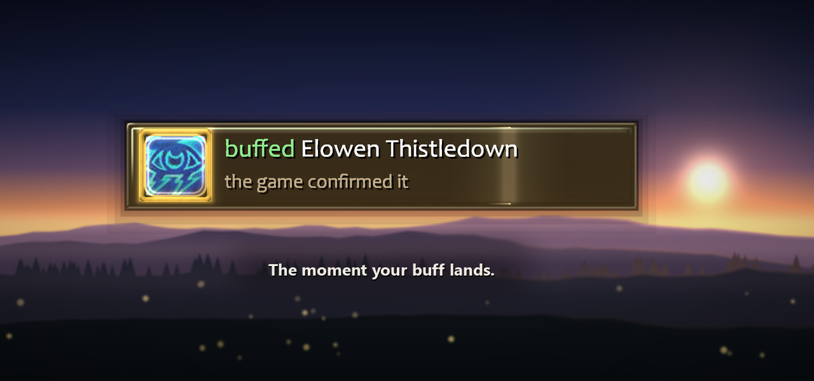
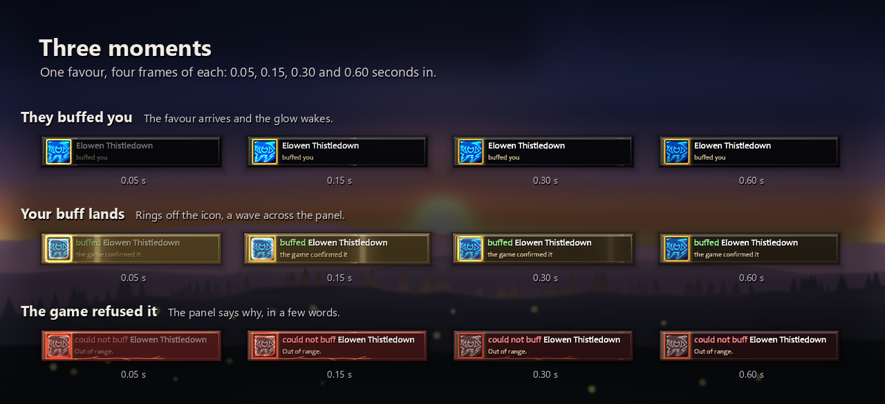
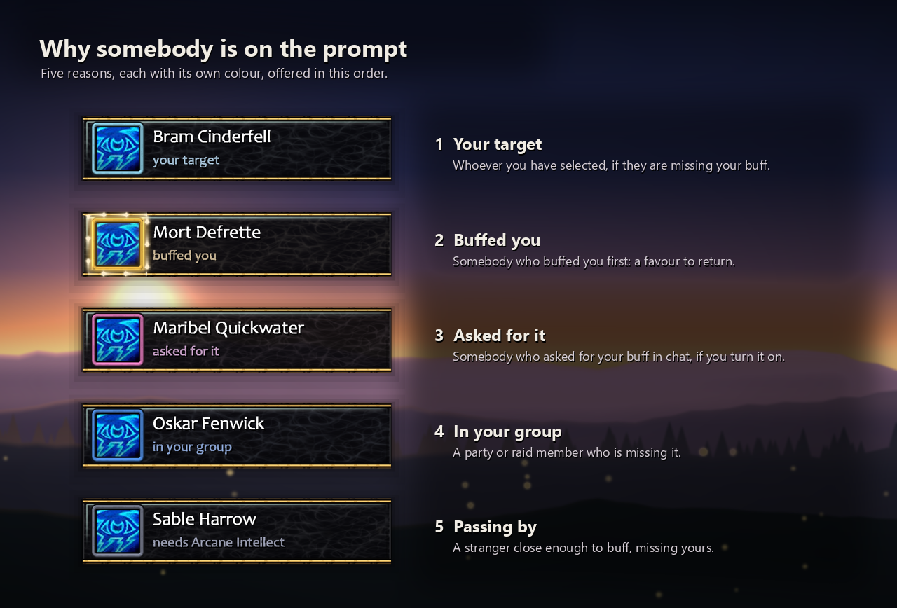
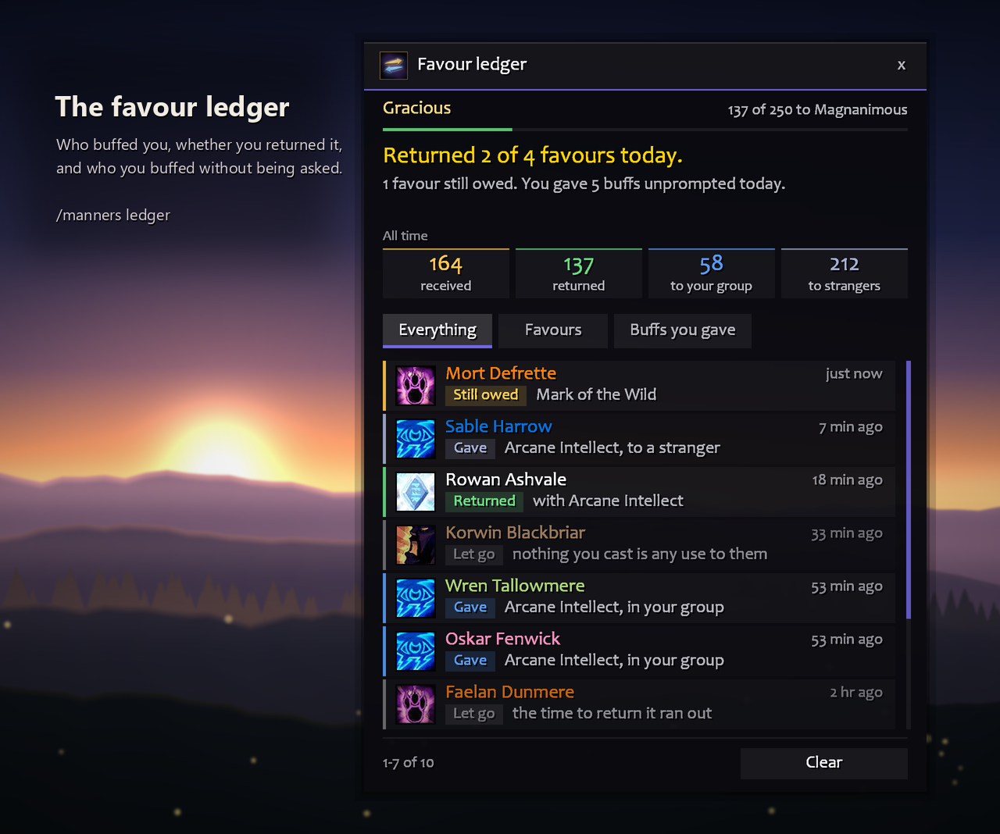
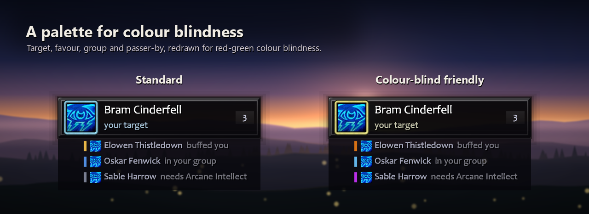
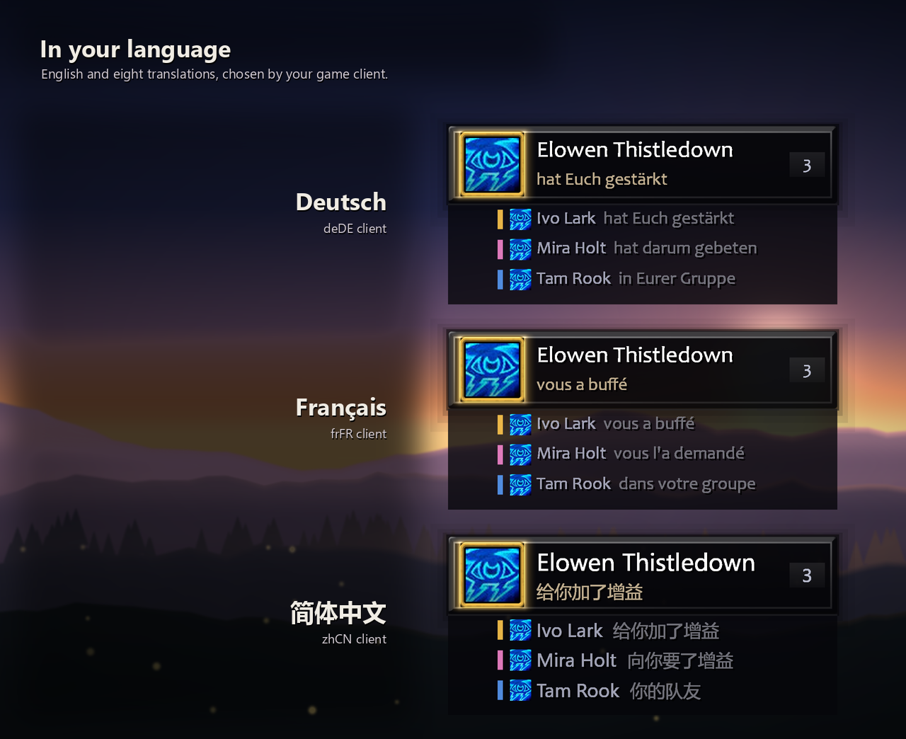

# Manners

**Somebody buffed you. One click buffs them back, and your target is handed
straight back.**

[](https://github.com/fpsacha/Manners/actions/workflows/ci.yml)
[](https://wow.curseforge.com/projects/1705364)
[](https://addons.wago.io/addons/rNkgzlNa)
[](LICENSE)





A priest buffs you in passing. By the time you have picked them out of a dozen
nameplates, they are gone. Manners saw who it was, worked out what you owe them
and put one button on screen. Click it, or press your key: they get their buff,
your own target comes straight back, and the favour is remembered through a
reload or a disconnect.

The same button offers your group, people who ask for your buff in chat, and
passers-by who are missing it, so buffing a stranger costs one click instead of
a minute of squinting at names. It looks after you too: your own armor, aura,
aspect or shield, and the poison, stone, oil or lure for each weapon, come up as
"You" when they are missing. In a dungeon or a raid it offers one group cast for
a whole party when you carry the reagent, puts your group first at a ready check
and when somebody is brought back, offers only the raid groups you were given,
and offers a top-up at the moment that suits each buff's length.

Setting it up takes one page. `/manners` opens **Start here**: two numbered
steps (who to buff, one key). The first time, two questions set the defaults
for you, or *Not now* keeps them.

Runs on every live client: **WoW Forever** 1.60.1, **Classic Era** 1.15.9,
**Burning Crusade Classic** (Anniversary) 2.5.6, **Mists of Pandaria Classic**
5.5.4 and **retail** (Midnight) 12.1.5.

## Installing

- **[Wago](https://addons.wago.io/addons/rNkgzlNa)**, and through it
  **WowUp**: search *Manners* and install. WowUp dropped CurseForge when
  Overwolf cut off third-party clients, so Wago is the one it reads.
- **[CurseForge](https://wow.curseforge.com/projects/1705364)**, and the
  CurseForge app.
- **By hand**: take a zip from
  [Releases](https://github.com/fpsacha/Manners/releases) and unzip it into
  `Interface/AddOns`.

All three carry the same build from the same tag.

> **Do not install from a clone of this repository.** `Libs/` is deliberately
> not committed (the libraries are fetched at build time), so a zip made from
> a checkout has none of them and will not load. Use a release.

## First steps

Open the options with `/manners`, or click the minimap button. The first
time, on a new profile, the window opens on **Start here** with two
questions at the top under *1. Quick setup*: *Who do you want to buff?* (people
who buff you, your group too, everyone near you, or your group kept topped
up for dungeons and raids) and *Should your character talk?* (stay silent,
just `/thank` them, a polite line, or in character). *Use these* sets them as
the choices on Start here and What I say would; *Not now* leaves everything as
it is, and the same choices wait on *Who to buff* and *What I say*. Either way
they are not asked again on that profile, and a profile you already had is
never asked. While they ask, they stand in for step 1, and *2. Put it on a key*
follows them. After that, Start here has two numbered steps, which set it up:

1. **Who to buff.** One quick choice, *Offer my buff to*, already answered:
   a new profile starts on *Everyone near me*, and the line under it says
   what that comes to. The rest is on the *Who to buff* page.
2. **Put it on a key or an action bar.** Set the key right there, or bind
   one under **Options > Keybindings > Manners** ("Buff the prompted player").
   Or press *Put Manners on an action bar* (or type `/manners macro`): the
   Manners macro is made (or put right, if it is there) and put on your
   cursor, and the line under the button says *Drop it on any action bar
   slot.* Drop it on any slot of any bar. A press of the slot, by mouse or by
   key, casts what a press of the prompt would, at whoever the prompt shows,
   and hands your target back the same way; it says no line (a line goes out
   only with a press of the prompt, which looks one last time at whether the
   cast can land). The game does not let one macro press a button that runs
   another, so the macro carries the cast itself: its first line is
   `/click MannersBar`, which tells Manners about the press, and under it
   Manners writes what the prompt would cast, out of combat, each time that
   changes. With nobody to buff, in the last moments of a global cooldown, or
   while the macro window is open, only the first line is there, and a press
   says why. In a fight the macro keeps what it held when the fight began, as
   the prompt does, and the button does nothing but say so: the game does not
   let an addon touch macros then. The macro is Manners' to write. A
   `#showtooltip` line you put on top stays; any other change by hand makes
   it yours, left as you wrote it and no longer followed (Manners says so
   once, and pressing the button again hands it back), and a macro of your
   own that clicks the prompt casts nothing.

   **The slot shows what a press would cast.** Manners tells the game which
   spell the macro stands for (or which scroll or enhancement, for the ones
   that are used from your bags), so the slot draws that spell's icon, its
   cooldown, its range and whether you can cast it, as any spell on a bar
   does. It changes only when what the prompt would cast changes, never in a
   fight (the slot then matches the button, which a fight freezes), and with
   nobody to buff it goes back to the macro's own icon, a note.

   **On a controller.** A controller button bound to the same command
   presses the prompt as a key does (the game's key bindings window offers
   the buttons once its gamepad mode is on; Manners does not need that mode
   and never switches it). The key shown on the prompt is the button as the
   game draws it, and a button held with a trigger or shoulder, which the
   game reads as Shift or Ctrl, shows the buttons you press (the left
   trigger and the face button, say). The macro on an action bar works with
   the controller's own action bar navigation like any other macro. With a
   gamepad switched on Manners opens none of the game's own menus, which the
   game's gamepad code refuses to close cleanly after an addon filled them: the
   minimap button's right click is the on/off switch, an options drop-down opens
   a list Manners draws itself, and Snooze starts or stops fifteen minutes.

Then press *Show me the prompt* at the top of the window (or type
`/manners test`) to see it where it sits. To move it, press *Move the
prompt* beside it (or type `/manners move`): the window steps aside, you
drag the prompt where you want it, and it locks itself when you let go. The
*Look* page starts with the same button and, beside it, *Where it sits*,
which has three ready-made places. The game's Edit Mode moves it too: while
Edit Mode is open the prompt is unlocked to be dragged, and it locks again
when Edit Mode closes (*Move it in Edit Mode* on *Look* switches that off). To `/thank` people or say a line when you
buff them, see *What I say*.

The first login on each character says what the addon does and what it needs
from you, once, and shows the prompt so you can see where it is.
`/manners welcome` says it again.

## What it does



Everybody who could use your buff is queued, in this order:

1. **Your target**, when the game can confirm they are missing it. A guess
   does not get to jump the queue.
2. **Your party or raid at a ready check, or just back from the dead**, when
   they are read as missing your buff or running low on it (see *Dungeons
   and raids* below).
3. **Somebody who buffed you.** Spotted by watching your own buffs appear and
   reading who cast them, which works on strangers too, as long as the game
   can still name them for you. The favour survives a reload or a
   disconnect. Somebody you buffed first who buffs you back is not owed
   anything: their buff came while yours on them still had more than its
   top-up time left (on WoW Forever, which never says who cast a buff on
   somebody else, while the buff Manners saw you give them would still be
   running). The ledger lists it as *Buffed back*, and nothing chimes.
4. **Somebody who asked for it in chat**, if you switch that on (see below).
5. **You**, when you are missing your own buff or one of your class's own
   (see *Buffing yourself* below).
6. **Your party or raid**, anyone missing your buff.
7. **Passers-by** missing your buff, seen through nameplates, your target,
   your focus and your mouseover. With the game's friendly nameplates off
   Manners sees almost nobody outside your group: *Who to buff* says so in
   red under *Passers-by*, with a red dot beside the page and a button that
   turns them on, *Start here* says the same under step 1, and a press of your
   key on an empty prompt says why it is empty.

It skips the dead, the out-of-range, anyone you just tried, anyone the buff
does nothing for (Arcane Intellect is wasted on a rogue), and, while you are not
flagged yourself, anyone flagged for PvP, since buffing them would flag you.

**On the prompt:** left-click (or your key) casts. **Right-click** skips that
person for now without marking their favour repaid; on one of your own buffs
it skips just that buff, so your next one comes up, and **Ctrl-right-click**
skips all of yours. **Shift-right-click** puts them on the never-offer list.

**The tooltip.** Hover the prompt, or a name in its list, and it says who and
what, and why they are offered, in one short line; hold Shift for everything
(who comes first and why, how long the buff lasts, what the clicks do).
*Tooltip on the prompt* on the *Look* page changes that to *Full*, to *Only
while holding Shift*, or to *Off*; the note about dragging that shows while the
prompt is unlocked stays whatever you pick. *Tooltip position* puts it above
or below the prompt, on the side with more room and clear of the prompt and
its list, or where the game puts its own tooltips. Nothing shows in a fight.

**Click any name.** With *List the next few below* on (*Look* page, off by
default), the names under the prompt are buttons of their own, each with the
icon of the buff that person would get. A left click buffs that person just as
a press on the prompt would, and hands your target back; right-click skips
them for now, shift-right-click puts them on the never-offer list. Names cannot
be clicked in a fight, when the prompt keeps what the fight found. *Click a
name in the list to buff them*, under the same heading, turns it off.

**Buffing yourself.** When you are missing the buff you give others, "You"
comes up on the prompt with "your own Arcane Intellect" under it, and a press
casts it on you and hands your target back: nothing is said, and nothing goes
in the ledger. With it come the buffs your class casts only on itself, once
you have learned them: a mage's armor, a priest's Inner Fire, a warlock's
Demon Skin or Armor, a paladin's aura and Righteous Fury, a hunter's aspect
and Trueshot Aura, a shaman's shield and weapon imbue (the full list is under *Which buffs
each class offers*).

- One at a time, your buff for others first: a mage missing both is offered
  Arcane Intellect, then the armor.
- Only when **none** of a kind is up, so the armor, aura or aspect you chose
  is never swapped for another. Only yours count: another paladin's aura on
  you does not stop the reminder. But two of the same aura do not stack, so
  Automatic passes over one that already reaches you from another paladin (or
  an Aspect of the Wild or a Trueshot Aura from another hunter) for the next
  you know, and offers nothing when there is none.
- Where your class has several of one kind, you pick one, or leave it on
  *Automatic*, which reminds you of the one you had up last (read from your
  own buffs, even if you changed it in a fight or in town). Until you have had
  one up, a mage gets Mage Armor in a dungeon or raid and Frost or Ice Armor
  elsewhere, a paladin Devotion Aura and a hunter Aspect of the Hawk.
  Automatic never picks the Cheetah or the Pack, but with either up you are
  not reminded. Righteous Fury on Automatic waits until your group role is
  tank.
- Never in a fight, and not in cities and inns unless you tick *Also in
  cities and inns*; that goes for your buff for others too. Nothing is offered
  while the game says the spell cannot be cast (a druid in cat form, a priest
  in Shadowform, a mage out of mana).
- With *Offer a top-up when it runs low*, a buff with a timer is also offered
  when it is running out; an aura or an aspect never is. Manners knows how
  long each buff lasts on your client and tops it up about a tenth of that
  before it ends (a minute before a ten-minute buff, five before an hour's),
  earlier in a raid or dungeon and for your own buffs, and only in the last
  half minute for somebody outside your group. So is Lightning Shield or
  Shadowguard down to its last charge, and Inner Fire down to its last five,
  after a fight.
- **A mage's scrolls.** *Familiar* reminds you when no familiar is with you
  and a Rat, Frog or Cat Familiar scroll is in your bags; *Weapon imbue* when
  no imbue is on the weapon in your main hand and you carry an imbue scroll
  that fits it (Lesser Flame on a staff, Chillknife on a dagger, Spark on a
  one-handed sword, and so on). A wizard oil is not an imbue: the game keeps
  the two on a weapon together, so a mage wearing an oil is still reminded of
  the imbue. A scroll is offered only once your level is up to it, with
  its own icon, and one press uses it from your bags: your target is not
  touched. Its use takes three seconds, and if moving cuts it short the scroll
  is offered again a moment later. *Automatic* takes the one you used last
  while you still have one that fits, otherwise the best your level and weapon
  allow. A top-up is of the enchant you are wearing: Spellbreak and Lesser
  Flame make the same one, so either tops it up once the other is used up. A
  mage with no scrolls sees nothing of this.
- **Weapons, one hand at a time.** On WoW Forever, Classic Era, Burning Crusade
  Classic and Mists of Pandaria Classic, when a weapon has nothing on it and a
  poison, sharpening stone, weightstone, wizard or mana oil or fishing lure that
  fits it is in your bags, "You" comes up with that item's icon, and one press
  puts it on: your target is not touched. The main hand and the off hand are
  reminded of separately, and a lure only for a fishing pole. Poisons are a
  rogue's alone, and a rogue's poisons are reminded on Mists and retail too
  (spells there, not items). Each kind has its own switch with your other own
  buffs on the *Who to buff* page. On WoW Forever a weapon wears an imbue (a
  shaman's Rockbiter Weapon, a rogue's poison, a mage's scroll imbue) and an
  oil, stone or lure at the same time, so each is reminded of on its own; a
  stone and an oil still replace each other. Manners never answers the game's
  question about replacing an enchant: that is left to you.
- **A shaman's weapon imbue.** Rockbiter, Flametongue, Frostbrand and Windfury
  Weapon are one family, *Weapon imbue*, under *Myself* on *Who to buff* (Classic
  Era, Burning Crusade, WoW Forever and Mists, with each client's own imbues).
  With none of them on the weapon in your main hand, "You" comes up
  with the first one you know, Windfury ahead of the rest, and a press casts it;
  an imbue already on the weapon, whichever, ends the reminder, and a poison,
  stone or oil does not count as one. Pick one in the drop-down to be reminded
  of that alone, or *Don't remind me*. On retail the main hand (Windfury,
  Flametongue, Earthliving) and the off hand (Flametongue once a weapon is in
  your off hand, or Thunderstrike Ward once a shield is) each have a switch of
  their own.
- **Well Fed.** Off until you switch it on (*Well Fed*, under *Myself* on
  *Who to buff*, for every class): then, with a food in your bags that gives
  the *Well Fed* buff and none on you, "You" comes up with that food's icon and
  one press eats it. The best one you are high enough for is offered first.
  Nothing is offered while you are eating, mounted or in a fight, or while any
  Well Fed is on you, whoever's food it was. A food you keep for something
  else (a fishing food, say) can be ticked under *Never remind me about*, which
  lists the foods in your bags: Automatic passes it over and offers the next.
  A meal cut short (you moved, stood up or were pulled) with no Well Fed to
  show for it brings the reminder back at once.
  Classic Era, Burning Crusade, Mists and WoW Forever; not retail.
- **Well-Rested.** For the Cozy Sleeping Bag: a switch under *Myself*, shown
  while the bag is in your bags, off until you switch it on. Then, with no
  *Well-Rested* on you, "You" comes up with the bag's icon and one press lays
  it down; rest in it a minute for the buff. Nothing is offered at the level
  cap, where there is no experience to gain, while you lie in the bag, during
  the hour its use cools down, while you eat, mounted or in a fight. Classic
  Era and WoW Forever.
- **Companion pet.** A switch under *Myself*, shown while you have a pet,
  off until you switch it on. On WoW Forever, with no pet out, Manners brings
  one out of your pet journal itself, with no press: *Which pet* picks the
  one you had out last, a random favourite or any pet. (A pet item you have
  not used yet teaches you the pet: use it once and it is in the journal.) A
  pet you use from your bags each time (every pet on Classic Era and Burning
  Crusade, a handful on Forever) comes up on the prompt as "You", and one
  press brings it out; Manners keeps count of it itself, since the game does
  not say whether one is out: death, a loading screen or a flight takes it, a
  `/reload` does not. Never in a fight, a dungeon, a raid, a battleground or
  an arena, nor while you are mounted, stealthed, dead, flying or casting. A
  pet you put away (its item used again, *Dismiss*, or the journal's button)
  stays away until you bring one out yourself. Should the game not let
  Manners use the journal, it stops trying for the session and says so in
  `/manners debug`. WoW Forever, Classic Era and Burning Crusade.
- **Detect Invisibility.** For warlocks: a switch under *Myself*, off until you
  switch it on. Then, with no Detect Invisibility on you (yours or another
  warlock's), "You" comes up and one press casts it on you. Classic Era, WoW
  Forever and Burning Crusade.
- **Unending Breath while swimming.** For warlocks: a switch under *Myself*,
  on by default. While you swim with no Unending Breath on you (yours or
  another warlock's, or a shaman's Water Breathing), "You" comes up and one
  press casts it on you. On dry land it is never offered, and a fight in the
  water holds it until the fight ends. Its switch is apart from the one for
  casting Unending Breath on others. Every client.
- **Flasks, elixirs and scrolls.** *Flask*, *Elixir* and one switch per scroll
  (Agility, Strength, Protection, Intellect, Stamina, Spirit) under *Myself*,
  each shown once you carry one and off until you switch it on. Then, with
  none of that kind on you, "You" comes up with the best one you can use, and
  one press uses it on you. A flask that works only in some places
  (Shattrath's, the nightmare ones) comes last. On Burning Crusade and Mists a
  flask fills both elixir slots, so it counts for *Elixir* too; on Mists so do
  the Alchemist's Flask and the Crystal of Insanity, and a scroll takes a
  Battle or Guardian elixir slot. A Scroll of Intellect, Stamina or Spirit
  waits while the class buff of the same stat is on you, unless that is a
  weaker rank than the scroll. Nothing is offered mounted or in a fight.
  Classic Era (Season of Discovery's too, and Mageblood Potion, the Troll's
  Blood potions and Gift of Arthas count as elixirs), WoW Forever, Burning
  Crusade and Mists. On retail, *Flask* alone, for every class: Midnight's and
  The War Within's flasks, the better quality first.
- **Scrolls, all at once.** *Scrolls*, under *Myself* on *Who to buff* and on
  by default, covers every scroll: the six stat scrolls and, on WoW Forever, a
  mage's *Familiar* and *Weapon imbue*. Switch it off and no scroll is offered
  and their switches leave the page; switch it back on and each is as you left
  it. It shows while you carry a scroll or have one switched on, and while it
  is off. Not on retail, which has no scrolls.
- **Forms.** Shadowform, Moonkin Form and Tree of Life are reminded of like
  any other buff of yours, and a druid's form never while you are in another
  one (cat, bear, travel). Moonkin Form comes before Tree of Life, and on
  Classic Era and Burning Crusade it waits while your group still needs your
  Mark of the Wild.
- **Tracking.** Find Herbs, Find Minerals, Find Treasure, a hunter's Track
  Beasts and the other tracking skills are one kind, *Tracking*, reminded of
  when none is on (after you die, say); *Automatic* takes the one you had on
  last. On WoW Forever a dwarf can keep Find Treasure on beside Find Herbs or
  Find Minerals, so there it has a switch of its own, *Find Treasure*: once
  you have had it on, it is reminded of whenever it is off, and a gathering
  tracking is still reminded of while Find Treasure is on. A dwarf who never
  turns it on is never asked to.
- *Save mana* holds you back only when *Below it, still offer* is *Nothing*,
  and *Raid groups I buff* never does. In a party you count towards a group
  buff, and the group cast covers you.
- A warrior's Battle Shout already covers the warrior (unless *Remind me of my
  shout when I'm alone* is on and you are in no group) and nobody needs Unending Breath
  on dry land, so neither is offered to you. A paladin wearing one of their
  own blessings is not offered another.
- Right-click "You" to skip that buff for now: your next own buff comes up in
  its place. Ctrl-right-click skips all of your own buffs for now, and *Skip
  for now* in the minimap menu skips the one buff. Shift-right-click switches
  *Myself* off, since the never-offer list is for other people, and chat says
  where to switch it back on.
- `/manners debug`, and the lines under *Myself* on the *Who to buff* page,
  say which of your own buffs is up, which is due, and why one is not being
  offered.

**Group buffs.** Once you know the group version of your buff (Arcane
Brilliance, Prayer of Fortitude, Prayer of Spirit, Prayer of Shadow
Protection, Gift of the Wild) and carry its reagent, a party with enough
people missing it gets one cast instead of one each. Three is the default,
and *When this many need it* sets 2 to 5. In a raid the whole raid is
counted together, because on WoW Forever the spell reaches everybody in
your party and raid within 100 yards. A paladin's Greater Blessings go by
class across the group instead, and are held back while anybody of that
class carries another of your blessings, which the Greater one would
replace. The prompt names who it is for ("Your party", "Your raid",
"Every Warrior") and why ("Arcane Brilliance -- 4 missing", "4 running
out"), and the tooltip counts your reagents. A
right-click skips the cast for the whole group; a shift-right-click puts only
the person it is aimed at on the never-offer list. Short of mana for the
group spell, you are offered the single one. With the chat lines on, chat
says when you are down to 5 reagents and when you run out, after which the
prompt goes back to one person at a time. With the Legacy perk Reagent
Economy you need no reagent at all: the group cast is offered with none in
your bags, and the tooltip says no reagent is needed. Nothing changes until
you have learned a group buff and carry its reagent or have the perk.

**Dungeons and raids.**

- *My group first at a ready check*: from the check until the pull (or a
  minute after everybody has answered, if nobody pulls), your party or raid
  goes to the front, behind only your own target. The prompt says "ready
  check".
- *Group members just revived first*: for two minutes after somebody in your
  group is brought back, they go to the front. A hunter getting up from Feign
  Death does not count.
- Both are on by default and only change the order: nobody is added, and
  only somebody whose buffs were read goes forward.
- *Raid groups I buff*: untick the groups you were not assigned. In a raid,
  their members are offered only if they buffed you, asked, or you target or
  focus them. `/manners debug` lists the groups still ticked, even outside a
  raid, so you can check before the pull.
- *Save mana: stop below (% mana)*, off by default: below it, your group,
  your target and passers-by wait until your mana is 5 points above it, so
  the prompt does not flicker between casts. *Below it, still offer*, under
  the slider, says what still comes up meanwhile: *People who buffed me or
  asked* (the default: favours, requests and your own buffs), *Only my own
  buff*, or *Nothing*. A favour held back stays owed and is offered once your
  mana is back, if there is time left to return it. The tooltip, a press on
  the empty prompt and `/manners debug` say what is held back and when it
  comes back.
- In a raid group, a battleground or an arena the "buffed you" chat line is
  not printed, and in a dungeon it waits out the fight. The favour is still
  noticed and offered. A group member whose buff lands again every few
  minutes (a warrior's shout) gets the line once in half an hour. Anybody who
  buffed you, a passer-by included, is not offered back while they wear your
  own buff with more than the top-up time left: there is nothing to repay.

**Never offer.** People on the list are never offered anything, as passers-by
or as group members. Somebody on it who buffs you is still offered the favour
back, because returning a favour is the point; shift-right-click them again to
let that favour go. Your `/ignore` list goes further: nobody on it is
thanked, offered a favour back or offered as a passer-by, though a group
member on it still is. The list is on the *Who to skip* page, and `/manners never`
and `/manners allow <name>` work from chat. In a fight the prompt cannot move
off the person it is showing, so a press still casts at them until the fight
ends, and chat says so.

**Friends and guildmates first.** A friend (Battle.net friends included) or
guildmate goes ahead of the other passers-by, or of the rest of your group. It
only changes the order: people who buffed you still come first, and somebody
known to be out of range never leads over somebody in range.

**Guilds.** *Leave out these guilds*, on the *Who to skip* page, is a box for
guild names, one a line, typed as the game shows a guild under a player (the
< > are optional, capitals do not matter; your own guild's name works too).
Nobody in those guilds is offered anything, in your group or as a passer-by.
People who buffed you or asked, and your target and focus, are still offered.
*Show their guild under the name*, on the *Look* page, writes the guild
as <Name> after the reason on the second line and in the tooltip, which is a
quick way to see which name to type. A guild the game has not told Manners yet
is read as none, so nobody is left out on a guess.

**Classes.** *Classes I buff as passers-by*, also on *Who to skip*, is a grid
of the classes, all ticked. Untick one and its passers-by are not offered your
buff, nor remembered for it. Your group, people who buffed you or asked, and
your target and focus are offered whatever their class.

**People who ask me for it.** Off by default, because reading chat is
guesswork. Somebody who asks for your buff in `/say`, `/yell`, group chat or a
whisper ("int pls", "fort?", "can I get motw", or the spell's name in your
language) is offered it for the next minute, after people who buffed you and
before your group. Nothing is ever said back. What counts:

- eight words at most, naming the buff as a whole word, with nothing like
  *no* or *not* in it;
- a please, a question mark, an opener like *can I* or *anyone*, or nothing
  but the buff's name;
- beside a nickname (*int*, *fort*) or *buff*, only small words like *me*,
  *get* or *pls*, so "int the healer" asks for nothing;
- words English uses for other things (*might*, *mark*, *wisdom*, *spirit*,
  *shadow*) need a please or to stand alone, and never count in group chat;
- nobody of your own class counts as asking (another mage saying "anyone need
  int?" is offering it), and nothing said in a fight counts unless it was
  whispered. A request still waiting when a fight starts waits until it ends.

They must still lack the buff and be somebody the game can see.
`/manners debug` lists the requests still standing.

**Snooze, and hiding while mounted.** `/manners snooze` hides the prompt for
15 minutes; `snooze 5`, `snooze 1h` (up to four hours) or `snooze off` for
your own. The minimap menu and the *Snooze* button at the top of the options
window have it too. Favours are still noticed while snoozed. A `/reload` ends
a snooze, and one started in a fight takes effect when the fight ends. *Hide
the prompt while I'm mounted* (When to offer page, off by default) keeps the
prompt away while you ride and brings it back when you get off. Press the key
while either is hiding the prompt and chat says which.

## The favour ledger



Who buffed you, with what and when, whether you returned it, and who you
buffed without being asked, newest first. Today's count ("Returned 12 of 14
favours today") and the all-time totals sit at the top, then tabs for
everything, favours, and buffs you gave. A favour you did not return says why:
the time ran out, nothing you cast helps them, or you put them on the
never-offer list. A buff from somebody returning one of yours says *Buffed
back*: nothing is owed for it, and it is not counted among the favours to
return. Hover a favour still owed and it says whether the prompt will offer
it, and when. A group buff counts as one buff given and says how many
who needed it got it; the favours it returned are marked returned.

**Titles.** Favours you return earn you a title: *Well Brought Up* at 10, then
*Well Mannered*, *Courteous*, *Gracious* at 100, *Magnanimous*, *Paragon of
Etiquette* and, at 1,000, *The Very Soul of Courtesy*. The one you hold sits at
the top of the ledger with how far you are from the next ("37 of 50 to
Courteous"), and in the minimap tooltip. A new title gets one line in chat,
once, even with chat lines off; a character that had earned some before titles
existed simply has them.

`/manners ledger`, a shift-click on the minimap button, or *Open the ledger* on
the Start here page, where it opens above the options. It keeps the last 200
entries per character; *Clear* empties the list and today's count but keeps
favours still owed, the all-time totals and your title. It opens in combat,
and the only thing it ever says in chat is a new title.

## The prompt's look

Twelve looks, each a card under Look > *Panel style* that you click to switch:

- **Glass** (the default): a dark pane of cut glass, the spell icon set in a
  metal bezel that brightens under the pointer.
- **Framed**: a flat dark panel in a thin rim, like the game's tooltips.
- **Minimal**: the words alone, no panel.
- **Luxe**: a slim dark card with a spine in the reason colour.
- **Toast**: a warm banner and a gilded medallion, the gold hammered and worn,
  the icon's ring a twist of rope.
- **Arcane**: smoked glass with a rim lit by the reason.
- **Ribbon**: a crimson ribbon and a gold medallion.
- **Letter**: parchment and a red wax seal.
- **Leather**: a stitched leather tag with a brass ring.
- **Forge**: forged iron and a riveted band, the reason glowing in a slot beside
  the icon like a bar of heated steel.
- **Archmage**: a violet crystal cut to a point at each end, your spell set in
  a hexagon of six arcane charges that light one by one when somebody buffs
  you, travel round while you owe them and discharge in lightning when your
  buff lands. The crystal sparkles at rest; *Animations* on *Calm* stills it.
  The icon is always a hexagon on this look.
- **Lightbringer**: a paladin's plate of silver and royal-blue enamel, your
  spell in a golden sun. A pillar of light comes down when somebody buffs
  you, the sun breathes while you owe them, and wings of light spread when
  your buff lands. The sun turns slowly at rest; *Animations* on *Calm* stills
  it. The icon is always round on this look.

Pick your own colours and fonts too; LibSharedMedia is supported.

On Glass, Framed and Minimal the prompt has a way of arriving and of answering.
As it comes up, two thin rules of light draw out from the icon along its top and
bottom edges and the words follow a beat behind; a favour arriving runs a glint
along them. When a buff lands, a ring pops out of the icon, a wave of light
crosses the panel and the panel's edge lights in the reason's colour (Minimal,
which has no edge, lights its two rules instead). When the game refuses it, the
edge flashes red, a crack runs under the words, the icon turns grey and the text
shakes. The other looks answer in ways of their own. The prompt fades out after
your last buff, and the icon shows the global cooldown sweep, like an action
bar.

**Text follows the panel.** Leave the text colour at white and it turns dark
by itself on a light panel colour, and class-coloured names that would vanish
on it are darkened too. Any other text colour is used exactly as picked. The
minimal look outlines its text so it reads over snow as well as in the dark.

**A colour-blind palette.** *Colour set*, under Look > Style, swaps the
four reason colours for pale yellow, orange, sky blue and violet, which stay
apart under protanopia and deuteranopia.



Set *Animations* to *Calm* for none of that movement. *Hide the prompt in
combat* takes the prompt and its list off the screen for the whole fight, and
nothing casts from them meanwhile: not its key, not a name in the list, not
the Manners macro on your bar. It comes back when the fight ends. With it off,
*No flashes in combat* keeps the prompt on screen in a fight with no flashes,
and *Dim the prompt in combat* draws Glass, Framed and Minimal at about half
strength while one lasts.

## The minimap button

A click opens the options, a shift-click the ledger, and a middle click
switches Manners on or off. Right-click for a menu: on or off, snooze (5
minutes to an hour), who is next (skip one, or never offer them anything), the
ledger, a preview, the prompt's lock, position, sound and effects, the chat
lines, and your profiles when you have more than one. In a fight the entries
that would move the prompt wait until it ends.

The icon dims while snoozed and goes darker still while off. A broker display
shows how many people who buffed you are still waiting. The same launcher is in
the **addon compartment** under the minimap, so hiding the button loses
nothing.

## The options

`/manners` opens the options window on the page you used last (*Start here*
the first time). Drag it by its title bar; Esc closes it. The game's own
**Options > AddOns > Manners** has a button that opens it too. Most settings
explain themselves; this is what their tooltips have no room for.

**On every page.**

- Along the top: *Show me the prompt*, *Move the prompt* (it reads *Lock it*
  while the prompt is unlocked; the game does not let a prompt be moved in a
  fight), *Snooze* (5, 15 or 30 minutes; while one runs the button says until
  when, and its menu can stop it) and *Manners is on*. A character with
  nothing for the prompt to show (a rogue with no poison in the bags, say) has
  only the switch.
- Under them, a line appears only while something keeps the prompt from
  doing what you would expect: Manners is off, the prompt is unlocked (with
  *Lock it* at the end of the line), a snooze is running, nothing can be
  offered, or the prompt is kept away while you are mounted. In a fight it
  also says that the changes on the open page wait for the fight to end.
- On the left, the pages: *Start here*; *Who to buff*, *Who to skip*, *When
  to offer*, *What I say*, *Look*; *Profiles*, with the profile in use under
  its name, and *Diagnostics*. A page with nothing for your character is left
  out, so a rogue with no poison in the bags has *Start here*, *What I say*
  (with only the `/thank` on it), *Profiles* and *Diagnostics*. A class with
  nothing to cast for others (a retail death knight, say) keeps *Who to buff*,
  with *Myself* and the switch alone, while a flask is in its bags or that
  switch is on, and *Start here* says where to find it. A red dot
  beside a page means something there wants looking at: nothing that can be
  offered, passers-by on with the game's friendly nameplates off, *Always
  offer* picked, a sound set to *None*, a colour with nothing left to colour,
  or something broken this session. A key binding is optional,
  so no red dot asks for one.
- The search box above the pages finds a setting by its name, its tooltip,
  one of its choices ("whisper" finds *Where to say it*) or the section it is
  in, capitals or not, in every language Manners is translated into. Pick a
  result (Enter takes the first) and the window goes there, opens the
  section it is in and flashes it.
- *Who to buff*, *Who to skip* and *When to offer* open on a grey line saying
  who the prompt is on right now and why, and how many more are waiting. It
  keeps up with the prompt while the window is open, and when nobody is on it
  says why: Manners is off, the prompt is unlocked, snoozed or kept away while
  you are mounted, or a fight is on and nobody new comes on until it ends.
- A greyed-out setting says under itself, and in its tooltip, which switch
  greys it ("Off while ... is on.", "Needs ... ticked.").
- The search box finds whole words, not pieces of them, says when there are
  more results than it shows, and finds a setting hidden behind a switch (it
  says which to turn on first). "quiet", "mute" or "spam" finds the chat
  switches.
- Each page starts with what most people change. Under a thin line, "The
  defaults suit most players; change these only if something bothers you.",
  come folded sections for fine-tuning: click one to open it, and it is still
  open next time. A gold dot on a folded section means something in it is not
  at its default.
- *Reset this page*, bottom left, resets the page you are on, after
  asking. It keeps where the prompt sits and its lock, the lines you wrote,
  the never-offer list, your key and *Manners is on*. *Start here*,
  *Profiles* and *Diagnostics* have no reset. The version number sits at the
  bottom too, for bug reports.
- A change on *Look* shows on the prompt itself: while you drag a slider
  there, and for a moment after any other change, the window fades so you can
  see the prompt behind it. Resting the pointer on *Show me the prompt* while
  the prompt is showing does the same. Opening *Look* out of a fight shows
  the prompt.

**Start here.** The two steps, the favour ledger, *Minimap and chat window*,
and *Show the welcome again* at the bottom.

- *1. Quick setup*, at the top, only on a profile that has never been set up
  (see *First steps*): the quick choices of step 1 and of *What I say*, put as
  two questions, with *Use these* and *Not now*, in place of step 1 while they
  ask. A class with nothing to give is not asked.

- *1. Who to buff*: *Offer my buff to* is a quick choice. *Only people who buff
  me*; *People who buff me, and my group*; *Everyone near me* (a new profile's
  defaults); or *My group, kept topped up (dungeons and raids)*, which also
  offers a top-up when a buff runs low. Each sets a few switches on *Who to
  buff* and *When to offer*, and the grey line under it says what they add up
  to. *Only people who buff me* also switches *Myself* off, and the other three
  switch it on. It never touches *People who ask me in chat*, the group buffs
  or who comes first. When the switches match none of the four, it reads
  *Custom (changed by hand)*. A hunter or a shaman, with nothing to give
  anybody else, gets no choice here, just a line naming the buffs of their own
  the prompt reminds them of.
- *2. Put it on a key*: the key is saved with your game key bindings, so it
  follows every profile. *Put Manners on an action bar* puts the macro on
  your cursor to drop on a bar (where the game would not carry it, it opens the
  macro window, so the macro is there to drag). The line under them says
  whether you are ready.
- *Minimap and chat window*: the minimap button, and *Show what Manners is doing in my
  chat window*. That is a line in your own chat when somebody buffs you, when a
  favour is repaid, and when a click fails. Use it to tell "the buff was never
  noticed" from "it was noticed but they could not be reached"; nothing from
  it is ever said to anybody else. Off, a press on an empty prompt says nothing
  either. *Hide all Manners messages in my chat window*, under it (it greys the
  first), silences even the few lines
  that switch leaves (a title earned, the game refusing somebody, a skip in a
  fight); what you type after `/manners` is still answered.

**Who to buff.**

- *Buff to offer*: automatic, or pin one spell. A pinned spell is the only one
  considered, so if you have not learned it there is nothing to fall back to.
  Where a class has several buffs, automatic offers whichever one they are
  missing, in list order: a priest walks Fortitude, then Divine Spirit, then
  Shadow Protection. Under it, one switch per buff; untick one to never offer
  it. A class with a single buff reads "You offer Arcane Intellect." instead
  of a dropdown.
- *Automatic for paladins*: blessings overwrite one another, so anybody
  already carrying one of yours is left alone rather than handed a different
  one. The pick is Wisdom for anyone with a mana bar and Might for everyone
  else. Under *Always offer*, or where the game hides which blessing they
  carry, the first blessing that suits them is offered, and it can replace
  yours.
- *Buff order*: for a class with more than one buff to give, the buffs as a
  list in the order they are tried, each with an arrow up and an arrow down
  (a class with one buff, or one spell pinned, has none). Move one and the
  order is yours: *Blessing of Kings first* goes from the page, since the
  order is what it meant, and *Back to Automatic* puts it all back. The order
  decides what somebody who wears none of your buffs is offered, and what
  somebody wearing another player's is offered next. Anybody wearing one of
  yours is left alone whatever the order, and Greater Blessings follow it.
- *Offer my buff to*: *People who buff me*, *My party and raid*, *Passers-by
  (players near me, not in my group)* and *People who ask me in chat*.
- *Passers-by within*: *Anywhere I can cast* (about thirty yards), *Nearby*
  (about ten, the default) or *Right beside me* (about five). Only passers-by
  are measured: somebody who buffed you was close enough a moment ago, and
  your group and whoever you targeted or focused were picked on purpose. The
  game gives no exact distance, so this lands on the nearest step the client
  can measure (LibRangeCheck, or the client's interact distance); where
  nothing can measure, everybody in casting range is offered.
- *Only in cities and inns*: off by default. Out in the world passers-by are
  left alone; everybody else is still offered. Greyed while *Offer nothing in
  cities and inns* (on *When to offer*) is on.
- *Skip players another paladin has blessed* (paladins, with the switches for
  each blessing; *Blessing of Kings first* now heads *Buff order*):
  off by default. Anybody carrying any blessing from another paladin is left
  alone, even one yours would stack with; somebody who asks you for a blessing
  by name is still offered it.
- *Don't offer Might to mages, warlocks and priests* (paladins): off by
  default. Blessing of Might does nothing for those three, so with the switch on
  it is left out of the walk for them: a mage whose Wisdom is another paladin's
  or running low is offered Kings or left alone, not Might. Everybody else,
  druids, shamans and hunters included, is offered it as before, and somebody
  who asks you for it by name still gets it.
- *Don't put Kings over a Fish Bowl's Boosted Stats* (paladins, WoW Forever):
  off by default. Sitting by a camp's Fish Bowl gives Boosted Stats, 8% to all
  stats, and Blessing of Kings replaces it. With the switch on, somebody
  wearing it is offered your Might or Wisdom first, and Kings only when
  nothing else of yours is missing for them.
- *Myself* (see *Buffing yourself* above): *Myself, when I'm missing my own
  buff*, on by default, switches everything on yourself on or off. Under it,
  one control for each of your class's own buffs you have learned: a
  drop-down where there is a choice (a mage's *Armor*, a paladin's *Aura*, a
  hunter's *Aspect*, a shaman's *Shield*) with *Automatic*, each spell you
  know and *Don't remind me*, and a checkbox for a buff on its own. Under
  them, *Never remind me about* has a box for each spell of those families you
  know: a ticked spell (one tracking skill, say) is skipped by *Automatic*,
  which offers the next of its kind instead, and is never offered at all, even
  when you picked it. Automatic
  says what it would pick right now, such as *Automatic (Mage Armor, the one
  you had up last)*. Righteous Fury's is *Automatic (only while I'm the
  tank)*, *Always* or *Don't remind me*. A mage carrying scrolls also gets
  *Familiar* and *Weapon imbue*, which list every scroll of their kind, carried
  or not; one picked with none in your bags waits until you have one, and one
  picked above your level (a profile shared with a higher mage) gives way to
  *Automatic* until you reach it. A poison, stone, oil or lure for a weapon
  has a switch of its own per kind (*Weapons, one hand at a time*, above). So
  does *Well Fed*, which every class has and which starts off. Alone, a stone,
  oil or poison is offered again only once it has worn off; in a group, with
  top-ups on, it is renewed ahead of the next pull.
  So do *Flask*, *Elixir* and each scroll, which start off too. *Scrolls*, on
  by default, switches every scroll off at once and takes their switches off
  the page until it is on again (*Scrolls, all at once*, above).
  Then *Also in cities and inns*, off by default, and *Consumables only in
  dungeons and raids*, also off, which keeps the oils, stones, food, flasks,
  elixirs and scrolls out of the open world (poisons and lures are not held
  back), then, for a warrior only, *Remind me of my shout when I'm alone*,
  off by default: with nobody in your group, Battle Shout is offered to you
  too when it is missing or running low (in a group it covers you already),
  in a fight as well, where nothing else of your own is offered,
  then *Put consumables on a button of their own*, off by default: food,
  flasks, elixirs, scrolls and your weapon's oils, stones and poisons leave
  the prompt for a small button of their own, which you drag where you want
  it while the prompt is unlocked; it has its own key under Key Bindings and
  its size on *Look*, a left-click uses the item, a right-click skips it for
  your skip time, and it never shows in a fight,
  and last what each of your
  own buffs is doing and why one is not being offered. On retail, a class with
  nothing of its own to put on does not see this part; everywhere else every
  class does, for *Well Fed*, and a hunter, a shaman or a rogue sees only this
  part of the page.
- *My group and raid*: *Use group buffs* and *When this many need it* (see
  *Group buffs* above), with how many reagents are in your bags, shown only
  to classes with a group buff; and *Raid groups I buff*.
- *Who comes first* (folded): *My target first*, *Friends and guildmates
  first*, *My group first at a ready check* and *Group members just revived
  first*. With *My target first* off, or under *Always offer* (nothing is read
  then), your target is ranked by why they are on the list like anybody else.
  A targeted stranger whose buffs cannot be read counts as a passer-by, so a
  friend goes ahead of them.

**Who to skip.** The switches that leave people out, and the never-offer
list. They used to be at the bottom of *Who to buff*.

- *Skip players flagged for PvP* (on): buffing somebody flagged flags you too,
  so while you are not flagged, nobody flagged is offered -- not even a favour
  back, which waits for their flag to drop. It steps aside while you are
  flagged yourself, as in a battleground, but not while your own flag is
  running out, since a buff would start it again. A group spell or a shout
  that would land on somebody flagged is held back too, and so, on Mists of
  Pandaria Classic and retail, is a buff for anybody in your party or raid,
  you included, since there it lands on all of you. Your class's own, such as
  an armor, land on you alone and are still offered. Under it, who it is
  holding back right now.
- *Skip my own class when they can cast it too*: off by default. Another mage
  can give themselves Arcane Intellect, so they are left out, unless they are
  too low a level for the rank you cast. Somebody who buffed you, asked, or
  you targeted is always offered. Every priest and paladin trains Divine
  Spirit and Kings on WoW Forever, so those are skipped the same way.
- *Skip players out of range*: where the spell's own range check has nothing
  to say, the game's follow distance (about 28 yards) is asked instead. Where
  nothing can tell, they are still offered. A group member the game cannot see
  at all (still in town, or far off in the instance) is left out. Whoever the
  game has just answered *Out of range* for stays off the prompt for ten
  seconds.
- *Skip players below level*: read off the unit, so somebody known only by
  name (the usual case for a passer-by who buffed you) cannot be checked and
  is offered anyway.
- *Never offer*: one row per name, with an X to take it off, then a box to
  add a name and *Clear the list*.

**When to offer.**

- *Hold back*, at the top:
  - *Offer nothing in cities and inns*: off by default. While the game calls
    you resting, in a city or an inn, nothing is offered to anybody: not
    passers-by, not your group, not a favour you owe. Somebody you target or
    focus still is. Your own buffs have their own switch under *Myself* on
    *Who to buff*.
    - *Where*, under it: *Cities and inns* (the default), *Cities only* or
      *Inns only*. A city is one of the capitals (Stormwind, Orgrimmar,
      Shattrath, Dalaran, the Shrines, Valdrakken, Dornogal and the rest, as
      each game has them), read from the map you are on; an inn is anywhere
      else the game calls you resting. When the game will not say which map
      you are on, both count.
  - *Offer nothing in dungeons, raids and battlegrounds*: off by default. The
    same rule inside a dungeon, a raid, a battleground or an arena: nothing
    for anybody but somebody you target or focus. Your own buffs are not held
    back.
  - *Hold back my target and focus too*: off by default. With either rule
    above on, it leaves the person you target or focus alone in a city, an inn
    or an instance as well.
- *Other people already buffed* (*Already buffed* for a class with nothing for
  others):
  *If they already have it*: *Skip them*, *Offer a top-up when it runs low*
  (then *Top up at most this many minutes early*, the longest it
  will ever wait, and *In a raid or dungeon, top up this many times earlier*),
  or *Always offer*. *Diagnostics* and `/manners debug` list when a top-up is
  due for each of your buffs.
- *My own buffs*: *Top up my own buffs before they run out* (on): your own
  buffs, and the ones you put on yourself, are offered again shortly before
  they end, whichever of the three above you pick for other people. *Remind
  me this many minutes early* sets the moment itself (0 works it out from
  the buff's length, and the line under the slider says so): earlier, so a
  ten-minute Thorns can come back before you pull, or later, 1 for a minute's
  notice of a Fortitude or 0.5 for thirty seconds of an oil. It holds in a
  dungeon or raid too, and is never more than half the buff's length ahead.
  Somebody who buffed you is offered the favour back whichever you pick. Your
  own buffs are always read, so you are never offered one you are wearing;
  a top-up reaches them too, but never an aura or an aspect. A rank below
  the one your cast would land (a level-60 wearing Fortitude's second rank)
  counts as not having it, for you and for them.
- *Don't offer when the game hides their buffs (fights)* (off): in a fight, and
  sometimes just after, the game hides other players' buffs, and Manners
  offers your buff marked *unverified*. With this on, nobody is offered
  unverified; somebody who buffed you or asked for a buff still is. Off,
  nobody is offered unverified in the first five seconds after a fight
  either, while Manners reads everybody again. Not shown under *Always
  offer*, which reads nothing.
- *Hide the prompt while I'm mounted*: dead, on a flight path or in a vehicle
  the prompt already stays away, because nothing can be cast there.
- *Save mana: stop below (% mana)*: 0 is off (see *Dungeons and raids*
  above). Classes without mana do not see it, and nor do hunters and shamans,
  whose prompt is for their own buffs alone.
  - *Below it, still offer*: *People who buffed me or asked* (default),
    *Only my own buff* or *Nothing*. Greyed while the floor is 0.
- *Buffing back*: how long somebody who buffed you is offered one back.
  - *Offer a buff back for (seconds)* (120): somebody the game can still see
    stays on the prompt this long; somebody it cannot see is let go sooner,
    when *Let them go after* is shorter.
  - *Count only class buffs as favours*: only class buffs such as
    Fortitude, a Fear Ward or a Soulstone count as a favour to return, or to
    `/thank`. A paladin's aura, a hunter's aspect or Trueshot Aura reaching
    you never counts, ticked or not.
  - *Stop sooner if they are probably gone* and *Let them go after (seconds)*
    (45): somebody who buffed you is rarely your target or on a nameplate, so
    all that is known is that they were in range when they buffed you. The
    clock runs from their buff, because nothing can see a player walk off.
  - *Keep favours through a /reload*: for a favour noticed a minute before a
    disconnect. The clock keeps running while you are away.
- *Timing* (folded): *Don't repeat a spell on someone for (seconds)* is per
  spell, so after Fortitude the next scan can still offer Divine Spirit.
  *A right-click skips for (seconds)* (12 by default, up to half an hour) is
  how long a right-click on the prompt, or *Not now* in its menu, blocks the
  whole person, or that one buff of yours. *Check for
  people every (seconds)* is how often Manners looks around.
- *Targeting* (folded): *Hand my target back afterwards*. The prompt targets
  everybody it buffs, group members too, because a named conditional
  (`[@name]`) only reaches your own party or raid and most people on the
  prompt are passers-by. With this on, the macro ends with
  `/targetlasttarget`, except outside a fight for somebody already your
  target, who stays targeted. With nothing targeted when it is armed, it ends
  with `/cleartarget` instead, so you finish with no target rather than an old
  one. The macro armed when a fight starts keeps
  `/targetlasttarget` for everybody until it ends. A warrior, whose shout
  never takes the target, has a line saying so instead.

**What I say.**

- *When I buff someone*, at the top: *Stay silent*, *Just /thank them*, *A
  polite line*, *In character (fits your race and class)* or *Whisper them a
  thank-you*. It sets the switches under it, and the grey line says what they
  add up to; change one by hand and it reads *Custom (changed by hand)*.
- */thank people who buff me*: off by default. When somebody buffs you, you
  `/thank` them, and everybody near sees it: whether or not you could buff
  them back, and with *People who buff me* on or off. Never in a fight or in
  any instance, nor while you are stealthed or feigning death, at most once
  per person every five minutes (half an hour for a group member) and once
  every ten seconds in all, so a raid
  buffing you on the pull is one thank. *Emote to use*, under it, picks which: `/thank`
  (the default), `/cheer`, `/bow`, `/clap`, `/salute`, `/wave`, `/nod`, `/smile`,
  `/applaud`, `/blush`, `/curtsey`, `/flex`, `/greet`, `/grin`, `/hail`, `/happy`,
  `/highfive`, `/hug`, `/kiss`, `/kneel`, `/love`, `/praise`, `/proud` or `/welcome`.
  *Wait a moment before thanking*, under it too, off by default: the `/thank`
  and the whispered thank-you go out one to three seconds after the buff
  lands, so they seem less automatic. Everything is checked again then: if
  they have gone out of sight, a fight has started or you are in an instance,
  nothing is sent. One thank waits at a time, so a burst of buffs during the
  wait is one thank.
  Only class buffs such as Fortitude are
  thanked while *Count only class buffs as favours* is on. A rogue or a
  hunter, with no buffs to give anybody, has this page with this switch alone
  on it. `/manners debug` shows the last thank, or why the last one was
  skipped.
- *Whisper a thank-you to people I can't buff back*: off by default. When
  somebody buffs you and nothing of yours goes back to them (a warrior, a
  rogue, a buff you have nothing to answer, or *People who buff me* off), you
  whisper them a thank-you: a line from the In character set, fitting your
  race and class and naming what they gave you. A whisper, because the game
  lets an addon /say only on a key press outside an instance. Under the
  /thank's rules: never in a fight or an instance, at most once per person
  every five minutes. With both switches on, both go.
- *Say a line when I buff someone*: off by default, and then only when you
  buff someone back unless you untick *Only when I buff someone back*. Four
  line sets (Azeroth (general), Polite, Cheeky, Just their name), editable,
  and a fifth, *In character (fits your race and class)*: over two thousand
  lines, picked when you click to fit your people, your class, your faction
  and the moment -- thanks, an answer to a request, an offer, a line for your
  group -- and what is happening: the spell you give (the group spell, for a
  group cast), a trade for the one they gave you, how often you two have
  swapped, an inn or a dungeon, the hour, somebody of your own class or
  people. It does not repeat itself, and a context the game will not reveal
  is left out. The line rides in the macro the button runs, because the game
  refuses addon-sent `/say` and `/yell` outside instances, which is exactly
  where somebody buffs you in passing. The Manners macro on an action bar
  carries the same line, written out of combat and rolled again after each
  press; one too long to fit beside the macro's first line leaves that press the
  cast alone, and the bar cannot hold the line back at the last moment as the
  prompt does. A macro says its line even when the
  cast fails, so the line goes in only with a buff that can land: somebody
  your target, focus, cursor, group or a nameplate still shows you, alive and
  in range, with the spell ready and the mana for it. When Manners cannot tell
  -- a passer-by the cursor has left, a range the game will not give -- the
  buff goes out without it, and the tooltip quotes no line. A passer-by is
  shown to Manners mostly by a nameplate, so with the game's friendly
  nameplates off a stranger seldom gets a line: while you speak with them off,
  a grey note under the switches says so, with *Show friendly nameplates*,
  which turns the game's setting on (not in a fight; it changes only when you
  click it). The first line left out for that reason in a session also says
  so in your chat, once. One line per
  person a minute: a second buff on somebody inside a minute of a line goes
  out silent, unless it returns a favour. A group cast that returns a favour
  thanks the person it repays, whoever it is aimed at. Line of sight
  cannot be checked. How long a line may be depends on the
  name and on whether your target is handed back. An empty box goes back to
  the chosen set, so untick *Say a line when I buff someone* to stay quiet.
  The lines stay hidden until it is ticked.
- *Where to say it*: say, yell, party, raid, emote, or *Whisper them*, which
  reaches the person you buff and nobody else. Party and raid speak only while
  you are in a party or a raid: out of one the buff goes out with no line, and
  the tooltip quotes none. A whisper goes only when the
  chat box cannot send it to somebody else by mistake. On Camelot that means
  a two-word name, surname accents and all; a one-word name
  gets the buff with no line. Somebody from your own realm
  who is out of sight is whispered only while the game can still name them,
  so not after a `/reload`.

**Look.** Where it sits and its lock, size, style and colours, getting
your attention (flash, animations, sound), the tooltip, and the waiting list.
Folded below: the exact position, the text, the prompt's wording, and the
icon.
On Glass, Framed and Minimal, *Shadow and outline on the text* (with the text)
and *Frame round the icon* (with the icon) can be switched off for a flat
prompt. A sound plays for a few seconds at most, a new one stops the one before
it, and switching *Play a sound* off stops it. The preview from *Show me the
prompt* goes away when you click it.

- *Tooltip on the prompt*: *Short* (the default: the name and spell, one line
  of why, and "Hold Shift for more"; Shift opens the full tooltip while it is
  held), *Full*, *Only while holding Shift*, or *Off*. It covers the names in
  the list too. The tooltip of an unlocked prompt, which explains the drag,
  stays under every choice.
- *Tooltip position*: *Beside the prompt* (above it in the lower half of the
  screen, below it in the upper half, never over the prompt or its list) or
  *Where the game shows tooltips*.

- *Animations*: on *Full*, the ring pops out of the spell icon only if the
  icon is shown, and a favour arriving runs a glint along the panel's rules
  unless *Flash when someone buffs me* is *None*. With the icon hidden, no
  stripe and no glint (Animations on *Calm*), *Flash when someone buffs me*
  has nothing to do and is greyed out. The cooldown sweep has its own switch
  under *Icon*.
- *Waiting list*, a section of its own: the count, and *List the next few
  below*, off by default: the next few people the prompt would offer, one line each.
  *Click a name in the list to buff them* (on) makes each line a button, as
  under *Click any name* above; how many are listed is *How many to list*.
- *Move it in Edit Mode* (on), under *Position*: while the game's Edit Mode
  is open the prompt is unlocked, so you drag it there with the game's own
  frames, as often as you like. It casts nothing meanwhile and locks again
  when Edit Mode closes. A prompt you unlocked yourself is left as it is, and
  Edit Mode opened in a fight leaves the prompt locked.
- *Hide the prompt in combat* (off): the prompt and its list are off the
  screen for the whole fight, and its key, a name in the list and the Manners
  macro on your bar cast nothing until it ends; then it is back, armed for
  whoever it names by then. If the Manners macro still held a cast as the
  fight began (you pressed it at that very moment, or changed it by hand), the
  prompt stays up for that fight and a line in chat says so. A change made in a
  fight counts from the next one.
- *No flashes in combat*: with *Hide the prompt in combat* off the prompt
  stays on screen, its key still casting, but the flashes stop, and the icon shows no cooldown
  sweep for the fight.
- *Dim the prompt in combat* (off): Glass, Framed and Minimal are drawn at
  about half strength in a fight, so the prompt reads as held. The other looks
  have their own way of showing a fight, and the setting is greyed out on them.
- *Colour set*: the target colour appears only while *My target first* is
  on and *If they already have it* is not *Always offer*.
- *Exact position*: the prompt's place in numbers. The arrows move it a pixel
  a click, ten with Shift.
- *Prompt wording*: what its two lines say (*Reason text: my own buff* is the
  line under "You").

**Profiles.** Which settings this character uses. When another character
uses the same profile, a grey line says so, and *Give this character its own
settings* copies the settings into a profile named after this one. Then the
profiles in plain words (*New profile*, *Use profile*, *Copy from*, *Delete*,
*Reset this profile*), and *Share as text*. After you paste settings, *Put my
settings back* takes them back, once a session. The minimap menu switches
between profiles too.

**Diagnostics.** What your class has and whether the game lets addons read
each buff, what has broken this session, and, under *Reporting a bug*, *Log
every click (noisy)*, **Run a full check-up** (see *Reporting a bug* below),
*Show a short summary* and *Check how Manners draws in this game* (puts every
look on the real prompt, tries the action bar slot and the tooltip, and puts
everything back; nothing is cast or said). Past five errors, *Show every error*
lists every one kept this session in your chat window (`/manners errors all`). "This client doesn't know
spell N" means Manners cannot see that version on anyone, which only affects
telling whether somebody already carries it.

**Where the Advanced tab went.** Each of its settings now sits with the ones
it belongs to:

- the favour settings: *When to offer*, under *Buffing back*;
- *Don't repeat a spell on someone for*, *A right-click skips for* and *Check
  for people every*: *When to offer*, under *Timing*;
- *Hand my target back afterwards*: *When to offer*, under *Targeting*;
- *Exact position* and *Prompt wording*: *Look*, under those names.

Each of those pages has its own *Reset this page*, so every
setting the old Advanced button reset is still reset, from the page it is on.

## Sharing settings

`/manners export`, or *Show my settings as text* under *Share as text* on the
Profiles page, puts your settings in a box as one line of text to keep or hand
to somebody. Paste one into *Paste settings here, then press Accept*, or after
`/manners import`, to use it. A chat line holds only 255 characters, so a
longer string has to go in the box. Only what differs from the defaults is
written, a damaged line is refused before anything changes, and `/manners
import undo` puts your own settings back.

A pasted line never carries whether Manners is on, the lock, where the prompt
sits, the click log or the minimap button. It never switches speaking on, and
while you have it on, what you say and where stays yours.

## Commands

```
/manners                    the options (also /manners options)

Everyday
/manners on | off           switch it on or off
/manners snooze [min|off]   hide the prompt for 15 minutes, or as long as you say
/manners test               preview the prompt, for styling
/manners ledger             the favour ledger
/manners never [name]       who is never offered anything, or put somebody on it
/manners allow <name>       take somebody off that list

Setting it up
/manners welcome            what it does, and the one thing it needs from you
/manners macro              put the macro for your action bar on your cursor
/manners move               unlock the prompt and drag it; it locks itself when you let go
/manners unlock             the same as move
/manners lock               lock it again (an unlocked prompt never casts)
/manners restore            switch handing your target back on or off
/manners verbose            switch the chat lines about who buffed you on or off

Sharing settings
/manners export             your settings as one line of text
/manners import <text>      use a line somebody exported
/manners import undo        put your own settings back

When something is wrong
/manners debug              what your class and this build allow
/manners errors [all]       the last few things that broke, if any did (all: every one kept)
/manners selftest [launch]  check Manners against your game, with a report to paste (also /manners check)
/manners dev                tools for testing the addon on this client: the click log, try, look and forms
/manners help               this list, grouped the same way
```

`/mnr` works in place of `/manners` in all of them. A word it does not
recognise suggests the closest command, or lists them all.

`/manners dev` lists four tools for finding out what this client allows. Only
somebody chasing a problem needs them, so they are kept out of the help, but
they work when typed directly and bug reports quote them:

```
/manners clicks             log what the button does when clicked
/manners try <macro>        run any macro text from the prompt
/manners look [unit]        every answer the game gives about a unit
/manners forms              example macros to try
```

## Languages



English, German, Spanish (Spain and Mexico), French, Italian, Korean,
Brazilian Portuguese, Simplified and Traditional Chinese, whichever
your client runs in. Slash commands are English in all of them.

## Which buffs each class offers

| Class | Buffs offered |
|---|---|
| Mage | Arcane Intellect |
| Priest | Power Word: Fortitude, Divine Spirit, Shadow Protection |
| Druid | Mark of the Wild, Thorns |
| Paladin | Wisdom, Might, Kings; Salvation (your party or raid only), Light and Sanctuary on Classic Era and Burning Crusade; Beacon of Light (Season of Discovery) or Oath of Light (WoW Forever), for your tank |
| Shaman | Earth Shield and Spirit of the Alpha (Season of Discovery), for your tank |
| Warlock | Unending Breath |
| Warrior | Battle Shout (your own party; your whole raid on WoW Forever); Commanding Shout too in Season of Discovery |

**One person at a time.** Earth Shield, Spirit of the Alpha, Beacon of Light,
Beacon of Faith, Oath of Light, Symbiotic Relationship and Blistering Scales can
be on one player only. Each goes to the player your group gives the tank role
(or the main tank mark in a raid), and only while none of yours is on anybody:
put yours on somebody else and it stays there, and they are offered the top-up.
Beacon of Faith never goes to the player wearing your Beacon of Light, so it
finds a second tank. They are never offered to passers-by, and anybody in your
group who asks for one by name is offered it; a plain "buffs pls" never names
them. A tank who buffs you is owed one back.

Individual buffs can be switched off on the *Who to buff* page (a warlock's
Unending Breath too), or one pinned so it is the only thing ever cast. A druid's
Thorns also has *Offer to*: *Everyone*; **Tanks only**, which in your group offers
it only to players the game gives the tank role or marks as main tank in a raid,
so the rest of a dungeon or raid is left alone (a player with no role is not a
tank); or **Only me**, which offers it to nobody else and, with *Myself* on, still
reminds you when your own is down. Under Tanks only, people outside your group and
anybody who asks you for it in chat are offered it as usual; under Only me, anybody
who asks is. Battle Shout reaches your own party (in a raid,
your own subgroup on Classic Era and the whole raid on WoW Forever) and nobody
else, so a warrior outside a group is offered nobody. That is deliberate rather than a fault.

A paladin who has learned Blessing of Kings offers it to everybody first, ahead
of Might and Wisdom (*Blessing of Kings first* on the *Who to buff* page, on by
default; Mists already puts Kings first). Somebody who already wears Kings from
another paladin is offered the blessing the list would have given them (Might,
or Wisdom for those with mana, then Salvation and Light where the client has them), and nobody is changed
from one of your blessings to another: anybody wearing one of yours is left
alone, so Kings is never put over your Might and your Might never over Kings.

Mages, priests, druids and paladins also cast the group version of a buff
once they have learned it and carry its reagent: Arcane Brilliance (Arcane
Powder), the three Prayers (Sacred Candle, or a Holy Candle for Prayer of
Fortitude's first rank), Gift of the Wild (Wild Berries or Wild Thornroot, by
rank) and the Greater Blessings (Symbol of Kings). Thorns has none.

**On yourself.** With *Myself* on, you are offered the buff you give others
too, except Battle Shout (it already covers you, unless you turn on *Remind me
of my shout when I'm alone*) and Unending Breath (nobody
needs it on dry land: it has a row of its own, only while you swim). And these, which your class casts only on itself, once
you have learned them:

| Class | Your own buffs |
|---|---|
| Mage | *Armor*: Frost Armor (Ice Armor from level 30) or Mage Armor; and on WoW Forever, from the scrolls in your bags, *Familiar* (Rat, Frog or Cat) and *Weapon imbue* (Lesser Flame, Chillknife and the rest, each for the weapon it fits) |
| Priest | Inner Fire; Touch of Weakness and Shadowguard, if you have learned them; Shadowform |
| Warlock | Demon Skin (Demon Armor from level 20), and Molten Armor in Season of Discovery; Demonic Sacrifice, or Soul Link if you have it, while your demon is out; Unending Breath while you swim |
| Paladin | *Aura*: Devotion, Retribution, Concentration, Shadow, Frost or Fire Resistance; and Righteous Fury |
| Hunter | *Aspect*: Hawk, Monkey, Wild or Beast, and in Season of Discovery Falcon and Viper (Viper never picked by *Automatic*; Cheetah and Pack count as up, but are never suggested); Trueshot Aura; Heart of the Lion in Season of Discovery (another hunter's does not count for yours) |
| Shaman | *Shield*: Lightning Shield or Water Shield; *Weapon imbue*; Spirit of the Alpha in Season of Discovery while your group role is tank (Loyal Beta counts) |
| Druid | Moonkin Form; Tree of Life in Season of Discovery; Omen of Clarity on Classic Era only (a passive on WoW Forever) |

A warrior has no buff of his own to be reminded of, and a rogue's own buffs are
his poisons; every class is reminded of a stone, an oil or a lure in the bags
for a weapon with nothing on it (*Weapons, one hand at a time*, above).

### Burning Crusade, Mists and retail

The tables above are WoW Forever's and Classic Era's. On the other clients each
class offers what that client gives it:

- **Burning Crusade Classic:** the same buffs at every Burning Crusade rank,
  and Commanding Shout for warriors (your own party only). On yourself, Molten
  Armor, Fel Armor, Aspect of the Viper, Sanctity and Crusader Aura join their
  families, and Earth Shield counts as a shaman's shield; Tree of Life and
  Demonic Sacrifice or Soul Link are reminded of too. A shaman with the talent
  also offers Earth Shield for the tank.
- **Mists of Pandaria Classic:** Arcane Brilliance, Power Word: Fortitude,
  Mark of the Wild, Blessing of Kings or Might, Legacy of the Emperor (and of
  the White Tiger), Dark Intent, and Battle Shout, Commanding Shout or Horn of Winter for your own
  party; Earth Shield and Beacon of Light for the tank, and Symbiosis for one
  member of your group who is not a druid and has no other druid's. On yourself: Molten, Frost or Mage
  Armor; Inner Fire or Inner Will; Shadowform; Moonkin Form; Righteous Fury; an
  aspect; Lightning, Water or Earth Shield; a weapon imbue; Grimoire of
  Sacrifice; and Unending Breath while you swim.
- **Retail:** Arcane Intellect (to those who use mana), Power Word: Fortitude,
  Mark of the Wild, Skyfury, Blessing of the Bronze, and Battle Shout for your
  own group; Earth Shield, Beacon of Light, Beacon of Faith, Symbiotic
  Relationship and Blistering Scales for the tank.
  Source of Magic is offered when you pin it or somebody asks for it. On
  yourself: a rogue's poisons, Shadowform, Grimoire of Sacrifice, Unending
  Breath while you swim, a shaman's imbues for each hand and a Lightsmith
  paladin's rites. Death knights, monks,
  demon hunters, hunters, rogues and warlocks have no buff for anybody else
  there, and Manners says so.

## Why a button and not automatic

Blizzard does not let an addon cast a spell on its own: casting is protected
and only runs from a hardware event. This has been true since patch 2.0 and no
addon gets around it.

So Manners does everything except the keypress. It decides who deserves the
buff and writes that decision onto a secure button; the *game* casts when you
click. That split is deliberate on Blizzard's part, and it is why the prompt
freezes during combat: whoever it shows when a fight starts stays on it until
the fight ends.

## Notes on WoW Forever

This client differs from other flavours in ways that are not documented
anywhere, and each one took a live test to find.

**Conditional targeting does not work.** `[@unit]`, `[@Name]`, `[@focus]`,
`[@mouseover]` and the secure `unit` attribute all fail, silently or with "You
have no target". A bare `/cast` with no target works fine, so this is
specifically about naming another unit. Two of those would not have worked
anywhere: `[@Name]` resolves only for somebody already in your party or raid on
every flavour, and `[@nameplateN]` resolves on none of them. Which is why the
macro is the same everywhere — targeting the person by name, casting, and
handing your target back is the only shape that reaches a passing stranger on
any client. The macro uses `/target`, which matches a name *prefix*, so
offering Mort could find Mortimer standing next to him. Where the client names
who received the spell, the addon notices the cast landed on somebody else and
says so; this client usually doesn't, and then the favour is counted as repaid
on the strength of the `/target` line alone. `/targetexact` is
detected (`/manners debug` reports it) but not used yet: it finds nobody at all
if the name is one character out, and the surname spelling the addon assembles
has not been checked against it in game.

**Secure buttons must register for mouse down.** Registering up only leaves the
click arriving and the attributes correct while the game casts nothing and
reports nothing. Every secure button that works here registers `"AnyDown"`.

**Unit power is a secret value** for players outside your group, so "does this
person have mana" cannot be read directly. Class is used instead, which is
accurate for every vanilla class.

**Other players' buffs are hidden in a fight**, and may stay hidden for a
moment after it: every read comes back secret. A buff read before with its
timer still counts in the fight and the five seconds after while it has time
left (seeing somebody dead forgets it), the reads are made again the moment the
fight ends, and nobody is offered "unverified" in those five seconds.

**`UnitName` returns a surname, not a realm**, in its second value. Joining
them with a hyphen produces names that no targeting call resolves, so here the
two are joined with a space.

**Nameplate unit tokens are secret** when read off the frame via
`C_NamePlate.GetNamePlates()`. The token passed to `NAME_PLATE_UNIT_ADDED` is
not, so that is what to track.

**There is no combat log.** Registering `COMBAT_LOG_EVENT_UNFILTERED` is
refused here, as it is on retail 12.0. So a favour is spotted by watching your
own buffs appear and reading `aura.sourceUnit`, which is a unit token:
somebody with no nameplate who is not your target cannot be identified at all.
Nothing can be done about that from an addon here.

## Reporting a bug

Please send a log with it: it turns a guess into a fix. Open the options
(`/manners`), go to **Diagnostics**, press **Run a full check-up**, click in the
box, press Ctrl+A then Ctrl+C, and paste it into a comment on CurseForge or an
issue from [the templates](https://github.com/fpsacha/Manners/issues/new/choose)
(*Something misbehaved* for a bug, *A class cast, or did not* for how a class
went), with a few words on what went wrong. Run it right after the bug if you
can.

The check-up holds the bug report (build, what this client allows, the settings
that matter), the self-test below, what `/manners debug` and `/manners errors`
say, your own buffs' reasons, the queue with each person's reason, where you
are (a fight, a city, an instance, a group), the bar macro, the other addons
loaded, your settings, and a trail of the last 200 things Manners saw and did
(favours, people on the prompt, presses and what became of them, refusals,
fights, the bar macro written, errors), kept in the character's saved
variables so it survives a `/reload`. Other players are named "Person 1",
"Person 2" and so on throughout. Nothing is said to anybody and nothing is
changed. *Show a short summary* is the short version.

### Checking Manners against your game

`/manners selftest` (or `/manners check`) holds Manners up against the game
you are playing, out of a fight, in a few seconds. It casts nothing, says
nothing, changes no setting and presses nothing on the prompt. Each check
reads PASS, WARN or FAIL with what it saw:

- **the client**: its build, interface, language, which client Manners took
  it for, and whether values are being kept secret;
- **every game call Manners depends on**: there, and answering in the shape
  Manners reads -- the aura reads, the spell calls, the weapon enchant list,
  the item and tracking calls, the menus, the colour picker, the emote,
  the spellbook, names with surnames, the mouse button and friendly
  nameplates;
- **what Manners believes**: the buffs you know and whether they can be
  cast, what each of your own buffs reads as, the scrolls in your bags, your
  main hand's enchants read through every call the game has and compared
  with what Manners reads, and your familiar;
- **the prompt**: its secure button, how it is clicked, the macro armed on it
  now and its length, and your key or macro;
- **range**: whether it can be read for your target, the player under your
  cursor and nameplates, and whether a press at your target would say its
  line;
- **speech**: whether the channel reaches anybody, the line on the prompt,
  and the voice of your people *In character* uses;
- **the options window**: that it builds, and has not fallen back to the old
  dialog;
- **errors** this session, and any saved setting that had to be repaired.

The report opens in a box under *Reporting a bug* on Diagnostics, ready to
copy, with one line in chat saying how many passed. Target a friendly player
first, and the range checks have somebody to measure.

`/manners selftest launch` adds the **launch checks**, for a new client or a
new build. Out of a fight it asks the game, in a blink, about
what the looks, the action bar slot and the controller keys lean on, and
puts everything back: the prompt's look (every look is put on it in turn,
inside one frame, and your own comes back), the *Manners* macro's slot (it is
set, read back, cleared and given back what it showed; with no such macro, a
temporary one called MannersSelfTest is made for the test and deleted at the
end, and the report says so), the macro's body written back (on that
temporary macro; yours is only read), the cursor, and the tooltip, which is a scratch
one. Each line reads PASS, CHECK or FAIL with the game's own answer: the font
file it took, whether a mask was made and attached, whether a frame can clip,
whether a strip can repeat, what the macro slot answers when it is set and
cleared, what the game writes for a controller button and the keys that
stand in for the triggers, whether the tooltip can be placed where each
setting asks, what it knows of `/cleartarget`, and whether the prompt lays
itself out again for a new resolution. A line at the top of the report
counts them. It is the report to paste when a look, the bar slot or a
controller does not draw right.

## Building a release

Full checklist in [RELEASING.md](RELEASING.md).

`Libs/` is deliberately not in the repository: `.pkgmeta` declares all 14
libraries as build-time externals, so the packager fetches current upstream
copies under their own licences.

**A zip built from a clone therefore has no libraries and will not load.**
Write the notes under `## Unreleased` in `CHANGELOG.md`, run the full
`python tests/selftest.py` once, then let `tools/release.py` do the rest: it
checks the tree and runs `tools/check.py`, sets the version, commits, pushes
master, waits for CI, tags, pushes the tag and waits for the release build.

```
python tools/release.py X.Y.Z --dry-run   # every step printed, nothing changed
python tools/release.py X.Y.Z
```

By hand it is the same steps, with the tag pushed only once CI is green:

```
python tests/setversion.py X.Y.Z
git commit -am "Manners X.Y.Z"
git push origin master
git tag vX.Y.Z && git push origin vX.Y.Z
```

A `-beta.N` or `-alpha.N` on the version marks the build as a pre-release.

A tag pushed without notes, or pushed together with master before CI has
passed, fails its build and stays on origin; RELEASING.md says how to take it
off.

`.github/workflows/release.yml` runs the test suites and checks that every
mutation still finds its code, then packages and publishes a GitHub release and
uploads to **CurseForge and Wago** from the one tag, for all five clients. A
destination needs both a token in the repository secrets and a project id in
the toc; missing either skips that upload in a way that reads exactly like
success, so the build log names which half is absent.

The listing text is in `.github/`, one file per field: see
[RELEASING.md](RELEASING.md#the-listing) for which goes where.

## Tests

```
python tools/check.py               validate, runharness and runscenarios, one line each
python tools/check.py --flavours    ... and each client's own scenarios as that client
python tools/check.py --anchors     ... and every mutation still finds its code
python tests/selftest.py --changed  the mutations of the files you changed
python tests/selftest.py            every mutation, each caught by the check it names
```

`tools/check.py` runs `tests/validate.py` (structure, syntax, Lua 5.1 limits,
translations, version consistency), `tests/runharness.py` (the addon loaded
against a mock client) and `tests/runscenarios.py` (adversarial scenarios), and
exits non-zero if any fails. `tests/selftest.py` puts back each fault the
suites exist to catch and checks the named check catches it; the full run takes
20 to 40 minutes, so it runs locally once before a release, while CI runs
`--anchors` on every push. See `tests/README.md`, and `CLAUDE.md` for the
flags.

## Listing images

The CurseForge icon and the screenshots are generated, not captured — see
`tools/README.md`. The screenshots are the addon itself, loaded on the mock
client, put into each scene through its own entry points and drawn by
`tools/render_prompt.py` and `tools/render_ledger.py`. CI refuses to draw one
that would show something other than what its caption says, so they cannot
advertise a prompt the addon does not build.

## Licence

MIT, see `LICENSE`. Bundled libraries keep their own terms — see
`THIRD-PARTY-NOTICES.md`. LibSharedMedia-3.0 is LGPL v2.1.
